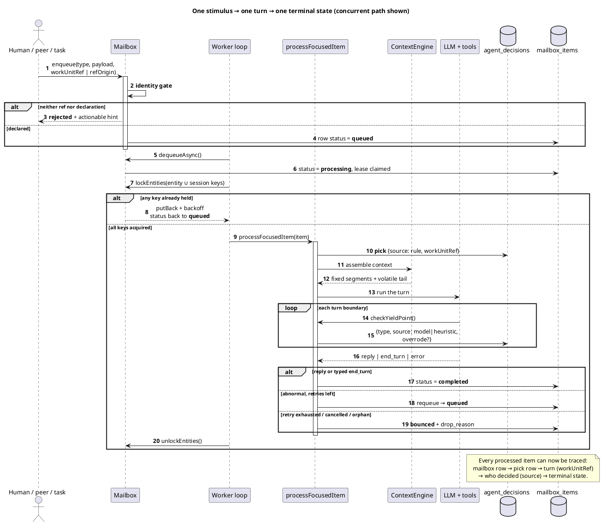
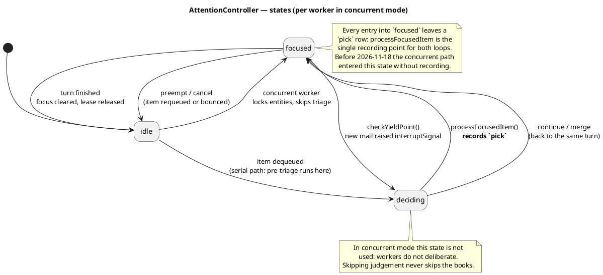
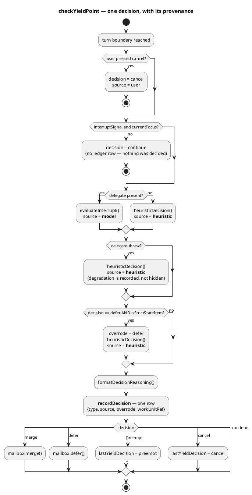

# Cognitive Architecture: Unified Agent Cognition

This document describes the unified cognitive architecture that governs how Markus agents perceive stimuli, prepare context, deliberate, act, and learn. It is a **continuous cognitive cycle** backed by persistent stores (`NOTEBOOK.md`, `knowledge.md`). Context preparation is **deterministic** — the former optional **Cognitive Preparation Pipeline (CPP)** was removed (see §3).

> **Memory SSOT**: Prefer [`memory-system.md`](./memory-system.md) — durable knowledge is `knowledge.md`, working (short-lived) state is `NOTEBOOK.md` (`system` tier). Writing is **single-writer**: `knowledge.md` / `NOTEBOOK.md` are written only through memory tools. `MEMORY.md` / `memories.json` / `state.md` are **legacy read-only sources**, read and migrated on load (see memory-system.md → “Migration-read”). Below, historical “MEMORY.md” references mean the older dual-store model.
>
> **Implementation status**: Core cycle, Notebook, knowledge memory, Attention Controller, Goal/Loop heartbeat integration, A2A DM channels, and `PendingCallbackRegistry` are implemented. **CPP was removed** — `packages/core/src/cognitive.ts` no longer exists and no pre-call LLM runs (§3).

---

## 1. Unified Cognitive Cycle

Every agent interaction follows the same loop. Heartbeat checks keep the cycle running when no external stimulus arrives.

```
                    ┌─────────────────────────────────────┐
                    │         Heartbeat (patrol)          │
                    │  goals · callbacks · failed tasks   │
                    └──────────────┬──────────────────────┘
                                   │
Stimulus ──► Triage / Appraisal ──► Context Assembly ──► Deliberation ──► Action ──► Reflection / Update
(Mailbox)    (AttentionController   (NOTEBOOK.md +         (main LLM +      (tools)    (memory_save,
              deterministic)         knowledge.md)           tools)                     notebook, dream)
```

| Stage | What happens | Primary components |
|-------|--------------|-------------------|
| **Stimulus** | Message, task, heartbeat, A2A, callback result enters the mailbox | `Mailbox`, `AttentionController` |
| **Triage / Appraisal** | Decide what to focus on | `AttentionController` |
| **Context Assembly** | Load procedural identity, curated knowledge, notebook workspace, mailbox state | `ContextEngine`, `NOTEBOOK.md`, `knowledge.md` |
| **Deliberation** | Main LLM reasons with assembled context and available tools | `Agent`, tool loop |
| **Action** | Execute tool calls (tasks, files, A2A, memory writes) | Tool handlers |
| **Reflection / Update** | Persist observations, update notebook, consolidate via dream cycle | `memory_save`, `notebook_upsert`, dream cycle |

The cycle is **continuous**: heartbeat patrols re-enter the loop, checking active goals, timed-out callbacks, and stalled work even when the mailbox is quiet.

**Concurrency note.** This five-stage cycle describes the **serial** (single-worker) attention loop. When an agent runs a concurrent worker pool ([concurrent-processing.md](./concurrent-processing.md)), each worker executes a *reduced* loop — Stimulus → Context Assembly → Deliberation → Action → Reflection — and deliberately **skips Triage / Appraisal and interrupt/preempt logic** ("concurrency without interruption", Scheme A). Triage, deliberation-over-queue, preemption and cancellation remain the serial loop's responsibility. Cross-worker consistency is instead handled structurally: an entity-affinity lock in the mailbox plus a `ConcurrentHandoffLog` whose records are injected into each worker's volatile context.

**What is never skipped: the books.** Recording is not part of deliberation. Both paths converge on `processFocusedItem`, which is the single execution point that writes the `pick` row — so a reduced loop still produces a complete ledger.

### End-to-end turn, with states



---

## 2. Cognitive Science Foundations

The architecture maps directly to established cognitive models:

| Model | Concept | Markus mapping |
|-------|---------|----------------|
| **Baddeley — Working Memory** | Central executive coordinates subsidiary systems; episodic buffer integrates sources | `NOTEBOOK.md` = central executive + visuospatial sketchpad (active workspace); `knowledge.md` = episodic buffer (integrates curated knowledge with experience) |
| **Cowan — Embedded Processes** | Focus of attention (4±1 chunks) within activated long-term memory | `## _observations` buffer = focus of attention (raw, not in prompt); curated `knowledge.md` sections = activated LTM (always injected) |
| **Kahneman — Dual Process** | System 1 (fast, automatic) vs System 2 (slow, deliberate) | System 1 = triage, mechanical retrieval, bounded auto-recall; System 2 = the main LLM's deliberation plus agent-driven `memory_search` / `kb_search` |
| **Boyd — OODA Loop** | Observe → Orient → Decide → Act | **Observe**: mailbox items; **Orient**: deterministic context assembly + notebook updates; **Decide**: main LLM deliberation; **Act**: tool execution |

Additional influences preserved from earlier design:

- **Tulving's memory systems**: Procedural (ROLE.md + skills), Semantic (`knowledge.md`), Episodic (sessions + activity index).
- **Metacognition (Flavell)**: the agent asks "do I know enough?" — now answered by active `memory_search` / `kb_search` rather than a pre-call appraisal LLM.
- **Global Workspace Theory (Baars)**: Notebook is the broadcast workspace — selected context competes for limited prompt capacity.

See [memory-system.md](./memory-system.md) for storage-layer detail.

---

## 3. Deterministic Context Assembly (CPP removed)

> **CPP removed.** The former Cognitive Preparation Pipeline — 0–3 pre-call LLM phases
> (Appraisal / Retrieval / Reflection), `packages/core/src/cognitive.ts`,
> `CognitivePreparation`, `selectCognitiveDepth`, the `CognitiveDepth` levels D0–D3 and the
> `agent.cognitive` config (depth/model/timeout fields **and** the `enabled` flag) — has been
> **removed**, types included; the deterministic situational block is now always assembled. It
> cost extra LLM calls per turn and duplicated the ContextEngine's own retrieval.

Context preparation is now **deterministic (no LLM)**: between triage and the main call the
ContextEngine assembles a small, bounded situational block.

```
Stimulus → Triage → Deterministic Context Assembly → Main LLM
                        │
                        ├─ situational block: recent activity + working-memory keys
                        ├─ bounded relevant-memory retrieval (## Relevant Memories)
                        └─ deterministic ## Cognitive Context block (always assembled)
```

### Output destination: prompt only (the notebook dual-write was removed)

CPP output used to be written to **`NOTEBOOK.md`** entries (via a `notebookWriter` callback). That
**dual-destination was removed**: relevance-matched memories are injected **for the current turn only**
as `## Relevant Memories`, and the deterministic situational block is injected as `## Cognitive Context`.
Neither is persisted as a notebook entry.

Prompt sections produced today: `## Cognitive Context` (deterministic) and `## Relevant Memories`
(`## Retrieved Context` / `## Reflection` are no longer produced).

Triage decisions still write `triage-decision` (managed tag `system`) — that is runtime state, not CPP output.

### Cognitive depth levels (removed)

The D0–D3 depth ladder (`selectCognitiveDepth`) was part of CPP and is **gone**, together with
the `CognitiveDepth` enum and the per-scenario LLM budget — assembly is always the same cheap,
deterministic step.

### Configuration

There is **no settings flag any more**. The deterministic situational block is always assembled —
the former `agent.cognitive` config, REST payload and Settings-UI toggle were all removed along
with the LLM pipeline they once gated. Deep recall stays agent-driven via `memory_search` /
`kb_search`.

---

## 4. Notebook (NOTEBOOK.md)

The Notebook is the agent's **persistent cognitive workspace** — Baddeley's central executive rendered as markdown on disk. It replaces the former volatile in-memory working memory.

| Attribute | Value |
|-----------|-------|
| Storage | `~/.markus/agents/{id}/NOTEBOOK.md` |
| Prompt injection | Always loaded as `## Notebook`, bounded to 16 entries / 6000 chars |
| Format | `## key` headings with `<!-- managed: … -->` and `<!-- updated: … -->` metadata |

### Managed entry types

| Tag | Writer | Purpose | TTL |
|-----|--------|---------|-----|
| `agent` | Agent via `notebook_upsert` / `notebook_clear` | Explicit notes, priorities, blockers | 96h |
| `system` | Runtime (triage, deliberation, mechanical retrieval) | Triage decisions, fallback context | 24h |

**Lifecycle**: Loaded at startup → **normalized** (TTL + caps, persisted) → updated in-process → persisted with a 2s debounce bounded by a 10s maxWait → survives restarts.

**Limits**: 16 entries total (4 of them `agent`-managed), 6000 chars each, 6000 chars for the whole injected block. TTL per tier as above. Eviction is oldest-first; the machine-written `system` tier is evicted **before** the `agent` tier, because situational state is cheaper to lose than the agent's own deliberate notes — and it expires on its own soon anyway.

The Notebook holds *situational* state. Durable knowledge flows to `knowledge.md` via `memory_save` / `memory_update` (`notebook_read` is the read-only view).

> **Why the notebook needs its own lifecycle** (see [memory-system.md](./memory-system.md) §2): the Notebook is a *resident* prompt region, unlike `## _observations` which is retrieved on demand. Resident regions must be bounded (count), decayed (TTL), deduplicated (key discipline), size-capped (per-entry + total), and made **single-writer** — otherwise every feature that writes to them accretes forever. All four were missing or partial here: three of four writers bypassed the entry cap, there was no TTL anywhere, and the load path trimmed nothing, so a real notebook grew to 26 entries / 33 KB including month-old situational state re-injected every turn.

---

## 5. Memory (knowledge.md)

Unified long-term store for curated knowledge plus a raw observation buffer — Cowan's activated LTM plus focus-of-attention staging area.

```
knowledge.md
├── ## conventions          ← agent-organized curated sections (in prompt)
├── ## procedures
├── ...
└── ## _observations        ← raw buffer (NOT in prompt)
```

| Layer | Role | Prompt |
|-------|------|--------|
| Curated sections | Distilled knowledge the agent maintains | Always injected as `## Your Knowledge` (via the volatile tail, not the byte-stable system prefix) |
| `## _observations` | Raw observations from `memory_save` | Excluded from prompt; processed by dream cycle |

The **dream cycle** (`memory_consolidation`) consolidates observations into curated sections (dedupe / merge / promote) by asking the agent's own model, then lands the result through the store's write APIs. This is the long-term learning path at the end of the cognitive cycle. It does **not** do load-time hygiene over `knowledge.md` — the platform never rewrites the agent's curated prose (that was `pruneMemoryMd()`, removed).

**Budget is reported, not rewritten.** The curated budget is a **soft** line: exceeding it is *reported* (log + in-prompt health banner) and the agent consolidates with `memory_organize` / `memory_update`. A **hard ceiling** (3× the soft budget) refuses the write fail-closed. The injected `## Your Knowledge` block carries a **health banner** when curated usage ≥70% (curated %, observation-buffer %, section count, observation count, archived chars, last consolidation time).

**Migration-read.** `MEMORY.md` / `memories.json` / `state.md` are legacy read-only sources, read and migrated on load; only `knowledge.md` is written, and observation metadata is emitted as a single `<!-- type: X, data-meta: {…} -->` line (the old `, tags: a, b` form is read but converged on write). See [memory-system.md](./memory-system.md).

---

## 6. Decision Mechanisms

Three interlocking mechanisms drive agent attention and sustained work:

### Attention Controller

Processes the **Mailbox** — the agent's unified stimulus queue. Responsibilities:

- Priority ordering and preemption
- Rule-based preemption only: `heuristicDecision()` in `attention.ts` is a pure rule table
  (same-session follow-up → merge, human chat preempts background, peer message preempts
  background, priority comparison) — deciding whether to interrupt costs **no** model call
- One `pick` decision per dequeued item; the priority queue alone decides processing order
- Yields to higher-priority items at turn boundaries (`checkYieldPoint()`), applying the same
  rule table

The queue decides **what** to process (priority + enqueue order). How context is prepared for processing is now deterministic (§3), not a second LLM stage.

#### Attention states



#### Who decided — provenance at a yield point

Every ledger row carries `source` (`model` / `heuristic` / `rule` / `user`). A platform
rule that refuses the model's choice records **one** final row with `overrode` set,
not two rows nobody can order.



Reading the ledger afterwards answers three questions without guesswork: **which turn**
(`workUnitRef`), **who decided** (`source`), and **what a rule overturned** (`overrode`).

### Heartbeat

A patrol re-enters the cognitive cycle without external stimulus. Nothing schedules it on a
timer: `AgentClock` owns the only timers (two sources, `mailbox-maintenance` and
`trigger-expiry`), and a patrol runs only when the liveness fallback asks for one
(`agent.triggerHeartbeat()` from the manager / API server). The resting default is
`rest(wakeOn)`, whose wake arrives as a mailbox `system_event`. Each patrol checks:

- Active goals (Goal/Loop — see below)
- Timed-out `PendingCallbackRegistry` entries
- Failed tasks and requirement monitoring
- Background operation completions
- Self-evolution and quality signals

There is no depth ladder anymore — every path, heartbeat included, uses the same deterministic assembly.

#### Spec: active-hours timezone (C1)

`isWithinActiveHours()` is the policy that says whether a patrol may run inside
`config.activeHours`. It and `minutesOfDayInTimeZone()` live in
`packages/core/src/heartbeat.ts` as pure functions; since the periodic scheduler was
deleted, **no runtime caller gates a tick on them** — there is no tick to gate. The C1 fix
they carry is the timezone rule: evaluation uses the **configured** timezone rather than the
host's local clock.

- **Behavior**: `activeHours` is evaluated in the **configured timezone** (falling back to
  host local time only when none is configured or the id is invalid), so an agent set to
  `09:00–18:00` is in-window during those hours in *its* timezone regardless of where the
  process runs.
- **Invariants**: same-instant evaluation yields the correct in/out-of-window result for a
  given configured timezone; the start minute is inclusive and the end minute exclusive; the
  midnight-wrap case (e.g. `22:00–06:00`) still works.
- **Testing**: the two helpers are pure and side-effect-free, so the invariants above are
  directly unit-testable at a fixed instant; the old dedicated heartbeat test file is gone
  along with the scheduler.
- **Status**: implemented (pure `isWithinActiveHours` / `minutesOfDayInTimeZone` via
  `Intl.DateTimeFormat`), currently unreferenced from production code.

> Prompt-cache note: heartbeat situational content (mailbox meta, notebook, timestamps) is
> injected in the volatile `[Live context]` tail, never into the byte-stable system prefix — see
> the injection-point ownership audit in [prompt-engineering.md §2.2](./prompt-engineering.md).

### Goal / Loop Mechanism

Requirements can carry a `GoalConfig` that turns them into **persistent objectives**:

```typescript
interface GoalConfig {
  loopEnabled: boolean;
  completionCriteria: string;
  maxIterations: number;
  currentIteration: number;
  lastCheckedAt: string;
  autoResume: boolean;
}
```

When `goalConfig.loopEnabled` is set, the requirement acts as a standing goal. Heartbeat injects an **Active Goals** section listing each goal's title, iteration count, and completion criteria. The agent assesses progress, creates follow-up tasks, and marks requirements complete when criteria are met.

Goal state is fetched via `goalFetcher` (wired from org-manager requirement service) and managed through requirement/task tools.

---

## 7. A2A Communication

Agent-to-agent messaging is unified under **DM Channels** — deterministic keys derived from sorted agent IDs:

```
dm:a2a:{sorted_id_1}:{sorted_id_2}
```

This leverages existing group-chat infrastructure:

- **Persistent history** — both agents can recall past exchanges via `recall_context`
- **Stable sessions** — messages route through the channel rather than ephemeral session IDs
- **Mailbox integration** — `sendGroupMessage` persists, notifies WebSocket clients, and enqueues on the target agent's mailbox

`agent_send_message` is always asynchronous (fire-and-forget). Substantial work should use requirements + tasks, not A2A messages.

### PendingCallbackRegistry

Async operations (e.g., `background_exec`) register callbacks tracked by `PendingCallbackRegistry`. When complete, results enter the originating agent's mailbox as `callback_result` items — ensuring they flow through the attention loop rather than being injected directly into sessions. Timed-out callbacks surface in heartbeat for investigation.

The result **belongs to the turn that launched it**. When the completion's `callback_result` row is queued under the launching turn's WorkUnit and that turn is still running, `injectTurnDelta` delivers the FULL result content into the turn before its next LLM call and consumes the row (a tail append — C8-B's ≤600-char label teaser cannot carry kilobytes of stdout), so no separate completion turn fires. If the turn has ended, the row drives a lineage continuation instead. `process poll/log` on a finished session also marks the result consumed, suppressing the redundant turn. Lineage (`originSessionId` + `originScenario` + `workUnitRef`) is persisted in the registry row — the ONE durable store — so a restart cannot orphan a completion from its launching scenario/entity, and same-origin queued completions coalesce into a single turn.

Implementation: `packages/core/src/pending-callback.ts`, persisted via `SqlitePendingCallbackRepo`.

---

## 8. Integration Map

```
┌───────────────────────────────────────────────────────────┐
│                      Agent Runtime                         │
│  ┌───────────┐   ┌──────────────┐                          │
│  │  Mailbox  │──►│  Attention   │───► ContextEngine        │
│  └───────────┘   │  Controller  │     (deterministic       │
│                  └──────────────┘      assembly, no LLM)   │
│                                            │               │
│  ┌──────────────────────────────────────────▼────────────┐ │
│  │  ContextEngine reads: ROLE.md · knowledge.md ·         │ │
│  │  NOTEBOOK.md · mailbox · goals · activity              │ │
│  └───────────────────────────┬───────────────────────────┘ │
│                              ▼                             │
│                       Main LLM + Tools                     │
└───────────────────────────────────────────────────────────┘
```

| Component | Location | Role in cycle |
|-----------|----------|---------------|
| `AttentionController` | `packages/core/src/attention.ts` | Triage, deliberation, focus management |
| `ContextEngine` | `packages/core/src/context-engine.ts` | Deterministic context assembly, relevant-memory injection |
| `Agent` | `packages/core/src/agent.ts` | Cycle orchestration, heartbeat, notebook persistence |
| `MemoryStore` | `packages/core/src/memory/store.ts` | knowledge.md + NOTEBOOK.md I/O, migration-read |
| `PendingCallbackRegistry` | `packages/core/src/pending-callback.ts` | Async callback tracking |
| `AgentManager` | `packages/core/src/agent-manager.ts` | A2A DM routing |

Types: `requirement.ts` (`GoalConfig`). (The former `packages/shared/src/types/cognitive.ts` was deleted with CPP.)

---

## 9. Relationship to Other Documents

| Document | Relationship |
|----------|-------------|
| [memory-system.md](./memory-system.md) | Storage model detail, dream cycle, tool reference, migration-read |
| [mailbox-system.md](./mailbox-system.md) | Mailbox types, priority, triage protocol |
| [prompt-engineering.md](./prompt-engineering.md) | Prompt section taxonomy |
| [architecture.md](./architecture.md) | System-wide component overview |

---

## 10. Implementation Status

### Completed

- Unified cognitive cycle with persistent Notebook and `knowledge.md`
- **Deterministic context assembly** (no pre-call LLM) — CPP removed
- Attention Controller triage + deliberation with notebook persistence
- Goal/Loop heartbeat integration with `GoalConfig` on requirements
- A2A DM channels (`dm:a2a:{sorted_ids}`) with group-chat persistence
- `PendingCallbackRegistry` with SQLite persistence
- Lossless memory budget (archive, not truncate) + health banner + migration-read

### Retired

- **CPP (Cognitive Preparation Pipeline)** — the Appraisal / Retrieval / Reflection LLM phases, `cognitive.ts`, `CognitivePreparation`, `selectCognitiveDepth`, depth levels D0–D3, and the `notebookWriter` dual-destination. Replaced by §3.
- `state.md` store (Working-layer state now lives in `NOTEBOOK.md`; legacy content migrated on load).
- Notebook `cpp` managed tier and `NOTEBOOK_TTL_MS_CPP`.

### Future Work

- Prompt-matrix guidance for agent-driven `memory_search` / `kb_search` (replacing the old depth heuristics).
- Simplify the compression pipeline (thinner sessions reduce pressure).

