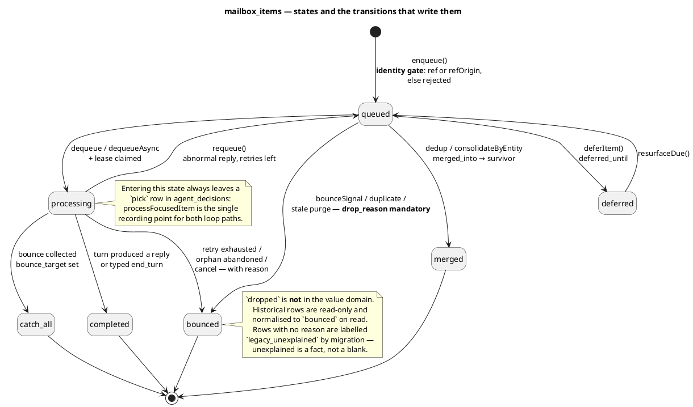

# Mailbox & Attention System

> Last updated: 2026-11-15 — the A2A chapter (§11) and the user-notification chapters
> (§12/§13) were extracted to [a2a-communication.md](./a2a-communication.md) and
> [notification-delivery.md](./notification-delivery.md). Only pointers remain here.

---

## 本文件范围 — Scope of this file

**This document owns the mailbox queue and the attention controller, and nothing else.** It is
the single source of truth for *how a signal enters, waits, is merged, is claimed, is retried
and is finally delivered to an agent*: the item-type registry (§3), the attention controller
(§4), the enqueue API (§5), persistence (§6), state-machine integration (§7), enqueue-time
deduplication (§14), restart/retry (§17/§18), the attention decision rules (§21), and the
address/envelope/bounce layer (§28). Priorities and the delivery invariants stated here are
binding for every producer.

- **Agent-to-agent (A2A)** — DM/group channels, the one-message-one-delivery-fact invariant,
  the reply sink, tools & transport, `PendingCallbackRegistry`, heartbeat integration: see
  [a2a-communication.md](./a2a-communication.md) (was §11; §11 below is a pointer).
- **User notification / IM delivery** — in-app notification store, `notify_user` vs
  `request_user_input`, destination resolution and approval cards: see
  [notification-delivery.md](./notification-delivery.md) (was §12/§13; §12/§13 below are pointers).
- The mailbox is the **transport** for both: it guarantees enqueue, priority and serialised
  attention; it does not define *what* a notification means or *who* should receive it.

---

## 1. Design Philosophy

Markus agents are modelled as **entities that focus on one thing at a time**. Like a human employee, an agent must not hold two conflicting beliefs about the same piece of work. When multiple stimuli arrive concurrently — chat messages, task assignments, status updates, review requests — the agent must make deliberate decisions about what to attend to and in what order.

This is implemented through two core abstractions:

- **Agent Mailbox** — A priority queue that serialises all incoming stimuli.
- **Attention Controller** — An event-driven focus manager that processes mailbox items one at a time, with interrupt handling at safe yield points.

**Concurrent processing (default on, opt-out).** The attention loop can instead run as a pool of N isolated **worker loops** so the agent handles several *independent* entities at once — see [concurrent-processing.md](./concurrent-processing.md). Serialisation is preserved **per entity**: an entity-affinity lock in the mailbox guarantees a given task / requirement / conversation / user is never processed by two workers simultaneously, and each worker holds its own `SessionWorkspace`, so the "one thing at a time" guarantee still holds for any single line of work. Setting `agent.concurrent.enabled = false` (or `maxWorkers = 1`) restores a strictly single-worker loop with identical behaviour to the original design.

### Why was processing originally serialised?

Early Markus let an agent handle multiple messages simultaneously, which caused:
- **Memory contamination** — Concurrent conversations polluted each other's session context.
- **Cognitive interference** — An agent composing a code review could be mid-thought when a chat message hijacked its attention.
- **Non-deterministic behaviour** — Race conditions in shared state made debugging nearly impossible.

The mailbox model fixed this by treating the agent's attention as a scarce, serial resource. Concurrent processing re-introduces parallelism **only *between* entities**, and addresses each of these three failures directly:

- **Memory contamination** → per-worker [`SessionWorkspace`](../../packages/core/src/session-workspace.ts) isolation via `AsyncLocalStorage`.
- **Cognitive interference** → concurrent worker loops are pure consumers; decide / preempt logic runs only in the serial loop.
- **Non-deterministic races** → entity-affinity lock in the mailbox + an agent-level tool write-lock.

See [concurrent-processing.md](./concurrent-processing.md) for the full guarantees, configuration, and known limitations.

---

## 2. Architecture

```
External Events                    Agent Internals
─────────────                      ───────────────
  human_chat ──┐
  a2a_message ──┤                  ┌──────────────┐
  task_status ──┤  enqueue()       │  AgentMailbox │ priority queue + dedup
  task_comment ──┼────────────────►│  (per agent)  │ sorted by priority + FIFO
  req_comment ──┤                  └──────┬───────┘
  review_req ──┤                         │ dequeueAsync()
  system_event──┤                         ▼
  heartbeat ────┤               ┌──────────────────┐
  session_reply──┤               │ AttentionController│ event-driven loop
  daily_report ──┤               │  state: idle →    │
  callback_result┤               │  focused → idle   │
  memory_consol──┘               └──────┬───────────┘
                                        │ delegate.processMailboxItem()
                                        ▼
                                 ┌──────────────┐
                                 │  Agent Core   │ handleMessage / executeTask
                                 │  (internal)   │ handleHeartbeat / respondInSession
                                 └──────────────┘

PendingCallbackRegistry ──enqueue('callback_result')──► AgentMailbox  (async op completions)
```

> **Concurrent mode:** `AttentionController` may run `N` worker loops instead of one
> (`launchWorkerPool()`), each dequeuing its own item and mounting an isolated
> `SessionWorkspace`. The mailbox skips any item whose *entity key* is already locked by
> another worker, so a single entity is still processed one item at a time. The diagram
> above shows the single-worker (serial) shape; the concurrent shape is
> `AttentionController → N × (dequeueAsync → lockEntities → processFocusedItem → unlockEntities)`.
> See [concurrent-processing.md](./concurrent-processing.md).

<!-- verified-against-code: 2026-10-25, packages/core/src/attention.ts (backstop / yield-point section; symbols: processFocusedItem, checkYieldPoint) -->

---

## 3. Mailbox Item Types — Centralised Type Registry

### 3.1 Single Source of Truth

All mailbox item types, their metadata, and their processing behaviour **should** be defined in one place: `MAILBOX_TYPE_REGISTRY` in `@markus/shared`. Core routing, attention heuristics and default priorities do read from it. Two things do not, and are tracked rather than assumed:

- the **frontend** keeps its own icon map and type switch (§9), and
- `activityType` and `createsActivity` were **deleted** from the descriptor on
  2026-10-25. The activity type is a property of the turn (scenario), not of the
  mailbox type — one mapping now lives in `SCENARIO_ACTIVITY_TYPE` (§6.3). A
  per-type `createsActivity` boolean could not express the real rule (a comment
  creates an activity only when it falls through to handleMessage), and nothing
  read it.

> **Target — not yet enforced: no string literals for type values outside the registry and the shared type union.** At present some consumers still hardcode type values as literals, e.g. the attention heuristics in `packages/core/src/attention.ts` (`heuristicDecision` and its R0/R1/R1.5 rules) and the `USER_INTERACTION_TYPES` / `PEER_INTERACTION_TYPES` static sets on `AttentionController`. The goal is to converge these onto registry-driven predicates; until then this constraint is aspirational, **not** a completed invariant.

> Line numbers were removed from these annotations on 2026-10-25: they had all
drifted (e.g. the sets were cited as lines 1493-1500 but live at 1595-1597), and a
stale line number is worse than none because it looks authoritative.

### 3.2 Identity on every enqueue

Every `AgentMailbox.enqueue` must declare **where the item came from**. Otherwise the
identity column is silently NULL and the item cannot be attributed to a turn — which is
what produced the 2026-11-15 incident where terminal gates required a fact that the
executing turn could not attribute.

| Field | Meaning |
|---|---|
| `workUnitRef` | The turn that produced the item: `session:<id>:r<N>` for a chat turn, `task_<taskId>_r<N>` for a task execution, `a2a:<entity>` for agent-to-agent. This is the intended normal case — measured coverage was 0.18% before the enqueue gate became mandatory (2026-11-18); see §6.7. |
| `refOrigin` | The caller's declaration of where identity comes from: `"entity"` / `"turn"` (a ref is present), `"pending-link"` (enqueued while wiring a link that will be attached on dispatch), or `"platform-internal"` (the platform itself, not an agent turn). **Required whenever `workUnitRef` is absent** — see §6.7 for why an undeclared NULL is rejected rather than logged. |

Enforcement is in `AgentMailbox.enqueue` (`packages/core/src/mailbox.ts`): an item carrying
neither field logs an ERROR and is **rejected**, rather than being stored with a NULL
identity. Adding a new caller means declaring one of the two — not adding a carve-out.

<!-- verified-against-code: 2026-10-25, packages/core/src/attention.ts (USER_INTERACTION_TYPES, PEER_INTERACTION_TYPES, heuristicDecision) -->

**Definition of record**: `packages/shared/src/types/mailbox.ts` — `MAILBOX_TYPE_REGISTRY`,
typed `Record<MailboxItemType, MailboxTypeDescriptor>`, so a missing or misspelt
type fails `tsc`. Shape invariants (per-type priority, category membership, and the
`entityScopes` suffix rule) are asserted in `packages/shared/test/shared-types.test.ts`.

> This document deliberately does **not** paste the literal. A pasted copy drifts
> silently — the copy that used to live here had already lost the `entityScopes`
> field added for concurrent entity locking, so a reader would conclude the
> descriptor has 7 fields when it has 8.

The part worth stating in prose is the data contract:

| Priority | Meaning | Types |
|---|---|---|
| 0 | critical | `human_chat` |
| 1 | high | `system_event`, `mention`, `session_reply`, `task_status_update`, `review_request`, `requirement_update`, `callback_result` |
| 2 | normal | `task_comment`, `requirement_comment`, `a2a_message`, `daily_report`, `workflow_update` |
| 3 | low | `heartbeat` |
| 4 | background | `memory_consolidation` |

Only two types have `createsActivity: false` — `task_comment` and
`requirement_comment`; every other type creates an activity row. `activityType` is
`null` for exactly `task_comment`, `requirement_comment` and `task_status_update`
(derived at runtime instead, see §6.3).

<!-- verified-against-code: 2026-10-25, packages/shared/src/types/mailbox.ts (MAILBOX_TYPE_REGISTRY), packages/shared/test/shared-types.test.ts (entityScopes invariants) -->

### 3.2 Type Descriptor Schema

```typescript
export interface MailboxTypeDescriptor {
  label: string;                    // Human-readable display name
  defaultPriority: MailboxPriority; // 0=critical, 1=high, 2=normal, 3=low, 4=background
  category: MailboxCategory;        // Filter group for UI
  icon: string;                     // Emoji/icon for UI display
  invokesLLM: boolean;              // Whether processing invokes an LLM call
  entityScopes: readonly MailboxEntityScope[]; // Concurrent entity-lock dimensions; MUST end with 'system'
}
// `activityType` and `createsActivity` were removed here — see §3.1 for why.

export type MailboxCategory = 'interaction' | 'task' | 'notification' | 'system';
```

### 3.3 Filter Categories

The frontend uses `category` for filtering. Users can also filter by individual `sourceType`.

| Category | Types | Description |
|----------|-------|-------------|
| `interaction` | `human_chat`, `a2a_message`, `mention` | Direct conversations with humans or agents |
| `task` | `task_status_update`, `task_comment`, `requirement_comment`, `review_request`, `session_reply`, `workflow_update` | Task & requirement lifecycle events (including execution triggers) |
| `notification` | `requirement_update` | Status change notifications |
| `system` | `system_event`, `heartbeat`, `daily_report`, `memory_consolidation`, `callback_result` | Internal agent processes |

<!-- verified-against-code: 2026-10-25, packages/shared/src/types/mailbox.ts (MAILBOX_CATEGORIES) -->

### 3.4 Special Processing Rules

**`task_status_update` — Execution vs. Informational**

`task_status_update` serves as the **unified trigger for all task lifecycle events**. It operates in two modes:

1. **Execution mode** (`extra.triggerExecution = true`): When a task transitions to `in_progress` and needs execution, `TaskService.runTask()` sends a `task_status_update` with execution context (onLog, cancelToken, workspace, executionRound) via `agent.sendTaskExecution()`. The agent processes this by calling `executeTask()` — the full task execution loop. Priority is set to 1 (high).

2. **Informational mode** (default, `invokesLLM: false`): For non-execution status changes (e.g., cancelled, blocked, completed), the item is **auto-completed without LLM invocation**. The agent logs the status change for awareness but does not spend tokens processing it. These transitions are handled by the system (FSM side-effects) and need no agent action.

When `updateTaskStatus()` triggers auto-start execution, the separate notification is **skipped** to avoid redundant processing. The execution-mode `task_status_update` serves as both trigger and notification.

Similarly, when a task transitions from `in_progress` to `review` (via `task_submit_review`), the assignee notification is skipped — the assignee itself initiated the submission and already knows the state change. Only the reviewer receives a `review_request` notification.

**Silent Transitions**: Certain system-managed transitions never produce a `task_status_update` notification because the real mechanism (cancel token or auto-start) already handles the work:

| Transition | Reason suppressed |
|-----------|-------------------|
| `blocked -> in_progress` | Auto-start fires a separate execution-mode item |
| `in_progress -> blocked` | Cancel token stops execution; notification is redundant |

These are defined in `TaskService.SILENT_TRANSITIONS` and checked early in `maybeNotifyAssignee()`.

**`requirement_update` — Conditional LLM Processing**

`requirement_update` is `invokesLLM: false` by default. Most requirement status transitions are informational — the agent is auto-notified without an LLM call.

There are three exceptions where `extra.actionRequired = true` triggers an LLM call with `scenario: 'requirement_action'`:

1. **Approval** (`priority: 1`): When a requirement is approved, the creator agent is prompted to create tasks to fulfill it. This is high priority because the user expects immediate follow-up.
2. **Rejection** (`priority: 1`): When a requirement is rejected, the agent decides whether to resubmit with updates via `requirement_resubmit` or abandon the requirement.
3. **All tasks done — review needed** (`priority: 2`): When all linked tasks reach terminal state, instead of auto-completing the requirement, the system notifies the creator agent. The agent reviews results and decides whether to mark the requirement as `completed` or create additional tasks.

**`requirement_comment` — Direct Discussion on Requirements**

`requirement_comment` is dedicated to threaded comments on requirements (analogous to `task_comment` for tasks). Unlike `requirement_update` (which covers status/decision notifications), `requirement_comment` represents interactive dialogue — questions, feedback, coordination.

Processing follows the same pattern as `task_comment`: `createsActivity: false`, `invokesLLM: false`. If the requirement has an active agent context, the comment is injected; otherwise it falls back to `handleMessage` with `scenario: 'comment_response'`, following the context-first protocol (§3.5).

**`task_comment` — Live Session Injection**

`task_comment` has a unique behaviour: when the referenced task is **actively being executed**, the comment is **injected into the running LLM session** (`injectUserMessage`) rather than creating a new activity. This means:
- `createsActivity: false` — it does not always create an activity (but the merge decision IS recorded)
- `invokesLLM: false` — it does not invoke a new LLM call; the injected text becomes part of the current task's next LLM turn
- If the task is NOT active, it falls back to `handleMessage` and DOES create an activity

### 3.5 Context-First Protocol for Comments

When processing `task_comment` (on inactive tasks) or `requirement_comment`, the agent uses `scenario: 'comment_response'`. This instructs the LLM to follow a mandatory context-gathering protocol **before** replying:

1. **Fetch the full item** — call `task_get` or `requirement_list` to get the complete current state
2. **Read ALL previous comments** — understand the full conversation thread
3. **Identify the commenter's intent** — question, request, feedback, objection, etc.
4. **Check related context** — look up referenced tasks, requirements, or files

Only after completing these steps does the agent formulate its reply. This prevents superficial responses that ignore important context already discussed in the comment thread.

The notification text sent to agents also includes explicit MANDATORY instructions reinforcing this protocol.

**Structural reply-to**: Both `task_comment` and `requirement_comment` tools support a `reply_to_comment_id` parameter that creates a structural link to the parent comment. The `task_comments` and `requirement_comments` tables have a `reply_to_id` column; when queried, a LEFT JOIN returns the parent comment's author and content snippet (`replyToAuthor`, `replyToContent`). The notification payload also injects an agent streak count (consecutive agent-only comments) to help agents decide whether further replies are warranted.

**Batch awareness**: The `comment_response` scenario prompt instructs agents to handle multiple bundled comments (separated by `---`) as a single consolidated reply, using `reply_to_comment_id` for the most important one and quoting others inline.

Priorities can be overridden per-item when enqueuing.

### 3.6 Review Comment Cascade Suppression

Comment notification routing is decided by one function — `resolveCommentAttention()`
in `packages/org-manager/src/task-attention.ts` — not by ad-hoc checks in the
comment handler. During an active review (`task.status === 'review'` and
`authorId === task.reviewerId`) the decision narrows to a single wakeup:

| Recipient | Notified? | Reason |
|---|---|---|
| assignee (the worker under review) | **yes** | `review_verdict` |
| creator / other watchers | no | — |
| anyone explicitly `@mentioned` | yes | `mention` (always delivered) |

Note the asymmetry, because the earlier version of this section had it backwards:
it claimed the worker *and* creator were both suppressed and that only @mentions got
through. The worker is deliberately woken — it is the agent that has to act on the
verdict. What gets suppressed is the **creator** and the wider watcher set.

**Rationale**: Without this guard, the reviewer's intermediate comments trigger a notification cascade:
1. Reviewer posts comment → creator/watchers receive `task_comment`
2. They process the notification with full LLM → may send A2A message back to reviewer
3. Reviewer processes A2A message → posts redundant second review

The review outcome is properly communicated through the status transition (`completed` or `in_progress` revision), not intermediate comments.

**`callback_result` — Async Operation Completions**

`callback_result` delivers the outcome of asynchronous operations back to the originating agent through the mailbox (priority **1 — high**). It replaces the legacy pattern of injecting results directly into an active LLM session via `injectUserMessage`, ensuring completions enter the attention loop like any other stimulus.

Typical sources:

1. **`background_exec` completion** — When a background shell process finishes, the agent receives a `callback_result` with exit code, duration, and stdout/stderr tail.
2. **In-session A2A reply** — When an agent sends `agent_send_message` with `reply_in_session: true` (deprecated alias: `await_in_session`), an `a2a_reply` callback is registered (correlated by `conversation_id`). The peer's reply is routed back into the **origin session** instead of a separate a2a session.

**Two delivery forms.** A resolved callback is delivered one of two ways, selected by `deliveryMode`:

- **`in_session`** → enqueues a `callback_result` bound to `originSessionId`, resuming the current conversation (used for `background_exec` completions and `reply_in_session` A2A replies).
- **`mailbox`** → enqueues a `system_event`, a fresh attention cycle (used for `schedule_wakeup` firings and autonomous follow-ups).

Payload shape (`payload.extra`):

```typescript
{
  callbackId: string;           // Registry ID (matches pending callback)
  originSessionId: string;      // Session to resume context in (in_session mode)
  callbackType: 'background_exec' | 'wakeup' | 'a2a_reply';
  correlationId?: string;       // conversation_id for a2a_reply
  exitCode?: number;            // For background_exec
}
```

Processing: `in_session` callbacks route to `handleMessage()` with the **originating session** (`originSessionId`) so the agent continues where it left off. Falls back to a fresh system session if origin is unknown. `invokesLLM: true`, `createsActivity: true`.

Registration flow: when an agent starts an async operation the completion is registered as a `PendingCallback` in `PendingCallbackRegistry` and persisted to SQLite:

- `background_exec` — the `background_exec` tool path calls `registerBackgroundSession()` (from `Agent.executeTool`, keyed by the returned bg session id, `originSessionId = active session`).
- `agent_send_message` with `reply_in_session` (alias `await_in_session`) — registers an `a2a_reply` callback keyed by `conversation_id`.
- `schedule_wakeup` — registers a `wakeup` callback with a `wakeAt` timestamp (and optional `recurringMs`).

On completion/firing the registry entry is resolved and delivered via the shared `Agent.deliverCallback()` helper according to its `deliveryMode`.

See [a2a-communication.md](./a2a-communication.md) §11.3 for the full `PendingCallbackRegistry` specification.

---

## 4. Attention Controller

### States

```
idle ──► focused ──► idle
           │  ▲
           ▼  │
        deciding
```

- **idle** — Waiting for mail. Blocks on `mailbox.dequeueAsync()`.
- **focused** — Processing a single mailbox item. All new mail triggers an interrupt signal.
- **deciding** — Evaluating whether to continue, preempt, cancel, merge, or defer (at a yield point).

### Event-Driven Interrupts

There is **no polling**. When a new item arrives while the agent is focused:

1. The mailbox emits `mailbox:new-item` via the EventBus.
2. The `AttentionController` sets an **interrupt signal**.
3. At the next **safe yield point** (between LLM turns in the tool loop), the agent calls `checkYieldPoint()`.
4. The controller evaluates the pending item with `heuristicDecision()` — a **pure rule table** (priority + type + session identity), no LLM call at any point. There is no "ask a model when the table says `continue`" fallback: the table's `continue` is final.

### Decision Types

| Decision | Effect |
|----------|--------|
| `pick` | Item dequeued from idle state (initial selection) |
| `continue` | New item not urgent enough — keep working on current focus |
| `preempt` | **Pause** current work — session is **deferred for later resumption**. The agent switches to the new item. When the agent becomes idle, `resurfaceDue()` automatically re-queues the deferred item for continued processing. |
| `cancel` | **Permanently stop** current work — the item is **dropped and will NOT be resumed**. Used when the new message explicitly revokes or contradicts the current work (e.g., "cancel that task", "don't publish this"). |
| `merge` | Absorb new item into current work (e.g., comment on current task) |
| `defer` | Explicitly postpone the new item |
| `delegate` | Hand off to another agent (future) |
| `drop` | Discard the item |

### Preempt vs Cancel Semantics

These two decisions handle fundamentally different situations:

- **Preempt (pause)**: "暂停" — The current work is saved. The mailbox item is moved to `deferred` status and will automatically resurface when the agent is idle. Session context (conversation history) is preserved by `sessionId`, so processing continues from where it left off.
- **Cancel (stop)**: "取消" — The current work is permanently abandoned. The mailbox item is marked as `completed` and will NOT be resumed. Used when the incoming message explicitly revokes or invalidates the current work.

The heuristic interrupt rules (`heuristicDecision`) never produce `cancel`, and nothing else in the decision path does either — there is no model in the loop to infer "the user meant stop". Cancellation is an **explicit act** (the user aborts, or the item is cancelled through its own terminal path); an ambiguous instruction like "wait before deploying" lands as `continue` or `preempt`, never as a silent irreversible cancel.

### Priority Invariant: User Interactions First

Only user chat (`human_chat`) is assigned **priority 0 (critical)** — the highest possible level. `task_comment` and `requirement_comment` are **priority 2 (normal)**, not critical. The heuristic rules enforce:

1. **R0**: If a new `human_chat` arrives from the **same user** while the agent is already processing that user's previous message, the new message is **merged** (injected into the active session as a follow-up). This avoids unnecessary preemption and allows natural multi-message conversations.
2. **R1**: If a new `human_chat` arrives while the agent is focused on any non-user work, the agent **always preempts** to handle it immediately. Only `human_chat` is in `USER_INTERACTION_TYPES`, so comments do **not** preempt this way — a `task_comment` / `requirement_comment` on the focused task/requirement is **merged** into context instead (R2 / R3).
3. When idle with multiple items queued, the priority queue ensures user interactions are dequeued first.
4. The agent's system prompt includes a **summary** of the mailbox queue — the pending count plus the top items, each truncated to `SYSTEM_MAILBOX_ITEM_PREVIEW_CHARS` (`ContextEngine.buildMailboxSection`). It is deliberately a truncated view. An earlier revision claimed the opposite ("the full mailbox queue, not a truncated view"); the code has always sliced.
5. **Preemption is resumable**: if a `human_chat` arrives while the agent is working, R1 returns `preempt` — the running item is parked with `deferDequeued()` and the user message is processed first; the parked item keeps its session and resumes on the next idle cycle (§22). Nothing is discarded.

<!-- verified-against-code: 2026-10-25, packages/shared/src/types/mailbox.ts (category tables), packages/core/src/attention.ts (USER_INTERACTION_TYPES, heuristicDecision, checkYieldPoint) -->

### Safe Yield Points

Yield points are inserted at natural pauses in the agent's processing pipeline:

- **Task execution** (`_executeTaskInternal`): After all tool calls complete and before the next LLM turn. Both `preempt` and `cancel` decisions are honoured:
  - **Preempt** → task session state is saved, mailbox item deferred. When the agent is idle, the deferred item resurfaces and execution resumes with full session context.
  - **Cancel** → mailbox item is dropped permanently. The task may need separate status updates (e.g., `cancelTask`) depending on the cancelling message's intent.
- **Chat/message handling** (`handleMessage`): After tool results are recorded. Interrupt behaviour depends on the **scenario**:
  - **Non-preemptable** (`chat` only): Only merge decisions are honoured (no preemption/cancellation), since a human user is awaiting a direct response. If a preempt/cancel decision is returned, the interrupt signal is **restored** (not consumed) so the high-priority item is processed immediately after the chat completes.
  - **Preemptable** (all other scenarios: `a2a`, `comment_response`, `requirement_action`, `review`, `heartbeat`, `memory_consolidation`): Full preemption/cancellation is allowed. These either have no real-time human caller waiting, or the caller (another agent, a system process) can tolerate the interruption.
- **Streaming chat** (`handleMessageStream`): After tool results are recorded. Only merge is honoured (same as non-preemptable `handleMessage`), since a human is receiving a streamed response. Preempt/cancel decisions restore the interrupt signal for immediate processing after the stream completes.

### Agent Stop/Pause Behaviour

When an agent is stopped (`Agent.stop()`) or paused (`Agent.pause()`):
1. **Active LLM stream is cancelled** via `cancelActiveStream()` — any in-flight LLM response is aborted immediately.
2. **Attention loop stops** — `AttentionController.stop()` sets `running = false` and wakes any blocked `dequeueAsync()`.
3. **In-flight item is NOT requeued at stop time.** `Agent.stop()` cancels the stream and halts the loop; the row stays `status='processing'` in SQLite. It is settled on the next startup by stale recovery (§17) — which requeues strict-state types and **drops** the rest. So "not lost" holds only for strict-state items; for a background item, stopping mid-processing loses it.
4. **Deferred items survive** — items deferred by preemption remain in the database and will be resurfaced when the agent restarts.

### Spec: processing backstop — cancel-on-timeout + single-flight (P0)

The attention loop wraps `processMailboxItem` in a generous backstop
(`MAILBOX_PROCESSING_TIMEOUT_MS`, or `APPROVAL_WAIT_TIMEOUT_MS` while awaiting approval)
via `Promise.race` in `processFocusedItem`. On timeout the item is **requeued**. Today the
original processing promise is **not cancelled** — it may still be running, so a requeue can
re-run tools and double side effects.

- **Behavior**: when the backstop fires, the in-flight processing is **cancelled**
  (`AbortController`/cancelToken shared with the LLM/tool path), and a **single-flight
  generation guard** ensures that if the original processing resolves *after* the timeout, its
  result is **discarded** (not persisted, not streamed, not re-completing the item).
- **Invariants**:
  - After a timeout-requeue, the tool side effects and persistence of the *timed-out*
    attempt happen **at most once** (the orphaned late result is dropped).
  - Requeue still occurs so the item is not lost.
  - Normal (non-timeout) completion is unaffected.
- **Design rationale (Hermes)**: an interrupted/aborted API call must not inject a
  half-finished result; discard in-flight work rather than racing two writers.
- **Testing** (`packages/core/test/attention.test.ts` — **A1a** "on backstop timeout, waits for the orphan to settle, then requeues (single-flight)" and **A1b** "on backstop timeout, does NOT requeue when the orphan never settles (no duplicate side effects)"; there is no single test named "A1"): a slow turn hits the backstop → `cancelProcessing` is invoked and
  the item is requeued; the original turn resolving late is dropped (no extra
  requeue/complete). The backstop is injectable via `setProcessingTimeoutMs` for
  deterministic testing.
- **Status**: implemented (`AttentionController.processFocusedItem` cancel-on-timeout +
  `AttentionDelegate.cancelProcessing`, wired in `Agent.createAttentionDelegate`).

### Spec: interruptible streaming chat (P1)

The **Streaming chat** yield point (above) is non-preemptable by design (a human awaits the
reply). B3 keeps that principle but distinguishes revocation from preemption: an explicit
**cancel** decision aborts the in-flight stream and drops the item (`[cancelled]`), while a
**preempt** restores the signal so the higher-priority item runs right after the turn (no
mid-answer truncation). Backstop-timeout abort is shared with A1's `cancelProcessing`.

- **Status**: implemented. Full behavior/invariants/tests live in
  [streaming-and-reattach.md §4.2](./streaming-and-reattach.md).

---

## 5. External API

### Entry Points

All external code MUST interact with agents through the mailbox API. Direct calls to internal methods like `handleMessage()`, `executeTask()`, or `respondInSession()` are forbidden — those are private implementation details of the attention loop.

#### `agent.enqueueToMailbox(sourceType, payload, options?)` — Fire-and-forget
Used for notifications that don't need a response:
```typescript
agent.enqueueToMailbox('task_comment', {
  summary: 'Comment on task X',
  content: notificationText,
  taskId: 'task_123',
}, {
  metadata: { senderName: 'Alice', senderRole: 'user' },
});
```

#### `agent.sendMessage(text, senderId?, senderInfo?, options?)` — Awaitable chat
Used when the caller needs a text response:
```typescript
const reply = await agent.sendMessage(
  userText, senderId, senderInfo,
  { sourceType: 'human_chat', images, toolEventCollector }
);
```

#### `agent.sendMessageStream(text, onEvent, senderId?, ...)` — Streaming chat
Used for SSE/streaming chat where events are streamed back via callback:
```typescript
const reply = await agent.sendMessageStream(
  userText, onEvent, senderId, senderInfo, cancelToken, images
);
```

#### `agent.sendTaskExecution(taskId, description, onLog, ...)` — Task execution
Used to run a task through the mailbox. Internally enqueues a `task_status_update` with `extra.triggerExecution = true`. Fire-and-forget with streaming log callback:
```typescript
void agent.sendTaskExecution(
  taskId, taskDescription, onLog, cancelToken, taskProjectContext, executionRound
);
```

#### `agent.sendSessionReply(sessionId, text, onLog, ...)` — Session reply
Used for post-task comment replies within an existing session:
```typescript
const reply = await agent.sendSessionReply(
  taskSessionId, prompt, onLog, senderId, senderInfo
);
```

Internally, all awaitable methods create a promise, store its resolve/reject in the mailbox item's metadata, enqueue, and return the promise. The attention controller processes the item, and `processMailboxItemInternal` resolves the promise with the reply.

### Invariant: Every LLM Call Goes Through the Mailbox

This is a critical design invariant. The following internal methods invoke the LLM but must NEVER be called from outside `agent.ts`:

| Internal method | Routed through | Mailbox type |
|----------------|----------------|--------------|
| `handleMessage()` | `sendMessage()` | `human_chat`, `a2a_message`, `system_event`, etc. |
| `handleMessageStream()` | `sendMessageStream()` | `human_chat` (with `extra.stream`) |
| `executeTask()` | `sendTaskExecution()` | `task_status_update` (with `extra.triggerExecution`) |
| `respondInSession()` | `sendSessionReply()` | `session_reply` |
| `handleHeartbeat()` | heartbeat:trigger → `mailbox.enqueue('heartbeat')` | `heartbeat` |
| `generateDailyReport()` | internally calls `sendMessage()` | `daily_report` |
| `dreamConsolidateMemory()` | internally calls `sendMessage()` | `memory_consolidation` |
| async op completion handler | `PendingCallbackRegistry.resolve()` → `enqueueToMailbox('callback_result')` | `callback_result` |

### REST API Endpoints

| Method | Path | Description |
|--------|------|-------------|
| GET | `/api/agents/:id/mind` | Current mind state (attention, focus, queue snapshot) |
| GET | `/api/agents/:id/mailbox` | Mailbox timeline — enriched history (see below) |
| GET | `/api/agents/:id/decisions` | Decision timeline (recent + persisted) |

#### `GET /api/agents/:id/mailbox` — Enriched Timeline

Query params: `limit`, `offset`, `type` (filter by `source_type`, comma-separated), `category` (filter by category from registry).

Response shape:

```json
{
  "queued": [ /* items currently in queue */ ],
  "queueDepth": 3,
  "history": [
    {
      "id": "mbx_...",
      "sourceType": "human_chat",
      "priority": 1,
      "status": "completed",
      "summary": "What's the status of...",
      "queuedAt": "2026-04-10T...",
      "startedAt": "2026-04-10T...",
      "completedAt": "2026-04-10T...",
      "decisions": [
        { "id": "dec_...", "decisionType": "pick", "reasoning": "Idle — picked from queue" }
      ],
      "activity": {
        "id": "act-...",
        "type": "chat",
        "label": "Chat with Owner",
        "totalTokens": 1234,
        "totalTools": 3,
        "success": true,
        "startedAt": "...",
        "endedAt": "..."
      }
    }
  ]
}
```

Each history item is self-contained: the mailbox stimulus, the decision(s) made, and the resulting activity summary. Activity logs are fetched separately on demand via `GET /api/agents/:id/activity-logs?activityId=...`.

### WebSocket Events

| Event Type | Payload | When |
|------------|---------|------|
| `agent:mailbox` | `{ agentId, item }` | New item enqueued |
| `agent:decision` | `{ agentId, decision }` | Attention decision made |
| `agent:attention` | `{ agentId, state, currentFocus }` | Attention state changed |
| `agent:focus` | `{ agentId, focus, mailboxDepth }` | Focus target changed |

---

## 6. Persistence & Data Model

### 6.1 Entity Relationships

```
mailbox_items (1) ──────┬──── (0..N) agent_decisions     (what the agent decided)
                        │
                        └──── (0..1) agent_activities     (what the agent did)
                                       │
                                       └── (0..N) agent_activity_logs  (LLM turns, tool calls)
```

`mailbox_items` is the **primary timeline**. Everything else hangs off it. The frontend queries mailbox history, and for each item can look up its decision(s) and execution log.

### 6.2 SQLite Tables

```sql
CREATE TABLE IF NOT EXISTS mailbox_items (
  id TEXT PRIMARY KEY,
  agent_id TEXT NOT NULL,
  source_type TEXT NOT NULL,       -- MailboxItemType enum value
  priority INTEGER NOT NULL DEFAULT 2,
  status TEXT NOT NULL DEFAULT 'queued',
  payload TEXT NOT NULL DEFAULT '{}',    -- JSON (summary, content, taskId, etc.)
  metadata TEXT DEFAULT '{}',            -- JSON (senderId, senderName, etc.)
  queued_at TEXT NOT NULL DEFAULT (datetime('now')),
  started_at TEXT,
  completed_at TEXT,
  deferred_until TEXT,
  merged_into TEXT,
  -- claim/lease + dedup columns: required by the crash-safe recovery in §17.
  -- An earlier revision of this document omitted them, which made §17's
  -- "staleness is judged by claim/lease state" unreadable: the columns it
  -- describes did not appear anywhere in the schema listing.
  retry_count INTEGER NOT NULL DEFAULT 0,
  claimed_by TEXT,
  lease_until TEXT,
  dedup_key TEXT
);
-- Actual indexes. Note the names and columns: the recovery path queries
-- (agent_id, status, lease_until), and the queue drains by (priority, queued_at).
CREATE INDEX IF NOT EXISTS idx_mailbox_agent_status ON mailbox_items(agent_id, status);
CREATE INDEX IF NOT EXISTS idx_mailbox_agent_queued ON mailbox_items(agent_id, priority, queued_at);
CREATE INDEX IF NOT EXISTS idx_mailbox_agent_source ON mailbox_items(agent_id, source_type);
CREATE INDEX IF NOT EXISTS idx_mailbox_agent_lease  ON mailbox_items(agent_id, status, lease_until);
```

CREATE TABLE agent_decisions (
  id TEXT PRIMARY KEY,
  agent_id TEXT NOT NULL,
  decision_type TEXT NOT NULL,       -- DecisionType enum value
  mailbox_item_id TEXT NOT NULL,     -- FK → mailbox_items.id
  context TEXT NOT NULL DEFAULT '{}',
  reasoning TEXT NOT NULL DEFAULT '',
  outcome TEXT,
  created_at TEXT NOT NULL
);
CREATE INDEX idx_decisions_agent ON agent_decisions(agent_id, created_at DESC);
CREATE INDEX idx_decisions_mailbox_item ON agent_decisions(mailbox_item_id);

CREATE TABLE agent_activities (
  id TEXT PRIMARY KEY,
  agent_id TEXT NOT NULL,
  mailbox_item_id TEXT,              -- FK → mailbox_items.id (the causal link)
  type TEXT NOT NULL,                -- derived from mailbox source_type (see §6.3)
  label TEXT NOT NULL,
  task_id TEXT,
  started_at TEXT NOT NULL,
  ended_at TEXT,
  total_tokens INTEGER DEFAULT 0,
  total_tools INTEGER DEFAULT 0,
  success INTEGER DEFAULT 1,
  created_at TEXT NOT NULL DEFAULT (datetime('now'))
);
CREATE INDEX idx_activities_agent ON agent_activities(agent_id, started_at DESC);
CREATE INDEX idx_activities_mailbox_item ON agent_activities(mailbox_item_id);

CREATE TABLE agent_activity_logs (
  id INTEGER PRIMARY KEY AUTOINCREMENT,
  activity_id TEXT NOT NULL REFERENCES agent_activities(id) ON DELETE CASCADE,
  seq INTEGER NOT NULL,
  type TEXT NOT NULL,                 -- 'status' | 'text' | 'tool_start' | 'tool_end' | 'error' | 'llm_request'
  content TEXT NOT NULL DEFAULT '',
  metadata TEXT DEFAULT '{}',
  created_at TEXT NOT NULL DEFAULT (datetime('now'))
);
CREATE INDEX idx_activity_logs_activity ON agent_activity_logs(activity_id, seq);
```

### 6.3 Activity Type Derivation

The `agent_activities.type` field is **not an independent enum**, and it is not a
property of the mailbox type either — it is a property of the **turn**, i.e. the
scenario. The mailbox type is a lossy proxy: `review_request` arrives as scenario
`review` (internal work), while the same type previously claimed `chat` in the
registry.

There is now exactly one mapping: `SCENARIO_ACTIVITY_TYPE` in
`packages/core/src/session-workspace.ts`, typed
`Record<AgentScenario, AgentActivityType>` so that adding a scenario fails the
build until someone decides what activity it produces. The registry's
`activityType` field was **deleted** — no runtime path read it, and it disagreed
with the switch on `review_request`.

| `mailbox_items.source_type` | `agent_activities.type` | Notes |
|-----------------------------|------------------------|-------|
| `human_chat` | `chat` | |
| `a2a_message` | `a2a` | |
| `task_comment` | *(none or `chat`)* | Active task → inject only (no activity); inactive → `chat` |
| `requirement_comment` | *(none or `chat`)* | Same pattern as `task_comment`: inject or fallback to `chat` |
| `task_status_update` | `task` or *(none)* | Execution mode → `task`; informational → auto-completed (no activity) |
| `requirement_update` | `internal` or *(none)* | `actionRequired` → LLM call; otherwise auto-completed (no activity) |
| `mention` | `chat` | |
| `review_request` | `chat` | |
| `session_reply` | `respond_in_session` | Has `task_id` |
| `heartbeat` | `heartbeat` | |
| `callback_result` | `internal` | Resumes originating session |
| `system_event` | `internal` | |
| `daily_report` | `internal` | |
| `memory_consolidation` | `internal` | |

The `activityType` is set to `null` in the registry for `task_comment`, `requirement_comment`, and `task_status_update` because it depends on the processing mode. `Agent.startActivity()` sets the type explicitly: `executeTask()` creates a `task` activity, while `handleMessage()` creates the appropriate type based on scenario.

### 6.4 Migration Plan

The key schema change is adding `mailbox_item_id` to `agent_activities`. Since `mailbox_item_id` is nullable (historical activities predate the mailbox system), this is a non-breaking additive migration:

```sql
ALTER TABLE agent_activities ADD COLUMN mailbox_item_id TEXT;
```

> No index is created on `agent_activities(mailbox_item_id)` in the code. An earlier
> revision of this document showed a `CREATE INDEX IF NOT EXISTS
> idx_activities_mailbox_item` statement that does not exist in the schema —
> removed on 2026-10-25 rather than left as documentation of an intention.

Historical activities without `mailbox_item_id` remain valid but lack the causal link. All new activities created after the migration will have the link set.

### 6.5 Persistence Lifecycle

1. **Enqueued** → `mailbox_items` row with `status = 'queued'`
2. **Dequeued** by attention controller → `status = 'processing'`, `started_at` set
3. **Decision made** → `agent_decisions` row referencing `mailbox_item_id`
4. **Activity started** → `agent_activities` row with `mailbox_item_id` set
5. **LLM turns / tool calls** → `agent_activity_logs` rows referencing `activity_id`
6. **Completed** → `mailbox_items.status = 'completed'`, `completed_at` set; activity `ended_at` set
7. If **deferred** → `status = 'deferred'` with optional `deferred_until`
8. If **merged** → `status = 'merged'` with `merged_into` pointing to the absorbing item
9. If **abandoned** → `status = 'bounced'` with a mandatory `drop_reason`, then collected into
   `catch_all` with `bounce_target`. This includes stale rows that recovery refused to
   requeue, retry-exhausted background items, duplicates spliced out by dedup, and explicit
   cancel decisions (see §28.5). `dropped` **is not in the status value domain** — historical
   rows carrying it are read-only and normalised to `bounced` on the read path.
   A bounce is a first-class terminal state, not an error case — and never a silent one.

### 6.6 Item state machine



### 6.7 Identity is mandatory at enqueue

An item carries either a `workUnitRef` or an explicit `refOrigin` declaration:

| Declaration | Meaning |
|---|---|
| `entity` / `turn` | a ref is present (entity identity / current turn identity) |
| `pending-link` | identity legitimately arrives after the work starts |
| `platform-internal` | genuinely no entity (receipts, internal events) |

Neither present ⇒ **`enqueue()` rejects** with an actionable message. The guard is
not opt-in: an optional strictness guards nothing. Under the previous
`MARKUS_STRICT_IDENTITY=1` opt-in, production took the "log and let it through"
branch and 242,496 inputs ended up with 0.18% identity coverage (measured
2026-11-18). `MARKUS_LENIENT_IDENTITY=1` is an explicit, auditable escape hatch —
used by the test harness for synthetic fixtures, never the default.

The distinction that matters: **"no entity yet" and "forgot to pass it" must not be
the same value.** Both are NULL in the column; only the declaration tells them apart.

---

## 7. Integration with State Machines

Every task and requirement status transition generates a `task_status_update` or `requirement_update` mailbox notification to the assigned/creator agent. This ensures:

- The agent is **always aware** of state changes, even those initiated externally (human approval, timeout, cascade cancellation).
- State transitions are **recorded in the mailbox timeline**, providing full traceability.
- The agent can **react** to state changes (e.g., start working when approved, reflect when rejected).

See [state-machines.md](./state-machines.md) for the full FSM specifications.

---

## 8. Relationship to Memory System

The mailbox system feeds into the agent's memory layers:

| Layer | Source | Cadence |
|-------|--------|---------|
| **Episodic** | Most processed items become a row in `agent_activities`, searchable via `recall_activity`. Exceptions: `task_comment` and `requirement_comment` do not create activity rows when injected into a running session. | Per interaction |
| **Semantic** | Patterns extracted from decision history via consolidation → MEMORY.md | Periodic (Dream Cycle) |
| **Procedural** | Recurring patterns may inform ROLE.md evolution | Rare |

The full stimulus/response record (`mailbox_items` + `agent_decisions`) and the action/outcome record (`agent_activities` + `agent_activity_logs`) together form the agent's **episodic memory** — retrievable via the `recall_activity` tool.

See [memory-system.md](./memory-system.md) for details.

---

## 9. Frontend — Agent Mind View

The Agent Mind tab provides a unified view of the agent's cognitive state and history. There are **no sub-tabs** — it is a single scrollable view.

### Layout

```
┌─────────────────────────────────────────────────────┐
│  [IDLE/FOCUSED/DECIDING]  Focused on: [type] label  │  ← Attention state header
│  Queue: 3 items waiting                        ↻    │
├─────────────────────────────────────────────────────┤
│  Filter: [All] [Interaction] [Task] [Notification]  │  ← Category filters from registry
│          [System]   + type dropdown for fine filter  │
├─────────────────────────────────────────────────────┤
│  ● human_chat  "What's the status of..."   completed │  ← Mailbox timeline
│    └─ [pick] Idle — picked from queue                │     (each item expandable)
│    └─ Activity: Chat with Owner  1.2k tokens  3 tools│
│       └─ (click to load activity logs)               │
│                                                      │
│  ● task_status_update  "Implement feature X"  completed │
│  ● heartbeat  "Heartbeat check-in"        completed │
│  ● task_comment  "Comment on task..."       merged   │
│    └─ [merge] Comment on active task — merged        │
│                                                      │
│  [Load Earlier...]                                   │
└─────────────────────────────────────────────────────┘
```

### Design Principles

1. **Mailbox is the primary timeline** — not activities, not decisions. Those are detail views within each mailbox item.
2. **Filters use `category` from the registry** — the UI derives its buckets from
   `MAILBOX_CATEGORY_TYPES`, a projection of `MAILBOX_CATEGORIES`.
3. **Icons come from the registry projection.** The web bundle cannot import
   `@markus/shared` at runtime (node-flavoured code does not belong in the bundle),
   so `packages/web-ui/src/lib/mailboxTypeMeta.ts` carries `{icon, category}` per
   type and `packages/shared/test/mailbox-type-mirror.test.ts` fails CI when the
   projection and the registry disagree — the registry stays the only writer. The
   previous hand-maintained map had already lost `workflow_update` and
   `callback_result`. Labels stay in i18n: copying English labels here would fight
   the translation layer.
4. **Expandable detail** — clicking a mailbox item shows: (a) decision badge(s), (b) activity summary, (c) lazy-loaded activity logs.
5. **Status indicators**: `completed` (green), `processing` (blue pulse), `merged` (blue), `deferred` (purple), `bounced` (red), `catch_all` (amber-red, bounces awaiting collection), `queued` (amber).

---

## 10. Completeness Guarantee

All paths that invoke the LLM are routed through the mailbox:

- **Human chat** (HTTP / WebUI / gateway) → `sendMessage` / `sendMessageStream`
- **Task execution** (runTask / runTaskFresh) → `sendTaskExecution`
- **Post-task comment reply** → `sendSessionReply`
- **Daily report** (API trigger) → `generateDailyReport` → `sendMessage(sourceType: 'daily_report')`
- **Heartbeat** (periodic timer) → `heartbeat:trigger` event → `mailbox.enqueue('heartbeat')` — includes active goals review and timed-out callback checks ([a2a-communication.md](./a2a-communication.md) §11.4)
- **Memory consolidation** (dream cycle) → `dreamConsolidateMemory` → `sendMessage(sourceType: 'memory_consolidation')`
- **Cross-agent messages** (A2A / delegation) → DM channel → `enqueueToMailbox('a2a_message')` ([a2a-communication.md](./a2a-communication.md) §11)
- **Async operation completions** (`background_exec`, etc.) → `PendingCallbackRegistry` → `enqueueToMailbox('callback_result')`
- **Notifications** (task status, requirement, comments) → `enqueueToMailbox`

No LLM call is made outside this architecture.

---

## 11. Agent-to-Agent Communication (A2A) — moved

A2A messages reach another agent as `a2a_message` **mailbox items** and nothing else;
`channel_messages` is only a projection (UI history + the context slice the recipient reads),
never a delivery channel, and "persisted but not awake" is a forbidden state. The mailbox is the
single delivery mechanism, `AgentDelivery.deliver()` is its only inter-agent caller, and a reply
never triggers the peer — there is no automatic reply chain.

The full contract lives in [a2a-communication.md](./a2a-communication.md) §11 — DM channels
`dm:a2a:{sorted_ids}` (§11.1), the delivery invariant (§11.1.1), the reply sink (§11.1.2), the
entry-point inventory (§11.1.4), tools & transport (§11.2), `PendingCallbackRegistry` (§11.3),
heartbeat integration (§11.4) and async-only correlation (§11.5).

---

## 12. User Notifications (human mailbox) — moved

The delivery contract for user notifications is defined in
[notification-delivery.md](./notification-delivery.md) §12 (storage, type registry, action
types, REST API, real-time delivery). **The mailbox only owns enqueueing and priority**: it
carries the resulting items — type, default priority, merge with siblings — but it does not
define what a notification means or how it reaches a person.

---

## 13. Agent-to-User Communication — moved

The `notify_user` (one-way, non-blocking) versus `request_user_input` (blocking, returns the
answer) contract, the `notify_context` metadata rules and the prompt guidance are defined in
[notification-delivery.md](./notification-delivery.md) §13. Mailbox-side, all that stays here is
the enqueue and priority of the produced items, plus one timing fact: while an item waits for
approval the attention controller uses `APPROVAL_WAIT_TIMEOUT_MS` (24 h) instead of the normal
45-minute backstop (`MAILBOX_PROCESSING_TIMEOUT_MS`), so the item is not requeued prematurely
(§4).

---

## 14. Enqueue-Time Deduplication

When multiple messages for the same entity arrive before the agent can process them, the mailbox merges them at enqueue time to prevent redundant processing:

### Dedup Groups

| Group | Dedup Key | Eligible Types |
|-------|-----------|---------------|
| Task comments | `payload.taskId` | `task_comment` |
| Requirement comments | `payload.requirementId` | `requirement_comment` |
| Channel messages | `payload.extra.channelKey` | `a2a_message` (includes `dm:a2a:*` DM channels and `group:*` channels) |

**Why status updates are excluded**: `task_status_update` and `requirement_update` represent distinct state transitions with different processing semantics. Merging a "task blocked" notification with a "task resumed" notification would lose critical state information. Only comments — which are additive human/agent text — are safe to merge.

### Merge Behaviour

When a new item matches an existing **queued** (not yet processing) item in the same dedup group:

1. The new item's `content` is appended to the existing item (separated by `\n\n---\n\n`)
2. The existing item's `summary` gains a `(+1)` suffix
3. The new item is **not** inserted into the queue — the existing item serves both
4. The merge is logged for traceability
5. For channel messages: the `messages` array in the payload is populated with structured per-sender entries

This prevents scenarios where 5 rapid-fire comments on the same task each trigger separate LLM calls. Instead, the agent sees one consolidated item with all 5 comments.

### Channel Coalescing

Group chat and A2A messages from the same `channelKey` are coalesced both at enqueue time and during entity consolidation. The merged item carries a `messages` array providing structured context:

```typescript
payload.messages: Array<{
  senderId?: string;
  senderName: string;
  content: string;
  timestamp: string;
}>
```

### Burst Coalescing Window

After dequeuing a non-user item, the attention loop pauses for `MAILBOX_COALESCE_WINDOW_MS` (default 200ms) before purge/consolidation. This gives rapid-fire messages time to arrive and merge via enqueue-time dedup, reducing redundant processing for burst scenarios (e.g., multiple agents posting to the same group chat within milliseconds).

**Execution-trigger safety**: Items with `extra.triggerExecution` (task execution triggers) are **never merged** — neither as the incoming item nor as the merge target. Execution items carry critical callbacks (`onLog`, `cancelToken`, `taskProjectContext`) in their `extra` field that would be lost during a content merge. They must always remain standalone queue entries.

### 14.5 Why time-window dropping was removed (2026-10-25)

Before this change, one A2A message had **two independent storm guards with
different judgements**, and two of them could discard the wake while the message
stayed persisted:

| Guard | Where | Judgement | Outcome on match |
|---|---|---|---|
| ~~`DM_MAX_DEPTH`~~ | ~~reply chain~~ | **deleted** | bounded a chain that no longer exists ([a2a-communication.md](./a2a-communication.md) §11.1.3) |
| `a2aCooldowns` | api-server, per (channel, peer) | 30 s wall clock | **drop the wake, keep the row** |
| `wakeBudget` | api-server, per agent | global quota | **drop the wake, keep the row** |
| mailbox coalescing | enqueue (§14) | same `channelKey` | merge into one item |

Measured consequence (2026-10-25): 12 DMs in three minutes produced 12
`channel_messages` rows, **exactly one wake**, eleven silent drops — and the tool
answered `{status: 'dispatched', message: '…will process it on their schedule'}`.
The sender therefore believed the peer had been notified and repeated the ask.

The judgement was also wrong **in kind**: both guards measured *time*, while the
storm they targeted is *repetition*. A 30-second window cannot tell "the same
question twelve times" (must be coalesced) from "twelve different messages" (all
must arrive), so it thinned real information while doing nothing about the
duplicate asks themselves.

Hence the rule in [a2a-communication.md](./a2a-communication.md) §11.1.1: **coalescing is the only thinning mechanism for a
channel**, and the chain guard may only prevent a chain from growing — it must
never discard an addressed message. Regression detector: a `suppressed by
cooldown` log line or a `wakeBudget.tryConsume` call existing anywhere in the tree
means the half-state is back.

---

## 15. Comment Activity Traceability

Agent-generated comments on tasks and requirements carry an `activityId` linking them to the execution context that produced them. This enables users to expand a comment in the UI and see the full execution log — every tool call, LLM turn, and reasoning step that led to the comment.

### Data Flow

```
Agent executing activity (activityId = "act-agent1-1234...")
  └─ calls task_comment / requirement_comment tool
       └─ tool reads getCurrentActivityId() → "act-agent1-1234..."
            └─ passes activityId to postTaskComment() / postRequirementComment()
                 └─ persisted in task_comments.activity_id / requirement_comments.activity_id
```

### Schema

Both `task_comments` and `requirement_comments` tables have an `activity_id` column (nullable, TEXT). Human-authored comments have `activity_id = NULL`.

### Frontend

The `CommentBubble` component checks for `activityId` on agent comments. When present, a "View log" button appears on hover. Clicking it fetches execution logs via `GET /api/agents/:id/activity-logs?activityId=...` and renders them inline using the `FullExecutionLog` component.

---

## 16. Mailbox Status Filters

The frontend Agent Mind view supports filtering by both **category** and **status**:

| Status | Color Indicator | Description |
|--------|----------------|-------------|
| `queued` | Amber | Waiting in queue |
| `processing` | Blue (pulse) | Currently being processed |
| `completed` | Green | Successfully processed |
| `merged` | Blue | Absorbed into another item |
| `deferred` | Purple | Postponed for later |
| `bounced` | Red | Delivery failed — `drop_reason` is mandatory |
| `catch_all` | Amber-red | Bounce collected into the overview, awaiting collection |

Both category and status filters are passed as query parameters to the mailbox API endpoint.

---

## 17. Restart Recovery

After a server crash or restart, mailbox items that were in `processing` status at the time of shutdown become stale — the in-flight LLM call and callbacks are lost. These items appear as permanent zombies in the mailbox history.

### Recovery Mechanism

On agent startup, `AgentMailbox.recoverStaleItems()` is called immediately after persistence is wired. It delegates to `MailboxPersistence.markStaleProcessingAsDropped(agentId, nowIso?, currentOwnerId?)`, which does three things — **not** the single blanket UPDATE that earlier revisions of this document showed:

1. **Select by a staleness predicate**, not just by status:

```sql
agent_id = ? AND status = 'processing'
  AND (claimed_by IS NULL OR lease_until IS NULL OR lease_until < ?)
  -- plus, only when the caller supplies its own id:
  OR (claimed_by IS NOT NULL AND claimed_by <> ?)
```

2. **Requeue strict-state candidates first.** Anything matching `isStrictStateItem()`
   — `payload.extra.triggerExecution`, `review_request`, `requirement_update` with
   `actionRequired`, `workflow_update` with `actionRequired` — is put back to `queued`.
   Those carry work that cannot be recreated from scratch, so dropping them would lose
   it. After requeue the row no longer matches the predicate, so the next step leaves
   it alone.
3. **Bounce the remainder** (`status='bounced'` + `drop_reason='stale_signal'` → `catch_all`).

If the candidate SELECT or the payload parse throws, the method logs and **falls back
to drop-only** — the conservative pre-existing behaviour — rather than proceeding with
a half-computed split.

This is safe because:
- `resumeInProgressTasks()` already re-creates execution items for any tasks that need to continue.
- The stale items' callbacks (`onLog`, `cancelToken`, etc.) are garbage-collected references that cannot be resumed.
- Marking as `bounced` (not `completed`) preserves the audit trail — these items did not complete successfully, and the reason is queryable.

### Post-Recovery Deduplication

After all queued items are restored from the database, `recoverStaleItems()` runs `deduplicateQueue()` to collapse redundant entries that accumulated before the restart:

1. **Heartbeat collapse**: Multiple queued heartbeats are reduced to a single entry (the most recent). Older heartbeats are marked `bounced` with a `drop_reason` (`dropped` is not in the status value domain — see §28.5).
2. **Comment merging**: `task_comment` items with the same `taskId` are merged. Same for `requirement_comment` by `requirementId`.
3. **Channel coalescing**: `a2a_message` items with the same `extra.channelKey` are merged (`CHANNEL_DEDUP_TYPES`). This rule was missing from earlier revisions of this list at §17 (it appeared only in §14).
4. **Priority escalation**: When merging, the survivor inherits the highest priority of all merged items.
5. **Strict-state safety**: Items matching `isStrictStateItem()` are never merged — that is broader than "only `extra.triggerExecution`": `review_request`, and `requirement_update`/`workflow_update` with `actionRequired`, are protected too.

Merged duplicates are kept for the audit trail: they get `status='merged'` with
`merged_into=<survivor id>`, and the survivor's **metadata** carries a `mergeCount`
counter. An earlier revision described a literal `(+1)` appended to the summary text;
no such string rewriting exists.

This prevents scenarios where a restart causes the agent to process 10 redundant heartbeats or 5 separate comment notifications for the same task.

### Startup Sequence

```
1. wireMailboxPersistence(agentId)   — sets save/updateStatus/markStaleProcessingAsDropped/loadQueued
2. mailbox.recoverStaleItems()       — drops stale processing, restores queued, deduplicates
3. resumeInProgressTasks()           — re-creates execution items for active tasks
```

---

## 18. Retry Cleanup

When a task is retried (`retryTaskFresh`) or a scheduled task is reset for rerun (`resetTaskForRerun`), any queued informational `task_status_update` items for that task are dropped from the mailbox. This prevents stale notifications (e.g., "Task blocked" from before the retry) from being processed alongside the fresh execution.

### What is dropped

Only `task_status_update` items that meet **all** conditions:
- Status is `queued` (not yet processing)
- `sourceType` is `task_status_update`
- `extra.triggerExecution` is **not** set (execution-trigger items are real work, never dropped)
- `taskId` matches the retried task

### What is preserved

- `task_comment` — genuine human/agent interactions
- `mention` — explicit @mention notifications
- `a2a_message` — inter-agent messages
- All items already in `processing` state

### Implementation

`AgentMailbox.dropStatusUpdatesByTaskId(taskId)` iterates the queue in reverse, splicing matching items and marking them as `dropped` in persistence. Called from `retryTaskFresh()` and `resetTaskForRerun()` in `TaskService`, before the fresh execution is enqueued.

---

## 19. EventBus Architecture

Each `Agent` creates its own private `EventBus` instance. The `AgentManager` has a separate manager-level `EventBus`. External listeners (e.g., WebSocket broadcast handlers in `start.ts`) register on the **manager's** EventBus.

### Event Forwarding

To bridge the gap, `AgentManager.forwardAgentEvents()` is called when each agent is created or restored. It subscribes to key events on the agent's private bus and re-emits them on the manager's bus:

```
Agent's Private EventBus          Manager's EventBus          start.ts (WS broadcast)
─────────────────────              ──────────────────          ───────────────────────
agent:activity-log  ──────────►  agent:activity-log  ──────►  Persist to main session DB
agent:activity_log  ──────────►  agent:activity_log  ──────►  Stream to frontend Activity tab
agent:started       ──────────►  agent:started       ──────►  agent:started WS event
agent:stopped       ──────────►  agent:stopped       ──────►  agent:stopped WS event
agent:paused        ──────────►  agent:paused        ──────►  agent:paused WS event
agent:resumed       ──────────►  agent:resumed       ──────►  agent:resumed WS event
agent:focus-changed ──────────►  agent:focus-changed ──────►  agent:focus WS event
agent:message       ──────────►  agent:message
task:completed      ──────────►  task:completed      ──────►  task update WS event
task:failed         ──────────►  task:failed         ──────►  task update WS event
mailbox:new-item    ──────────►  mailbox:new-item    ──────►  agent:mailbox WS event
attention:decision  ──────────►  attention:decision  ──────►  agent:decision WS event
attention:state-changed ──────►  attention:state-changed ──►  agent:attention WS event
```

Events emitted directly on the manager's bus (no forwarding needed):
- `agent:created` — emitted by `AgentManager.createAgent()` / `restoreFromDB()`
- `agent:removed` — emitted by `AgentManager.removeAgent()`
- `system:*` — emitted by `AgentManager` global operations

### Why Two Buses?

The agent's private bus provides internal encapsulation — the agent, its mailbox, and its attention controller communicate without coupling to the manager. The manager's bus provides a single subscription point for infrastructure concerns (persistence, WS broadcast, monitoring).

---

## 20. Main Session Activity Injection

Each agent has a **main session** — a persistent chat session that serves as the agent's chronological activity log. Every mailbox item the agent processes (except `human_chat`) generates a concise activity summary in this session.

### Purpose

Without the main session, the agent loses narrative continuity across processing contexts. For example: a user creates a task via chat, the task completes via heartbeat-triggered execution, but the agent's chat session has no record of the completion. The main session bridges this gap by recording all mailbox-driven activity.

### Data Flow

```
Agent processes mailbox item
  └─ finally block in processMailboxItemInternal()
       └─ buildActivityOutcome(item) → outcome string
            └─ injectActivityToMainSession({type, summary, outcome, mailboxItemId})
                 ├─ memory.appendMessage() → in-memory context for next LLM turn
                 └─ eventBus.emit('agent:activity-log', {agentId, sessionId, message, metadata})
                      └─ [forwarded to manager's EventBus]
                           └─ start.ts listener:
                                ├─ chatSessionRepo.getOrCreateMainSession(agentId)
                                ├─ chatSessionRepo.appendMessage() → DB persistence
                                ├─ chatSessionRepo.updateLastMessage() → session sort order
                                └─ ws.broadcastProactiveMessage() → real-time frontend update
```

### Message Format

```
[ACTIVITY: <sourceType>] <summary> → <outcome>
```

Examples:
- `[ACTIVITY: heartbeat] Heartbeat check-in → heartbeat processed`
- `[ACTIVITY: callback_result] Background process succeeded: npm test → callback processed`
- `[ACTIVITY: review_request] Review task "Fix login bug" → reviewed`
- `[ACTIVITY: task_status_update] Task assigned: implement API → executed`

### Frontend Rendering

Activity log entries (marked with `activityLog: true` metadata) are hidden from the chat interface and visible only in the Agent Profile Mind tab. This reduces noise in the chat while keeping full traceability in the agent's profile.

**Exception — `notify_user` and escalation**: These messages bypass `injectActivityToMainSession` entirely and are instead injected as regular chat messages via their own `agent:notify-user` and `agent:escalation` event handlers. `notify_user` messages carry `{ notifyUser: true, priority, taskId?, requirementId? }` metadata (not `activityLog`), and their content includes an embedded `<!-- notify_context -->` comment with task/requirement references. They render as normal agent chat bubbles, allowing users to see and reply to them directly. The embedded context ensures the agent retains awareness of the notification's origin when processing the user's reply.

When the user opens an agent's chat, the frontend loads sessions via `getSessionsByAgent()`, which returns the main session first (sorted by `is_main DESC`). The main session's messages include both user conversations and notify/escalation messages, displayed chronologically.

### Completion protocol (typed `end_turn`)

There is **no** text completion marker any more. An agent ends a turn by **calling the
`end_turn` tool** (unconditionally injected, budget-protected); the reply is then empty on
purpose, and the mailbox/attention layer receives the typed sentinel `[end_turn]`
(`END_TURN_REPLY_SENTINEL`). A tool call cannot be paraphrased into prose, cannot leak into a
reply, and needs no detection heuristic or cleanup — the old `<<HANDLE_COMPLETE>>` string, its
prompt injection, its `<think>`-aware detector and its leak regex were all deleted (see
[platform-hardening-2026-10.md](../records/platform-hardening-2026-10.md) §6).

`detectAbnormalCompletion()` now judges exactly one thing: **did the turn produce any output at
all?** `[preempted]`, `[cancelled]` and `[end_turn]` are deliberate typed signals → normal. An
empty/undefined reply → abnormal:

- background types are **requeued** (up to `MAILBOX_ITEM_MAX_RETRIES`); once the budget is
  exhausted the item is marked **dropped** (visible, no silent loss), and
- user-interaction types are marked **dropped** without retry (the user already saw partial
  output and tool calls may have had side effects — restarting would duplicate them).

### Spec: unfinished/refused work is visible (P0)

The two "complete without retry" cases above (and tool failures / `MEMORY.md` write
refusals) currently resolve near-silently — the user has no clear signal the turn did not
finish cleanly.

- **Behavior**: when a turn completes without a marker after continuation (or a tool returns
  a structured error, or a memory write is refused), the agent emits a **structured event**
  (`incomplete` / `tool_error`) and an activity-log entry. Retry semantics are **unchanged** —
  this adds visibility only.
- **Invariants**: each condition emits exactly one corresponding event; no additional retries
  are triggered by making it visible. See the mailbox-item terminal states in
  [state-machines.md](./state-machines.md) and the event contract in
  [streaming-and-reattach.md §4.1](./streaming-and-reattach.md).
- **Testing** (`packages/core/test/attention.test.ts` — "A3: emits agent:incomplete…"):
  a marker-missing completion emits exactly one `agent:incomplete` event, adds no retry, and
  completes the item.
- **Status**: implemented (`AttentionController.emitIncomplete`), emitted from **three**
  terminals: complete-without-retry, max-retries-exhausted, and backstop-timeout where the
  orphan could not be stopped. An earlier revision listed only the first two. Consumers can
  forward it to the activity log / SSE per [streaming-and-reattach.md §4.1](./streaming-and-reattach.md).

---

## 21. Attention Decision: One Rule Table, Zero Model Calls

When an agent dequeues a mailbox item while other items are still queued, **nothing is
"triaged"**. There is exactly one decision surface, and it is a deterministic rule table in
`packages/core/src/attention.ts`. There is no second model call, no batch decision phase,
no decision protocol the agent must answer before it is allowed to work, and no prompt that
turns "what should I do next?" into a paid inference question. An earlier revision of this
document described a three-tier model (Tier 0 reflex / Tier 1 LLM classifier / Tier 2
full-session deliberation, with a `[DELIBERATION MODE]` prompt and a structured
decision-tool result); that whole stack has been deleted. What follows is what the code
does today.

### 21.1 The single entry point: `heuristicDecision(current, new)`

`AttentionController.heuristicDecision()` (`packages/core/src/attention.ts`, ~:1515) is a
top-to-bottom rule table — **first match wins**, zero model calls:

| Rule | Condition | Decision |
|------|-----------|----------|
| R0 | Same sender, same session, both `human_chat` | `merge` |
| R0x | New `human_chat` is an explicit NEW session | `continue` |
| R1 | New is `human_chat`, current is not | `preempt` |
| R1.5 | New is `a2a_message`, current is background | `preempt` |
| R2 | `task_comment` on the same `taskId` as current | `merge` |
| R3 | Requirement update/comment on the same requirement | `merge` |
| R4 | New priority is `critical`, current is not | `preempt` |
| R6 | New has strictly higher priority (lower number) | `preempt` |
| R8 | Same priority, current is background/system | `preempt` |
| R9 | New is a mention, current priority ≥ normal | `preempt` |
| — | Otherwise | `continue` |

The production delegate (`agent.ts` → `evaluateInterrupt`) returns exactly
`heuristicDecision(current, new)`; the model-based interrupt judge it once consulted is
gone, so no interrupt can cost a model call. Note also what the table does **not** produce:
`cancel`. The heuristic never cancels, and nothing else in the decision path infers a
cancel either — cancellation is an explicit terminal act.

Every decision is recorded (`recordDecision` → `attention:decision` ledger row with the
rule's reasoning), which makes the whole surface reproducible and testable: same queue
state, same decision.

### 21.2 Entity consolidation before processing

Before anything is decided, a non-user item's queue is cleaned up:

- **Stale purge** — `purgeStaleItems()` drops expired informational items (old heartbeats,
  superseded status updates) that would only cost a turn.
- **Cross-type entity merge** — the head item is temporarily put back
  (`putBack(headItem)`), `consolidateByEntity()` collapses queued items sharing the same
  `taskId` / `requirementId` (and `a2a_message`s sharing a `channelKey`) into a single
  rich-context item, and the head is re-dequeued.

This differs from enqueue-time dedup (which only merges same-type comments):
- **Enqueue-time**: `task_comment` + `task_comment` for same task → merged (fast, prevents accumulation)
- **Pre-processing**: `task_comment` + `a2a_message` + `task_status_update` for same task → consolidated (comprehensive, gives agent full entity context)

Strict state items are never used as merge targets (see §21.4), so a formal task execution
cannot be folded into a neighbour's context.

### 21.3 Decision flow

```
dequeueAsync() → item
  │
  ├─ USER INTERACTION (human_chat)? → skip cleanup, process immediately
  │
  └─ otherwise
       ├─ COALESCE WINDOW: MAILBOX_COALESCE_WINDOW_MS pause when the queue is non-empty
       │    (lets rapid-fire messages merge via enqueue-time dedup)
       ├─ putBack(item) → purgeStaleItems() → consolidateByEntity() → dequeue()
       ├─ record 'pick' — which item is next is decided by the priority queue alone
       └─ processFocusedItem(item)
            │
            └─ new item arrives mid-processing?
                 → heuristicDecision(current, new)   ← one rule table, first match wins
                      ├─ merge / continue → keep working (merge injects context)
                      ├─ preempt          → suspend current (deferDequeued → resumes
                      │                     with its session context when idle)
                      └─ defer            → park the NEW item (refused for strict state)
```

There is no third branch to take: ordering is not a judgement call. The priority queue
(priority + enqueue sequence) is the only producer of "which item is next", and the rule
table is the only producer of "should this one interrupt that one".

### 21.4 Strict state items are never deferred

Items carrying formal task/requirement/workflow state transitions — collectively **strict
state items** (predicate `isStrictStateItem` in `@markus/shared`):
- `task_status_update` with `extra.triggerExecution` (formal task execution)
- `review_request` (review request)
- `requirement_update` / `workflow_update` with `extra.actionRequired` (closure action)

are protected at four points:

1. **`defer` is refused and falls back to the table** — if the evaluated decision is
   `defer` for a strict item, the controller logs the refusal and re-runs
   `heuristicDecision` (`attention.ts` ~:1442-1465). A high-priority task execution comes
   back `preempt`, i.e. it is executed as its own item.
2. **Mailbox tools refuse them** — `defer_mailbox_item` / `drop_mailbox_item` return an
   error (defense in depth); only `prioritize_mailbox_item` may change their priority.
3. **Consolidation never swallows them** — `consolidateByEntity()` skips strict items, so
   they cannot be merged away into another item's context.
4. **Lost-closure recovery** — if a task execution item ever resurfaces from persistence
   **without its callback closures** (e.g. deferred before start, then resurfaced after
   restart), the agent no longer silently completes it: it emits an `agent:incomplete`
   event with `reason: resurfaced-task-execution-lost-closures`, and the org-manager
   `TaskService` subscribes to that event and calls `recoverLostTaskExecution(taskId)` —
   re-dispatches the task via `runTask` (with proper closures) if it is still `in_progress`
   and has no active execution. This prevents tasks from hanging in `in_progress` forever.

Why this matters: task execution, review, and requirement/workflow finalization must run
through their dedicated state machines (`executeTask(taskId, onLog)` with live
`onLog`/`cancelToken`/`responsePromise` closures). Deferral persists the item and loses the
closures with it, so task logs never land under the task and the task can remain
`in_progress` with nobody working it.

**Preemption is a pause, not a loss.** When a running item is preempted, the controller
parks it with `mailbox.deferDequeued(item)`; the payload keeps its `sessionId`, so when it
resurfaces on the next idle cycle it resumes where it left off (§22). Only an explicit
cancel resolves an item as `dropped` — and even then it is recorded as a bounce with a
reason and collected into the catch-all overview (§28), never silently erased.

### 21.5 Mailbox management tools

The agent manages its own queue with per-item tools (registered in the `mailbox-admin`
domain, available in every scenario):

| Tool | Purpose |
|------|---------|
| `check_mailbox` | Read-only queue inspection |
| `defer_mailbox_item` | Postpone an item (optional `defer_minutes`) |
| `drop_mailbox_item` | Discard a stale item — recorded as a `stale_signal` bounce, not a silent drop |
| `prioritize_mailbox_item` | Re-prioritize an item (0-4) |
| `notebook_upsert` | Update situational awareness |
| `notebook_clear` | Clear stale awareness |

**Safety**: `human_chat` items are protected — they cannot be deferred, dropped,
or reprioritized by tool calls. **Strict state items** (formal task execution / review /
requirement·workflow closure actions — see §21.4) are protected too: `defer_mailbox_item` /
`drop_mailbox_item` return an error, and only `prioritize_mailbox_item` may change their priority;
they are ultimately executed one at a time by the normal dequeue path.

Each tool takes effect immediately on the queue. There is no second, batched interface to
pair them with — one item, one call, observable in the queue right away.

### 21.6 Notebook (keyed working memory)

The agent maintains a **keyed working memory store** (`workingMemory` Map) that
replaces the former `currentCognition` string. Each entry has:
- A key (agent-chosen label, e.g., "task-priorities")
- Content text
- Update timestamp

Entries have exactly two writers: the agent itself through `notebook_upsert` /
`notebook_clear`, and a one-shot import of the retired `state.md` (`legacy-state` key).
The former machine-written `deliberation` / `triage-decision` keys disappeared with the
mechanisms that produced them — nothing writes a decision summary into the notebook behind
the agent's back.

All entries are injected into every system prompt as a `## Notebook` block with
age labels per entry. (The internal field is still named `workingMemory`; the prompt
heading was renamed to `## Notebook`, so the old name survives only in code.) The agent decides what to keep, update, or expire.

### 21.7 Key methods

| Method | Location | Purpose |
|--------|----------|---------|
| `heuristicDecision()` | `attention.ts` (~:1515) | The entire decision surface: top-to-bottom rule table, first match wins |
| `evaluateInterrupt()` (delegate) | `agent.ts` | Returns `heuristicDecision(current, new)` unchanged — no model call |
| `consolidateByEntity()` | `mailbox.ts` | Merges items sharing same taskId/requirementId (cross-type); skips strict state items |
| `purgeStaleItems()` | `mailbox.ts` | Drops expired informational items before consolidation |
| `deferDequeued()` | `mailbox.ts` | Parks a preempted item so it can resume; only an explicit cancel drops |
| `recordDecision()` | `attention.ts` | Writes the `attention:decision` ledger row (reasoning + queue context) |
| `defer_mailbox_item` / `drop_mailbox_item` / `prioritize_mailbox_item` | `tools/mailbox-tools.ts` | Per-item queue management; refuse strict state items |

---

## 22. Deferred Item Auto-Resume

Deferred mailbox items are automatically resurfaced when the agent is idle:

- `resurfaceDue()` is called at the top of each attention loop idle cycle (before `dequeueAsync`) and after `recoverStaleItems` on startup.
- Items where `deferredUntil <= now` or `deferredUntil` is undefined (deferred without a time = resume on next idle) are re-enqueued.
- Deferred items are loaded from persistence via `loadDeferred(agentId)`.

## 23. Task Status Update Processing

`task_status_update` items are **informational by default** (`invokesLLM: false`); execution-mode items (`extra.triggerExecution`) run as a full task execution (§3.4). The side-effect system in `updateTaskStatus()` handles all real actions automatically:
- **→ `in_progress`**: Auto-starts task execution
- **Leaving `in_progress`**: Cancels running execution
- **→ `review`**: Notifies reviewer (agent via mailbox, or human via approval request)
- **Terminal states**: Checks and unblocks dependent tasks

Agents do NOT need to take action on these notifications — they serve as episodic memory and processing context. Agents should NOT send A2A messages to duplicate what the side-effect system already does.

## 24. Why a Rule Table (and not a model)

§21's decision surface is a lookup table on purpose. The earlier three-tier framing
(Kahneman's System 1 / System 2) described a mechanism that no longer exists in the code:
there is one tier, it costs zero tokens, and it is decidable from the queue alone.

| Concern | How the rule table answers it |
|--------|------------------------------|
| **Dual Process Theory** (Kahneman, 2011) | The fast path *is* the only path — an interrupt is decided by priority and type, never by reflection |
| **Determinism** | Same queue state ⇒ same decision; no sampling, no model variance, no unrepeatable ordering |
| **Observability** | Every decision lands in the `attention:decision` ledger with the rule's reasoning and the queue context that produced it |
| **Interaction cost** | 0 model calls and 0 added latency per interrupt — the agent's budget goes to the work, not to deciding what the work is |
| **Working Memory / Episodic Buffer** (Baddeley, 2000) | The `## Notebook` block carries keyed, agent-authored context across processing cycles |
| **Prospective Memory** (Einstein & McDaniel, 2005) | `rest(wakeOn)` declares a wait and gets a turn back when it matches or expires — the mailbox, not a poll loop, is the reminder |

### Design Rationale

- **Why not let a model reorder the queue?** Because it is a decidable question. Priority +
  enqueue sequence already produce the order; paying a full tool-enabled turn for it bought
  nothing and made the order unobservable (the decision only landed in a log). The original
  motivation — several messages about the same entity — is absorbed structurally by the
  merge layers (enqueue-time dedup, coalescing window, `consolidateByEntity`), not by a
  smarter judge.
- **Why not let a model classify interrupts?** Same reason: "is a `human_chat` more
  important than a status update?" is answered by the rule table without inference. An
  interrupt that costs a model call is an interrupt that can be delayed by the very work it
  is meant to interrupt.
- **Why keep the per-item tools?** `defer` / `drop` / `prioritize` are still the agent's own
  judgement about its queue — but expressed one item at a time, immediately, and visibly in
  the queue. That is the opposite trade-off from a bulk model decision: local, cheap,
  auditable.
- **Why does `preempt` defer instead of drop?** Because "interrupted" is not "finished":
  the paused item keeps its session and resumes (§22).
- **Why is `defer` refused for strict state items?** Persistence loses the closures a task
  execution runs on; a resurfaced execution cannot actually execute and the task hangs in
  `in_progress` (§21.4).
- **Why inject the notebook into future prompts?** This is **metacognitive regulation** —
  keyed, agent-authored summaries persist across processing contexts and keep behaviour
  consistent without a machine-written decision trail.

---

## 25. Proactive Messaging Capabilities

### Can agents proactively send messages?

**Yes.** Agents can initiate communication across multiple channels, including targeted user notifications.

### 25.1 User DM (1:1 Chat)

**Tool**: `notify_user`

| Capability | Status |
|-----------|--------|
| Send proactive message to user | **Yes** — appears in agent's main chat session |
| Message shows in chat UI | **Yes** — as regular assistant message (not hidden as activity log) |
| User can reply in chat | **Yes** — reply triggers `human_chat` mailbox item |
| Notification bell | **Yes** — `HITLService.notify()` creates persistent notification |
| Target specific user by ID | **Yes** — `target_user_id` parameter (optional) |
| Fallback when no target specified | Uses `currentInteractingUserId` (last human who chatted), then team owner |
| Initiate first-ever conversation with user | **Yes** — via `target_user_id` during any processing turn |

**Flow**:
```
Agent calls notify_user(title, body, target_user_id?)
  → Build context suffix: <!-- notify_context: task_id=xxx, requirement_id=yyy -->
  → memory.appendMessage(formattedMsg + contextSuffix) — in-memory session
  → eventBus.emit('agent:notify-user', { targetUserId, taskId, requirementId, ... })
  → start.ts handler:
      → chatSessionRepo.getOrCreateMainSession(agentId, targetUserId ?? ownerId)
      → chatSessionRepo.appendMessage(msg, metadata: { notifyUser, priority, taskId, requirementId })
      → ws.broadcastProactiveMessage(metadata: { notifyUser, taskId, requirementId }) — scoped to target user
      → hitlService.notify() — notification bell entry
```

**Context preservation**: When the user replies to a notification, `restoreSessionFromHistory()` loads the message content (including the `<!-- notify_context -->` comment). The agent's `chat` scenario prompt instructs it to use these references to retrieve full context before responding.

### 25.2 Group Chat

**Tool**: `agent_send_group_message`

| Capability | Status |
|-----------|--------|
| Send message to team group | **Yes** — `channel_key: "group:<teamId>"` |
| Send message to custom group | **Yes** — `channel_key: "group:custom:<id>"` |
| Message visible to all channel members | **Yes** — persisted + WebSocket broadcast |
| Triggers other agents in channel | **Yes** — enqueues `a2a_message` to peer agents |
| Create new group chat | **Yes** — `agent_create_group_chat` tool |

### 25.3 Agent-to-Agent (A2A)

A2A messages route through persistent DM channels (`dm:a2a:{sorted_ids}`) — see [a2a-communication.md](./a2a-communication.md) §11.1.

| Tool | Capability |
|------|-----------|
| `agent_send_message` | Direct message to another agent via DM channel |
| `agent_broadcast_status` | Status update to all colleagues (lightweight, no LLM) |
| `agent_delegate_task` | Formal task delegation with protocol |

### 25.4 Proactive Messaging During Focused Processing

There is no separate decision turn in which to speak: every proactive message is sent from
the item's own processing turn, where the agent already has memory, activity recall and the
task/requirement tools.

```
Focused turn starts (item #1 dequeued)
  → Agent calls memory_search to check commitments
  → Agent calls notify_user(target_user_id="usr_alice", ...)  — the notification this item called for
  → Agent calls task_comment(...)                             — records the finding on the task
  → Agent calls defer_mailbox_item("item_4", reason)          — parks unrelated work (refused for strict items)
```

One item, one turn, one LLM call. Work that needs its own turn gets its own turn — that is
what the queue is for, and there is no protocol by which the agent can declare other items
"handled inline".

---

## 26. Future Work

- **Proactive messaging scheduler** *(implemented)*: Agents schedule time-based follow-ups via `schedule_wakeup` (one-shot or recurring); a coarse per-agent sweep fires due wakeups into the mailbox. See [a2a-communication.md](./a2a-communication.md) §11.3.
- **Cross-agent priority coordination**: Allow a manager agent to influence subordinate agents' mailbox priorities.
- **Decision pattern learning**: Use long-term decision history to adaptively tune heuristic thresholds.
- **Working memory persistence**: Persist keyed working memory across agent restarts (currently volatile).

---

## 27. Scheduling-Link Blocking Protection

> Last updated: 2026-09. Distilled from the scheduler-blocking audit (feat/context-os).
> Question the audit answered: **can a single provider call permanently block the agent
> main loop / event queue / scheduling chain?** Answer: no for errors, bounded for hangs,
> with a small set of known no-timeout gaps.

### 27.1 Layered protection (error → hang → blocking)

| Layer | Mechanism | Bound |
|-------|-----------|-------|
| Error isolation | Multi-layer `try/catch` around every provider call; a thrown error never stalls the loop | immediate |
| Hang backstop | In-flight work watchdog — longest possible stall is **45 min** (bounded outage) | 45 min |
| Retry cap | Provider retries — `DEFAULT_MAX_RETRIES = 3` (configurable 0-10), **not 2** as earlier text claimed | finite |
| Watchdog sweep | Attention/watchdog sweeps at **30 s** granularity | 30 s |

### 27.2 Known gaps (no-timeout awaits)

- **GAP-A — ~~triage deliberation is NOT inside the backstop~~ (stale, closed)**: the
  Tier-2 decision-model await was deleted with LLM triage (§21). The decision path is a
  pure rule table with no model call, so the only unbounded model work in a mailbox turn
  is the item's own processing turn — covered by the 45-min watchdog above.
- **GAP-B — ~~task-queue has no per-task timeout~~ (stale, closed)**: `TaskService.checkTimeouts()`
  enforces `task.timeoutMs` against `startedAt` and fails the task with an explicit message.
  Do not spend time "adding" this — it exists.
- **GAP-C — ~~dream semaphore may leak~~ (stale, closed)**: `Agent.acquireDreamSlot()` is
  paired with `Agent.releaseDreamSlot()` inside a `try/finally` (agent.ts:10015/10037), so
  every exit path releases the slot.

### 27.3 Fail-loud chain (the intended design)

Provider errors propagate **loudly** (no silent swallow): error → `requeue` (with retry
count) → exhausted → `emitIncomplete` (visible structured event). This is the same
visibility-first invariant as §4.1 — a failure must never look like success.

### 27.4 Design intent

The chain is allowed to **stall (bounded) but never to block silently forever**. Any new
`await` inserted into the main loop or attention path must be either (a) bounded by
a timeout/backstop, or (b) explicitly justified as blocking by design. Watchdog + backstop
values are single-source constants in `packages/core/src/` — do not fork them per caller.

---

## 28. Addresses, Envelopes and Bounces

> Last updated: 2026-11-12. This is the **canonical description of current behaviour**.
> Execution narrative and evidence live in
> [records/cut6-mailbox-address-envelope-design-2026-11-12.md](../records/cut6-mailbox-address-envelope-design-2026-11-12.md)
> and [records/cut6-c4-verification-2026-11-12.md](../records/cut6-c4-verification-2026-11-12.md).

### 28.1 The problem this layer removes

Before this layer, "who is this signal from, and who is it for" existed only as an
**inference** over `payload.extra` flags and a handful of `sourceType === '…'` branches,
and a signal that could not be routed was written as `status = 'dropped'` — a terminal
state with no reason field, no echo, and no reader. The production DB held ≥28,621 such
rows. Structure was being derived from payload; nothing was queryable.

Three structural rules replace that:

1. **Structure is never inferred from payload.** Identity is a column, not a guess.
2. **A signal that cannot be delivered is never silently discarded.** It becomes a
   *bounce*: a row with a structured reason, collected into a catch-all overview that a
   human or agent can claim.
3. **One fact, one writer.** One address format writer, one envelope builder, one
   resolver, one status-transition execution point.

### 28.2 Address format (v1)

An internal mailbox address is `<local>.<org>@markus.global`: exactly one dot, lowercase
ASCII `[a-z0-9-]`, no leading/trailing/doubled hyphens, `local` ≤ 32 chars, `org` ≤ 30.
The dot count defines the namespace: **0 dots = platform-reserved**, **1 dot = org**,
**≥2 dots = external domain (kept opaque)**.

| Rule | Enforcement point |
|---|---|
| `formatAddress()` / `parseAddress()` are the **only** format entry points | `packages/shared/src/address.ts`; no other module may `split('.')` an address |
| Reserved names (platform + ops/host names) are a **closed set** | `PLATFORM_RESERVED_ADDRESSES` / `LOCAL_RESERVED` / `ORG_RESERVED`, locked by tests |
| Out-of-range input is **rejected with an actionable hint**, never silently rewritten | `AddressResult` carries `{ ok: false, reason, hint }` |
| A string that looks like an internal address is **not** an identity | `parseAddress()` returns `MailAddressRef`, which cannot produce `agent` / `im` |
| Human `users.email` may not be an org-format `markus.global` address | single guard in `SqliteUserRepo.assertHumanEmail()` (all three write paths) |

`AddressRef` (the envelope's `from`/`to` type) is a discriminated union wider than
`MailAddressRef`: it adds `{ kind: 'agent', agentId }` and
`{ kind: 'im', platform, nativeUserId }` — **delivery-party identities, not mailboxes**.
`fromVerified` rides on the envelope, not on the address object, so an external string
can never be mistaken for a verified internal identity.

### 28.3 Bindings and the resolver

Addresses are bound to targets in `channel_bindings` (`address` + `revoked_at`, plus the
`address_bindings` view). The unique index is
`uq_channel_bindings_address_active ON channel_bindings(address) WHERE revoked_at IS NULL`
— **`org_id` is deliberately absent from the key**: the org slug is already encoded in the
address, and scoping by the *current* org would make `cto.acme@markus.global` unresolvable
from any other org's instance. Revoking stamps `revoked_at`; rows are never deleted.

`resolveEnvelopeTarget(envelope, catchAllOwner, lookup?)` is the **single resolver** and
reads the envelope only — its signature makes `payload` / `sourceType` physically
unreachable (rule 1 expressed as a type boundary, not a comment). It returns exactly two
shapes: `{ matched: true, targetRef, agentId }` or
`{ matched: false, reason, catchAll }`. There is no third "quietly undefined" outcome.

| `to.kind` | Behaviour |
|---|---|
| `agent` | Direct internal delivery — the target identity is already given |
| `markus` | Look up the address book; hit ⇒ unique active target, miss ⇒ `no_active_target` |
| `platform` / `external` / `im` | Not a delivery recipient in v1 ⇒ `unresolved_address` (platform addresses are senders, external mail is not implemented, `im` is a sender identity) |

### 28.4 The delivery envelope

Every inbound signal carries a `DeliveryEnvelope` persisted in `mailbox_items.envelope`
(JSON). `buildDeliveryEnvelope()` in `packages/shared/src/mail.ts` is the **only** shape
writer; no module may hand-write the object literal.

| Field | Role |
|---|---|
| `from` / `to` | `AddressRef` — identity, queryable |
| `messageId` | Idempotency identity. Projected into `mailbox_items.message_id` because uniqueness must be adjudicated by an **index**, not by parsing a JSON blob |
| `intent` | `deliver` \| `trigger_execution` \| `action_required` — promoted out of `payload.extra.{triggerExecution,actionRequired}` |
| `signalClass` | `chat` \| `a2a` \| `callback` \| `governance_event` \| `record` \| `system` — assigned by the single routing decision |
| `externalThreadRef` | Causal chain (In-Reply-To / References). **Read-only**: never routes, never dedups |
| `auth` / `replyTo` / `workUnitRef` | Reserved slots, **always `null`** in v1 (no SPF/DKIM/DMARC, no replies, no WorkUnit writer yet) |

Reserved slots are written as explicit `null`s rather than omitted: omitting makes the
JSON shape vary with the input, which forces a branch per shape on the read side.
`parseEnvelope()` returns `undefined` for NULL / empty / malformed JSON and **never
synthesises** a plausible-looking envelope.

Three delivery points supply only what they actually know; assembly happens once, in
`AgentMailbox.enqueue()`:

| # | Delivery point | Supplies |
|---|---|---|
| 1 | IM inbound (`cli/src/commands/start.ts` `messageRouter.setAgentHandler`) | `from = im:<platform>:<senderId>`, `messageId = message.id` (adapter re-delivery lands one row) |
| 2 | Gateway `createTask()` (`org-manager/src/api-server.ts`) | `from = agent:<createdBy>`, `messageId = gateway-task:<taskId>` |
| 3 | A2A `AgentDelivery.deliver()` | `from = agent:<fromAgentId>`, `messageId = deliveryId`, `externalThreadRef = chainId` |

A2A deliberately does **not** dedup on `chainId`: two different messages in the same chain
at the same hop are both legitimate, and deduping on the chain would silently swallow one.

### 28.5 Bounces and the catch-all overview

`dropped` is **no longer in the status value domain**. Historical rows are read-only and
are normalised to `bounced` on the read path by `normalizeSignalStatus()`; no `UPDATE` is
ever run against them.

```
queued ─▶ processing ─▶ completed | deferred | merged
   │            │
   └────────────┴──▶ bounced ──▶ catch_all ──▶ queued (claimed by a human/agent)
                        ▲            ▲
                   reason + why   bounce_target
```

`drop_reason` is mandatory and draws from a **closed set** — six producible reasons plus
one reserved:

| Reason | Meaning |
|---|---|
| `unresolved_address` | The `to` kind is not a delivery recipient in v1 |
| `no_active_target` | Org address has no active binding |
| `lease_expired` | Claim expired mid-flight |
| `duplicate_message_id` | Same `(agent, messageId)` delivered twice |
| `stale_signal` | Superseded / TTL-expired / deliberately discarded. **Only** this meaning |
| `payload_invalid` | The signal cannot be read as a turn at all — request-shape validation rejected it (`SignalPayloadInvalidError`) |
| `processing_error` | The platform threw while handling a signal it *could* read. Not the sender's fault, and not a decision: this is the platform's own regression surfaced as data |
| `dsn_bounce` *(reserved)* | External DSN; shape fixed, **never produced** in v1 |

**Each reason names one actor and one action** — that is the whole point of the closed set, and the
criterion used to decide what belongs in it:

| Reason family | Who acts | Action |
|---|---|---|
| `unresolved_address`, `no_active_target` | operator / org admin | fix the binding |
| `payload_invalid` | sender / ingest site | fix the payload |
| `duplicate_message_id` | sender | none (idempotency worked) |
| `lease_expired` | platform | observe (self-heals) |
| `processing_error` | platform | fix the code; a rising rate is a regression signal |
| `stale_signal` | **nobody** | it is a *decision*, not a failure |

`processing_error` exists because without it "the platform broke" had no name and kept being
recorded as `stale_signal` — which asserts that someone decided the signal was not worth handling.
Recording "we failed" as "this was worthless" is the same lie as the C5 defect, one layer down.
`stale_signal` is therefore narrowed to exactly one meaning: a human or agent deliberately decided
not to handle this signal. Both directions are pinned by tests — the failure family may not write
`stale_signal`, the decision family may not write `processing_error`.

`payload_invalid` exists because the first real-instance probe exposed a lying reason:
a chat request missing `payload.content` was recorded as `stale_signal` under the event
name `duplicate_delivery_dropped`. A reason that lies is worse than no reason — the
overview aggregating by reason conflated "expired" with "malformed". The observability
event is `mailbox.signal_bounced`.

**The classification predicate is a fact, not an exception class.** A second
real-instance probe (2026-11-13) caught the first fix still lying on one path: the same
missing-`content` request this time threw a plain `TypeError` (`… reading 'trim'`) from a
line *earlier* than the validation layer, so an `instanceof SignalPayloadInvalidError`
check returned `undefined` and `drop()` fell back to its `stale_signal` default. In other
words "what reason gets recorded" depended on **which line threw first** — coincidence,
not a criterion. The projection is now
`bounceReasonOfFailure(err, item)`: any failure on an item whose payload cannot be read
as a turn (`isPayloadUnreadable()`, the *same* predicate `turnContentOf()` validates
with) is `payload_invalid`. The reverse edge stays closed: an unknown exception on a
**readable** payload is not projected, so `payload_invalid` cannot become the next
catch-all bucket, and no exception at all yields no failure-family reason (deliberate
drops stay `stale_signal`).

`bounceSignal()` performs two real transitions through the single execution point
(`AgentMailbox.updateSignalStatus()`): `X → bounced` (the fact that delivery failed) and
`bounced → catch_all` (the fact that it is now nobody's to collect yet). Collapsing them into
one state would make "recorded but not yet collected" inexpressible.

### 28.6 Invariants (guarded by behavioural tests)

| # | Invariant | Test |
|---|---|---|
| I1 | At most one active target per address | Concurrent binds ⇒ exactly one success; the partial unique index is the backstop |
| I2 | `resolve()` never reads payload | Mutating `payload.extra` leaves the resolution unchanged |
| I3 | No silent discard | A recipient-less signal yields a `bounced` row with a non-empty reason, visible in the catch-all overview; `dropped` delta = 0 |
| I4 | All three links carry an envelope | Triggering chat / task / a2a yields `envelope IS NOT NULL` on each row |
| I5 | Binding someone else's address is refused | Binding as another identity ⇒ rejection with an actionable hint |
| — | Envelope uniqueness is index-adjudicated | `uq_mailbox_agent_message ON (agent_id, message_id) WHERE message_id IS NOT NULL AND status <> 'bounced'` (bounce rows record a *failed* delivery, not a second copy) |

### 28.7 Tool surface

| Tool | Semantics |
|---|---|
| `bind_address` | Claim / rebind an address; omitting `targetRef` means self. Binding another agent's address is refused |
| `address_list` | Read own (optionally org-wide) active bindings |
| `address_revoke` | Stamp `revoked_at` on one's own binding |
| `message_route` | Read one signal's resolution, `drop_reason` and catch-all bucket — the取证 path for I3 |
| `catch_all` | Read/claim the catch-all overview |

Failure returns are written from the caller's point of view: a resolution failure returns
`{ status: 'bounced', reason, catchAll }` rather than only logging — the agent cannot see
logs, it can only model from the return value.

### 28.8 Migration and rollback

Idempotent `ALTER TABLE … ADD COLUMN` for every new column (`mailbox_items.envelope`,
`work_unit_ref`, `signal_class`, `intent`, `message_id`, `drop_reason`, `bounce_target`;
`channel_bindings.address`, `revoked_at`) and `CREATE VIEW IF NOT EXISTS address_bindings`.
**No backfill**: historical rows keep `NULL` and the read path warns and falls back to
`agent_id`. Old rows without `intent` / `round` are decoded once at the persistence →
memory boundary (`rehydrateStructuredFields()`); that shim's removal condition is
"`envelope IS NULL` rows = 0". Rollback is `git revert` per card; the resolver has an
off-switch that restores the legacy `explicitAgentId → channel → instance` chain.

### 28.9 Explicit boundaries (what v1 does not do)

No mail send/receive, no DNS/MX/SPF/DKIM/DMARC, no `org_slug` / `agent_alias` /
`role_slug` columns, no cross-org delivery, no alias self-service, no global address
registry. `work_unit_ref` is a column with a **write count of zero** — the only writer
arrives with WorkUnits, and creating a reference before the entity would be a dangling
reference by construction.
