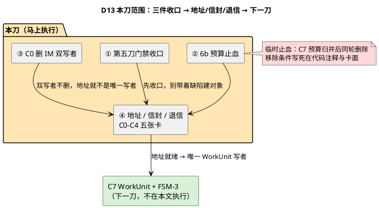
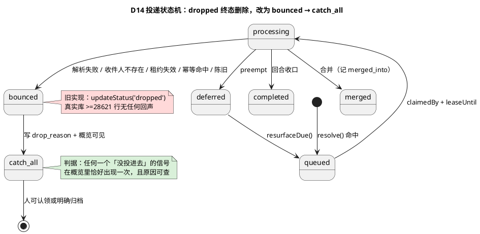
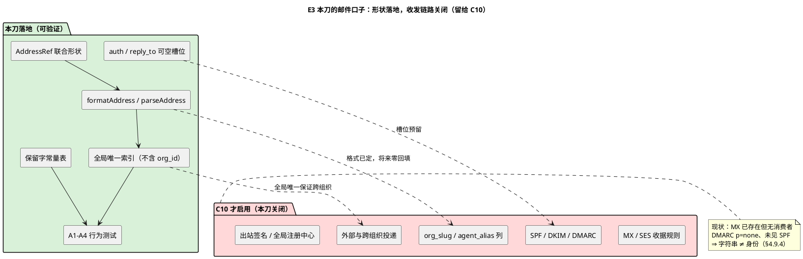
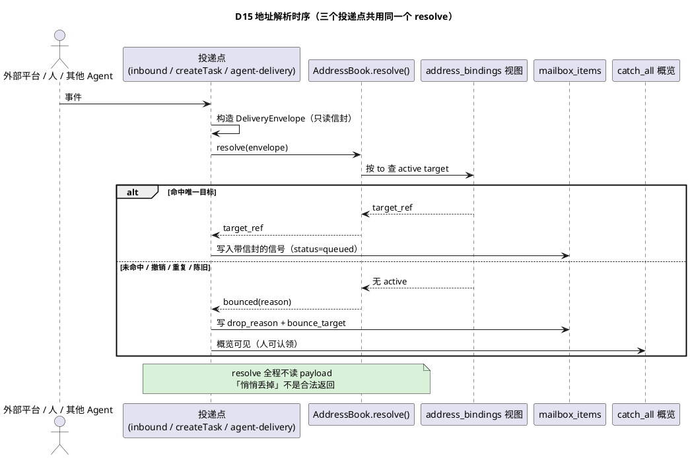
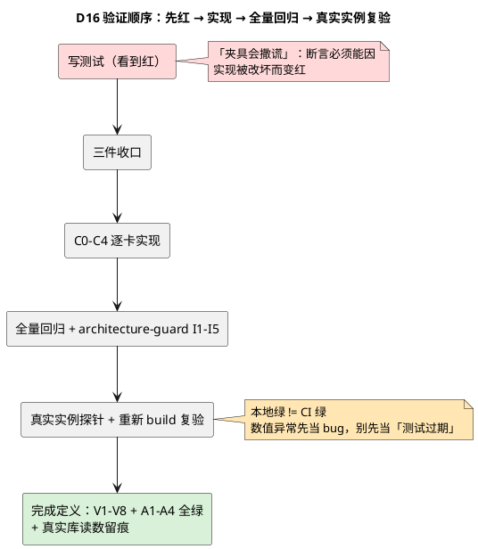

# 第六刀 · 马上执行：三件收口 + 地址/信封/退信

> 状态：**马上执行**（Owner 2026-11-11 概念定稿，唯一依赖门禁已过）· 版本 v3.1 · CTO
> 唯一事实源：[`markus-master-refactor-plan-2026-11-11.md`](./markus-master-refactor-plan-2026-11-11.md) §2 概念 / §4 设计（含 §4.9 邮件地址标准 v1）/ §5 C6 / §6 验证。本文是**执行文档**，不另立概念、不重复定义。
> 图：全部内联 `plantuml` 代码块（Markus 原生渲染），不依赖 SVG 构建产物。
> 硬边界：本刀动共享基础设施（入站路由、新列、视图），**改前通知团队、改后等确认**；merge main / 发版 / 删数据 / 改他人绑定一律 Owner 明确批准才动。

---

## 0. 这一刀到底做什么

**一句话**：把三件已知缺陷收口，然后给每条入站信号一个「有收件人、有信封、投不进去有回声」的入口。做完之后，平台才第一次能回答「这封信该给谁」——这是后面 WorkUnit、主动 Agent、外部适配器的前置条件。



**本刀的「做完」定义**：三条日常链路（chat / task / a2a）各写出一条带信封的真实记录；无收件人的信号在 catch-all 概览可见；`dropped` 增量归零；三件收口的验收全部有真实数据证据。

**本刀不做**：不建 `work_units` 表、不写 `work_unit_ref` 的值（列只加不写，唯一写者在 C7 才接入）、不实现四档自主度、不接外部来源、不改 `cs_*`/`sess_*` 会话契约、**不实现邮件收发**（不改 DNS / MX / SPF / DKIM / DMARC、不建 `org_slug` / `agent_alias` / `role_slug` 列、不发信不收信、不做邮箱存储与别名自助工具）。邮件地址只定标准与口子，见 §2.8 与主计划 §4.9。

---

## 1. 三件收口（先做，绿了才动新代码）

> 顺序纪律：先收口已知缺陷，否则第六刀的验证信号会被旧缺陷污染。每件都给「现状证据 → 改动 → 验收 → 回滚」，四格齐全。

### 1.0 C0 复核结论（2026-11-11 真实代码 / 真实数据）

> **更正**：下面三张「收口」卡是照着更早的提交写的。在 HEAD `d7a17730` 上逐条取证后，②③ 已由 H6 与 `d7a17730` 结构性落地；照旧卡再打补丁等于往已修好的代码上叠一层。C0 判定为「证据收口完成，无新增生产代码」。

| 收口 | 卡片写的状态 | HEAD 真实状态（证据） | 决定 |
|---|---|---|---|
| ① 第五刀门禁 | 三面一致未比对 / cut3 未深探 / 运行包旧 / 两卡未裁决 | 真实库：`tasks` 1732、`status_transitions` 仅 `task` 8153 + `requirement` 858、`channel_bindings` 1、`users.email` 命中组织格式 **0**；运行实例 `/api/health` = `0.12.3-rc.0` / 99 agents；C1 时区用例 **14/14 绿**；cut3：`END_TURN_REPLY_SENTINEL` 已在 `shared/src/limits.ts:154` 类型化，回合完成分支无遗留 in-band 哨兵 | 三面一致 + cut3 已可裁决；**重新 build 复验归 C4（V7）**，C0 不重复；心跳 reflex prompt 的 `HEARTBEAT_OK` 是心跳专用 ack、非回合完成哨兵，归 §4.4 的 C8 一并删除 |
| ② 6b 预算止血 | `subagent.ts:24` = `Infinity`，需把默认改成 30 的临时补丁 | 真实路径 **`packages/core/src/tools/subagent.ts:24`**；H6 已落 `aggregateBudget`(100) / `iterationBudget` / `filesTouched` / `budget_exhausted` 结构化交卷，并有 `subagent-budget-visibility` / `subagent-result-schema` 两个测试文件；生产 ctx 由 `agent.ts:998` 传 `_maxToolIterations`(200)，`Infinity` 只是未传参时的回退 | **不打补丁**：结构性修复已存在；`Infinity` 回退归 C7「删机制」时一并消除，不本轮叠加 |
| ③ 删 IM 双写者 | `org-manager/src/router.ts:205` 运行时写内存 map | 真实路径 **`packages/comms/src/router.ts:203/213`**、**`packages/cli/src/commands/start.ts:448/2787`**；DB 已由 `setBindingLookup(RepoBindingLookup)` 成为入站主源；`bindPlatformAgent` 唯一生产调用是启动期 seed `applyPersistedPlatformBindings()`；`compositeLookup` 仍把内存 bootstrap 当第二**读取**源 | **没有可删的运行时写路径**；残留是 dual-read 而非 dual-write，归 C2 的 `resolve()` 单一解析器收口 |

三处过时路径已同步更正到 §1.2 / §1.3 的证据行。**结论：三件收口以证据判定完成，基线 60 用例全绿；本刀第一家真正需要写的代码是 C1 的地址格式守卫**（见 §7）。

### 1.1 ① 第五刀门禁收口

| 格 | 内容 |
|---|---|
| 现状证据 | 第五刀 checklist §4：三面一致（UI / DB / 日志）未逐面比对；cut3 未深探；运行包固定 `/dist-electron/mac-arm64/Markus.app/Contents/Resources/app.asar`（16a28403），源码已由 d7a17730 带入但运行包未重建；两张验证卡 `tsk_1fa331f7f706` / `tsk_5e12b7bb4b91` 仍开着（**勿删**，是测试数据） |
| 改动 | ① 逐面真实探针：同一条任务在 `tasks` / `status_transitions` / `agent_activity_logs` 三面各查一次，记录读数与时间戳；② cut3 深探：确认类型化 `END_TURN_REPLY_SENTINEL` 替换 in-band 文本哨兵后无遗留分支；③ 同提交重新 build 运行包，复验横幅归属与 C1 时区用例；④ 给两张验证卡写裁决记录（保留数据） |
| 验收 | 三面读数一致或有明确可归因差异；横幅归属正确；cut3 无遗留 in-band 哨兵；两卡状态更新且数据未删 |
| 回滚 | 纯探针 + build，无数据写入；卡面记录可撤 |

### 1.1.1 C0 三面一致逐面比对（2026-11-12 真实读数 · 证据表）

> 读数对象：`tsk_1fa331f0e666cd00aced0821`（第五刀验证卡，review 态）。DB 探针走只读连接 `file:~/.markus/data.db?mode=ro`；UI 面走平台工具面 `task_get`（与看板同源 DTO）。本表是 §1.1 第①项「逐面真实探针」的落地证据，不是重述计划。读数时刻均为 Asia/Shanghai（UTC+08:00）。

| 面 | 取数方式 | 读数 | 读数时刻 |
|---|---|---|---|
| **UI / 看板面**（平台工具 DTO） | `task_get(tsk_1fa331f0e666cd00aced0821)` | `status=review`；`statusChangedAt=2026-11-10T03:15:56.435Z`；`reviewerId=agt_7eb0cdc93b6ec495fdaacc66`（内容总监，stopped）；`blockedReason=null`；`statusHistory` 恰 2 条（9008 `pending→in_progress` / 9009 `in_progress→review`）；`deliverables=[]` | 2026-11-12 00:25:24 CST |
| **DB `tasks`** | `SELECT status, blocked_reason, execution_round, status_changed_at, started_at FROM tasks WHERE id=?` | `status='review'`；`blocked_reason=NULL`；`execution_round=1`；`status_changed_at=2026-11-10T03:15:56.435Z`；`started_at=2026-11-10T03:15:50.933Z` | 2026-11-12 00:20:14 CST |
| **DB `status_transitions`** | `SELECT ... FROM status_transitions WHERE entity_id=? ORDER BY created_at` | 恰 2 行：`pending→in_progress`（human / Jason Carter / `Approved`）`2026-11-10T03:15:50.933Z`；`in_progress→review`（agent / CTO / `Submitted for review`）`2026-11-10T03:15:56.435Z` | 2026-11-12 00:20:14 CST |
| **`agent_activity_logs`** | `content LIKE '%<id>%' OR metadata LIKE '%<id>%'` | 27 条命中；关键事件 `task_create` tool_end `2026-11-10T03:15:44.731Z`、`task_submit_review` tool_start `2026-11-10T03:15:56.431Z` / tool_end `2026-11-10T03:15:56.438Z` | 2026-11-12 00:20:14 CST |

**逐面一致性结论**：`statusChangedAt`（UI）= `status_changed_at`（`tasks`）= `status_transitions` 最新一行 `created_at` = `2026-11-10T03:15:56.435Z`，三面**逐字段一致**；`statusHistory` 2 条与 `status_transitions` 2 行的 from/to/actor/reason/时间逐条一致；`task_submit_review` 的 tool_start `.431Z` → DB 写 `.435Z` → tool_end `.438Z` 构成闭合因果链。

**差异归因（逐条给解释，不含糊）**：

| # | 表面差异 | 归因 |
|---|---|---|
| D1 | `agent_activity_logs` 27 条 vs `status_transitions` 2 行 | 观测日志是 append-only 逐工具/逐文本事件（含本轮后续复核探针），状态迁移只记状态跃迁；粒度不同，不是丢失或重复 |
| D2 | UI 读数走 `task_get` 而非 `/api/tasks/:id` | `curl /api/tasks/:id` 与浏览器同源 `fetch` 均返回 **401 Unauthorized**（cookie 鉴权，第五刀 checklist §1 已记录）；`GET /tasks/:id` 的 200 是 **SPA catch-all**（§6 陷阱清单），不是数据端点。两者均不构成数据缺失；DOM 横幅归属的重新 build 复验**已决定归 C4（V7）**，C0 不重复 |
| D3 | 全库 `tasks` 1737 / `status_transitions` 9021（task 8159 + requirement 862）vs 主计划附录 A 14:2x 读数 1732 / 9011 | 差 +5 / +10；`created_at > 2026-11-11T06:20:00Z` 的恰为 5 张任务 / 10 条迁移 → 全部由第六刀 C0–C4 五卡建卡及其状态变更产生，可归因、无漂移 |
| D4 | `agent_activity_logs` 3,753,906 vs 文档「≥3.75M」 | append-only 持续增长；主计划 §0 已规定「随写入增长的行数一律写 ≥N + 读数时刻」，本行即按该口径 |
| D5 | 同批另两卡：`tsk_5e12e7703e2cbc563998ccd7` UI/`tasks` 均为 `blocked` + `blocked_reason='deps'`、`status_transitions` 2 行（第 2 行 `changed_by_type=system`、`changed_by_name=NULL`、`reason=NULL`）、日志 42 条；`tsk_594b439a4362be43984bc86b` UI/`tasks` 均为 `in_progress`、迁移 1 行、日志 26 条 | `blocked_reason` 与迁移行的 `changed_by_*` 是同一次状态更新写的**不同列**（依赖闸门写 system 行，任务行写 `deps`），不是两个写者；日志条数按 D1 归因 |

**判定**：① 的三面一致逐面比对**完成**，无不可归因差异。DOM 横幅归属复验按 §1.0 决定归 C4（V7），本卡不重复、不留待补。

### 1.1.2 cut3 深探：回合完成哨兵无 in-band 遗留（2026-11-12）

| 项 | 真实读数（HEAD `79a8421e`） |
|---|---|
| 类型化哨兵 | `packages/shared/src/limits.ts:154` `export const END_TURN_REPLY_SENTINEL = '[end_turn]'`；全仓 `src` 中该字面量**仅此一处** |
| 生产者（回合完成分支） | `packages/core/src/agent.ts:1803` `return endedTurnViaTool ? END_TURN_REPLY_SENTINEL : result;`；`agent.ts:2738` 心跳自检完成同样返回该常量 |
| 消费者 | `packages/core/src/attention.ts:62` `if (reply === END_TURN_REPLY_SENTINEL) return undefined;` → 类型化沉默判为**正常完成**，不 requeue |
| 行为守卫 | `packages/shared/test/limits.test.ts:52-53,75`（常量值与 scrubber 不误吞哨兵）、`packages/core/test/attention.test.ts:86,91,128`（哨兵不被判异常）；本轮 11 文件 / 171 用例复跑全绿（§7.5.1） |
| 已退役的 in-band 标记 | `<<HANDLE_COMPLETE>>` 及其畸形变体**只剩** `limits.ts:170-174` 的 `stripLegacyCompletionToken` 有界兼容清洗器，恰好 2 处调用：`agent.ts:219`（`stripCompletionMarker` 显示/持久化边界）、`org-manager/src/sse-handler.ts:300`（落库边界）；带显式移除条件 |
| 无遗留的证据 | `grep -rn "HANDLE_COMPLETE" packages/*/src --include=*.ts` 全部命中为注释/文档与该正则，**零**注入、**零** `<think>` 探测器、**零** 回合完成分支里的文本检测、**零** 补标记续跑 LLM 调用；`agent.ts:224-236` 的 `createMarkerStrippingDelta` 已不再保留尾部缓冲（`flush` 为空操作） |

**结论**：回合完成由「调用 `end_turn` 工具」这一**类型化事实**承载，不再由「载荷里出现某个字符串」推断（R3' 结构不从载荷推断）。**cut3 深探完成，回合完成分支无 in-band 遗留。**

**`HEARTBEAT_OK` 的定性（本卡不动）**：出现于 `agent.ts:9986`（心跳 reflex prompt「…respond with exactly: HEARTBEAT_OK」）、`agent.ts:10027`（`isOk = cleanReply.trim() === 'HEARTBEAT_OK'` → 只发一条「Patrol complete — all clear.」并 `endActivity`）、`context-engine.ts:1660/1846`（心跳提示词）；`pending-callback.ts:43` 与 `callback-scenario.test.ts:7` 是**历史缺陷注释**（回调曾被误降级为 heartbeat reflex），已由场景回放修复。它是心跳巡检专用 ack，**从不进入 `detectAbnormalCompletion`，不是回合完成哨兵**；心跳路径的完成信号本来就是 `END_TURN_REPLY_SENTINEL`（`agent.ts:2738`）。**已决定归入主计划 §4.4 的 C8（删 `hb_<date>` 滚动会话、巡检改条件触发）一并删除，C0 不动。**

### 1.2 ② 6b 预算止血（临时，有明确移除条件）

| 格 | 内容 |
|---|---|
| 现状证据 | **`packages/core/src/tools/subagent.ts:24`** `DEFAULT_MAX_SUBAGENT_ITERATIONS = Infinity`；`packages/shared/src/limits.ts:714` 聚合上限 100；真实事故 2026-11-10 17:10 三路子 agent 全部 0/3 交付（`budget_exhausted`）。**H6 已结构性修复**（见 §1.0），本项不再叠加临时补丁 |
| 改动 | ① 默认上限改有界值（30）；② 聚合上限按并发数 N 预分，`N × perChild ≤ 100`，建子 agent 前就切开，不留全局竞争；③ 耗尽时强制交卷 `{done, partial, notDone, filesTouched}`，让主会话能建模下一步；④ 子 agent prompt 明示预算 |
| 验收 | 单路不再无限循环；三路并发时聚合上限按 N 生效；`budget_exhausted` 返回体四字段齐全且 `filesTouched` 可用；V8 绿 |
| 回滚 | 单提交 revert 即恢复；不影响已有子 agent 结果 |
| **移除条件** | **C7 落地 `work_units.budget` 时同轮删除本补丁**。代码注释与卡面都写这一句，避免补丁变成永久机制 |

### 1.3 ③ C0 删 IM 双写者

| 格 | 内容 |
|---|---|
| 现状证据 | **`packages/comms/src/router.ts:203/213`** `bindAgentToChannel()` / `bindPlatformAgent()` 写内存 `agentChannelMap`（当前仅测试与启动 seed 调用）；`getBindings()` 导出；**`packages/cli/src/commands/start.ts:2787`** `setBindingLookup(RepoBindingLookup)`，DB 已是入站主源。残留为 `compositeLookup` 的 dual-read（见 §1.0），非双写者；真实库 `channel_bindings` 1 行 |
| 改动 | ① 删运行时写路径，只留启动期 seed；② `getBindings()` 改为只读 DB 视图（本刀的 `address_bindings`）；③ `setBindingLookup` 只接 DB 源；④ golden 测试锁入站行为逐条不变（含 A2A 走 `agent-delivery.ts` 的链路） |
| 验收 | 全仓只剩 `bind_address()` 一个写者；入站行为逐条与改动前一致；V1 绿 |
| 回滚 | 单提交 revert；视图可删、列可空；旧行 `NULL` 合法 |

> 三件全部绿之前，不写 §2 的任何代码。这是「先收口」的可执行判据，不是口号。

---

## 2. 地址 / 信封 / 退信：详细设计

### 2.1 数据模型（只加可空列与视图，不删表、不重建、不回填）

| 对象 | 动作 | 兼容 / 语义 |
|---|---|---|
| `channel_bindings`（1 行） | `ALTER ADD COLUMN address TEXT, revoked_at TEXT`；全局部分唯一索引 `UNIQUE(address) WHERE revoked_at IS NULL`（**键里不含 `org_id`**，H4）；`CREATE VIEW address_bindings` | 视图只加列，旧 SQL 不动；一地址至多一个 active 目标（I1）；撤销 = 打 `revoked_at`，不删行；组织短名已编入地址，跨组织不会撞 |
| `mailbox_items` | 加 `envelope TEXT, work_unit_ref TEXT, signal_class TEXT, intent TEXT, dedupe_key TEXT, drop_reason TEXT, bounce_target TEXT` 全部可空 | 旧行 `NULL` = 无信封，读路径 `warn` 并 fallback 到 `agent_id`；**`work_unit_ref` 本刀只加列、不写值**（C7 才有唯一写者，避免先建引用后建实体） |
| `status_transitions` | `entity_type` 取值域扩至 `signal`（`work_unit` 在 C7 扩） | TEXT 列，无 schema 变更；旧查询按已知类型过滤 |
| 观测四表 | **不动** | ≥11.6M 行不回填；`work_unit_ref` 留到 C7 |
| 死表 8 张（0 行） | **不动、不复活** | M6 标 deprecated，门禁禁止新写入；`external_thread_ref` 不建在 `messages` 上 |
| `organizations` / `agents` / 角色注册表 | **本刀不建列**：`org_slug` / `agent_alias` / `role_slug` 只定名字、字符集、唯一性与保留字 | 主计划 §4.9.2 / §4.9.6 / M10；C10 才 `ADD COLUMN`，零回填。历史两行组织同名 `My Organization`，显式赋值，绝不从 `name` 推导 |
| `users.email` | **不动**，但加一条唯一校验守卫（A4） | 人类邮箱不得写入 `markus.global` 组织格式；`hub_username` 与 `agent_alias` 不共用命名空间 |

**信封形状**（`DeliveryEnvelope`，避开 `A2AEnvelope` 命名冲突）：

```json
{
  "from": { "kind": "markus|platform|external|agent|im", "raw": "...", "local": "...", "org_slug": "...", "verified": false },
  "to":   { "kind": "markus|platform|external|agent|im", "raw": "...", "local": "...", "org_slug": "..." },
  "subject": "string",
  "messageId": "platform-unique（外部邮件 = RFC Message-ID）",
  "auth": null,
  "reply_to": null,
  "work_unit_ref": "wu_* | null  // 本刀恒为 null，C7 接入",
  "external_thread_ref": "opaque string | null（In-Reply-To / References）",
  "signal_class": "chat|a2a|callback|governance_event|record|system",
  "intent": "deliver|trigger_execution|action_required"
}
```

`from` / `to` 是主计划 §4.9.5 H1 的 **`AddressRef` 判别联合**，不是自由字符串：`kind='markus'` 才带 `local` / `org_slug`；`kind='external'` 时 `raw` 原样保存、`verified` 默认 false。**本刀只落形状，不实现 `external` 的收发与校验**；`auth` / `reply_to` 可空、本刀不写值（H5/H6）。

**四条硬规则**：`external_thread_ref` 只读、不参与路由/连接/去重（主计划 §2.1 第 7 行）；`envelope.threadId` 不存在，改名为 `work_unit_ref` + `external_thread_ref`（主计划 §2.8 第 2 条）；`triggerExecution` / `actionRequired` / `round` 从 `payload.extra` 提到 `intent` / `dedupe_key` 结构列；`AddressRef` 之外**不得拼地址字符串**，也不得因字符串长得像内部地址就当成内部身份（主计划 §4.9.4）—— **结构不从载荷推断**（R3'）。

### 2.2 唯一写者 + 唯一解析器

| 角色 | 函数 | 只读什么 | 禁止 |
|---|---|---|---|
| 写者 | `bind_address(address, target_ref)` | DB 视图 `address_bindings` | 不得写内存 map；不得绕过直接改 `channel_bindings` |
| 解析器 | `resolve(envelope)` → `target_ref | catch_all` | **只读信封** | 不得读 `payload`；不得读 `sourceType` 做语义判断；不得静默返回 `undefined`；**不得按当前 `org_id` 限定查询**（H4） |
| 地址格式 | `parseAddress(raw)` / `formatAddress(local, org_slug)` 两个纯函数（H2） | 只处理 `AddressRef` | 别处不得 `split('.')` 拼地址；大写/中文/`+tag`/多点/保留字一律拒绝 + 给可行动提示 |
| 决策点 | `routeMailboxItem(item)`（纯函数，保持唯一） | 新结构列 | 删除 `hasAuthorityFlag()` / `buildRoundDedupKey()` 两个从载荷推断的函数 |

`resolve()` 的结果只有两种：解析到唯一 active 目标，或 `catch_all`。**没有第三种「悄悄丢掉」**。

### 2.3 三个投递点（信封在这里构造）

| # | 位置 | 现状 | 本刀改动 |
|---|---|---|---|
| 1 | `org-manager/src/im/inbound.ts:110-140` | `explicitAgentId → channel → instance` 三级回退 | 回退链保留作兼容，但**先** `resolve(envelope.to)`；构造信封后写入 `mailbox_items.envelope` |
| 2 | `org-manager/src/api-server.ts:2206` `createTask()` | 直接建任务 | 建任务同时写一条带信封的投递记录，`to` 从 `assignee_id` 构造 |
| 3 | `core/src/agent-delivery.ts:169` `enqueueToMailbox('a2a_message')` | A2A 唯一出口 | 构造 `from/to/messageId`；`external_thread_ref` 从 A2A 消息头取，只读保存 |

另修 `org-manager/src/api-server.ts:2851` 的 manager bus / agent 私有 bus 事件错投（既有事故记录），纳入 golden 测试。

### 2.4 工具面（Agent 自助，不靠人点 UI）

| 工具 | 语义 | 权限 |
|---|---|---|
| `bind_address(address, target_ref?)` | 认领/改绑一个地址；`target_ref` 省略 = 自己 | 只能绑**自己**；改他人绑定禁止（I5） |
| `address_list()` | 列出自己可见的绑定 + 状态 | 只读 |
| `address_revoke(address)` | 打 `revoked_at` | 只能撤自己的 |
| `message_route(messageId)` | 查一条信号的路由结果 / `drop_reason` / 回声 | 只读，用于 V4 取证 |

> 工具返回体站在 Agent 角度写：它看不到日志，只能靠返回值建模。解析失败必须返回 `{status:'bounced', reason, catchAllId}`，不能只写日志。

### 2.5 catch-all 与退信（消灭静默丢弃）



五类 `bounced` 原因全部结构化：`unresolved_address` / `no_active_target` / `lease_expired` / `duplicate_message_id` / `stale_signal`。`drop_reason` 必填，`bounce_target` 指向 catch-all 概览 id。**旧 `dropped` 行保留只读，读路径归一为 `bounced`**，不改写历史数据。

第 6 类 `dsn_bounce`（`MAILER-DAEMON` / DSN 退信）**本刀只预留枚举位、不启用**，留给 C10 接外部邮件时直接复用这条 `bounced → catch_all` 通道，避免将来临时加分支（主计划 §4.9.5 H8）。

### 2.6 五条不变量 I1–I5（architecture-guard 行为测试）

| # | 不变量 | 会咬人的测试 |
|---|---|---|
| I1 | 一个 active 地址至多一个 `target_ref` | 并发两次 `bind_address` 同一地址 → 恰一成功一冲突；DB 部分唯一索引兜底 |
| I2 | `resolve()` 不读 payload | 只改 `payload.extra` 内容，路由结果不变 |
| I3 | 无静默丢弃 | 构造无收件人信号 → `bounced` 行 + catch-all 概览可见 + `drop_reason` 非空；真实库 `dropped` 增量 = 0 |
| I4 | 三条链路都有信封 | 分别触发 chat / task / a2a → 三条 `mailbox_items.envelope IS NOT NULL` |
| I5 | 改他人绑定禁止 | 以 A 身份 bind B 的地址 → 拒绝且给出可行动提示 |

测试写成**行为测试**，不用 `readFileSync + toContain` 那种重命名即失效的文本断言。

### 2.7 迁移与回滚

- 迁移：幂等 `ALTER TABLE ... ADD COLUMN`（SQLite 支持 `IF NOT EXISTS` 语义需脚本判定）+ `CREATE VIEW IF NOT EXISTS`；幂等 `UPDATE` 修 `requirements DEFAULT 'draft'` 遗留值（M2）。
- **不回填**：所有历史行新列为 `NULL`，读路径 `warn` + fallback；不做批量 UPDATE。
- 回滚：单提交 revert；视图 `DROP VIEW`；列保留可空（不删列，避免 SQLite 重建表）；`resolve` 开关关闭后回退到 `explicitAgentId → channel → instance` 旧链。
- 一次提交 = 一个可回滚单元；五张卡各一次提交，不合并。

### 2.8 邮件地址标准 v1：本刀只留口子，不接收发

> **唯一事实源**：主计划 §4.9（格式、保留字、信任边界、H1–H12 口子清单、§4.9.6 预留字段、§4.9.7 验收）。本节只列**本刀必须落地的那几个形状**，不重复定义。Owner 2026-11-11 明确「不要现在实现」—— 下面每一项都是「把口子留好」，不是开工。

| 口子 | 本刀落什么（形状 / 名字 / 约束） | 本刀不做什么 |
|---|---|---|
| H1 `AddressRef` | `envelope.from/to` 判别联合（§2.1） | 不实现 `external` 的投递与校验 |
| H2 纯函数 | `parseAddress(raw)` / `formatAddress(local, org_slug)` 两个纯函数 + 行为测试（A1） | 别处不得 `split('.')` 拼地址 |
| H4 全局唯一索引 | `UNIQUE(address) WHERE revoked_at IS NULL`，键里不含 `org_id`（§2.1） | 不按当前 org 限定 `resolve()` 查询（§2.2） |
| H5/H6 槽位 | `envelope.auth` / `reply_to` 可空字段（§2.1） | 本刀不写值、不校验 SPF/DKIM/DMARC |
| H8 退信 | 第 6 类 `dsn_bounce` 只预留枚举位（§2.5） | 本刀不启用、不发 DSN |
| H12 保留集 | `PLATFORM_RESERVED_ADDRESSES` 常量表 + 单测锁死（A2） | 不开放组织绑定 0 点地址 |
| H10 人类邮箱隔离 | `users.email` 写入 `markus.global` 组织格式 → 唯一校验守卫拒绝（A4） | 不建列；`hub_username` 与 `agent_alias` 不共用命名空间 |
| H3/H7/H9/H11 | 字段名、字符集、唯一性、保留字定稿 | **不建列、不建表、不改 DNS、不发信、不收信、不做邮箱存储 / 别名自助 / 跨组织投递 / 全局注册中心** |

#### 2.8.1 C1 口子清点（H1/H2/H4/H10/H12：落地点 / 验证 / 边界）

| 口子 | 落地点（唯一写者 / 唯一执行点） | 验证用例 | 本卡边界（谁负责后续） |
|---|---|---|---|
| **H1 `AddressRef`** | `packages/shared/src/address.ts` `AddressRef` 判别联合（`markus｜platform｜external`，`verified` 由信封单独携带）；地址绑定的返回体 `AddressBindOutcome / AddressRevokeOutcome / AddressResolution` 同文件 | `address-guards`(A1–A4 24 例) + 本卡 `address-tools`(10 例) 全绿 | 信封 `DeliveryEnvelope` 的形状与三个投递点写入归 **C2**；本卡不实现 external 收发 |
| **H2 纯函数（唯一解析点）** | `formatAddress` / `parseAddress`（`79a8421e`）是唯一格式入口；`SqliteAddressBindingRepo.rejectUnbindable()` 复用 `parseAddress`，bind / revoke 共用一套判定 | 全仓 `grep -rn "split('\.')" packages/*/src` 命中的 10 处均为 JWT / 扩展名 / 路径 / 版本号，**0 处拼邮箱地址**；`markus.global` 硬编码 10 处均为 Hub/remote URL，非邮箱 | `resolve(envelope)` 归 **C2**（本卡只提供 `resolve(address)`） |
| **H4 全局唯一索引** | `uq_channel_bindings_address_active ON channel_bindings(address) WHERE revoked_at IS NULL`（键里只有 `address`，**不含 `org_id`**）；`findActive()` / `resolve()` 的 SQL 无 `org_id`；视图 `address_bindings` 是唯一读面 | 架构守卫用例断言 DDL 不含 `org_id` 且含部分谓词；行为用例：同地址跨两个 org 第二次 bind ⇒ `conflict`；`alice.acme` 与 `alice.globex` 可共存 | 跨组织投递（H4 的下游）归 **C10**；本卡只保证索引与解析的全局性 |
| **H10 人类邮箱隔离** | `SqliteUserRepo.assertHumanEmail()` 唯一执行点，`create` / `upsert` / `updateProfile` 三条写路径全部经过它；拒绝 `markus.global` 组织格式，**不改写** | A4 用例：三条路径均抛 `organisation address`；被拒后原值不变；普通邮箱 / 空 email 照常可写 | 不建列、不动 `users` 表结构；`hub_username` / `agent_alias` 命名空间归 **C10** |
| **H12 保留集闭集** | `PLATFORM_RESERVED_ADDRESSES`（`address.ts`）+ `rejectUnbindable()` 把 0 点平台地址判为 `bounced/platform_reserved` | `conduct@` / `postmaster@` / 0 点 `alice@markus.global` 全部拒绝且零行落库；并发绑定同一地址恰一成功 | 组织不得绑定平台保留地址（本卡已实现）；「新造 0 点地址」的入口不存在（工具面只接受 1 点内部地址） |

**A1–A4 口子验收判定**：A1/A2/A3/A4 四条均有会咬人的行为用例（先看到红：org slug 含下划线与 `..` 段的两条断言确实先失败，改夹具后才绿），本卡判 **A1–A4 全绿**。

，`local` 为 Agent 英文别名或职能短名（组织内唯一、共用唯一域），`org` 为全局唯一组织短名；恰好一个点，0 点是平台保留，≥2 点留给将来团队级；全小写 ASCII，大写/中文/`+tag`/多点/保留字一律拒绝 + 给可行动提示。



**A1–A4 口子验收（architecture-guard 行为测试，不依赖收发能力）**：

| # | 判据 | 会咬人的测试 |
|---|---|---|
| A1 | 格式唯一写者 | `formatAddress`/`parseAddress` 覆盖 0/1/≥2 个点、大写、中文、`+tag`、保留字、超长、连续 `--`；⚠ 任一非规范输入必须拒绝且返回可行动提示 |
| A2 | 平台保留集闭集 | 尝试 `bind_address('conduct@markus.global')` 等 → 拒绝；并发绑定同一地址 → 恰一成功（I1） |
| A3 | 跨组织不撞 | 两个不同 `org_slug` 下的同名 `local` 可共存；同一完整地址跨 org 重复绑定 → 唯一索引冲突 |
| A4 | 人类邮箱隔离 | `users.email` 写入 `markus.global` 组织格式 → 唯一校验守卫拒绝 |

> 四条全绿 = 口子留好。判据：**将来接外部邮件时，不需要改地址格式、不需要回填历史数据、不需要新造第二套解析函数**。



---

### 2.9 信封落地口径（C2 实做，2026-11-12）

> 本节记录 C2 **实际怎么落的**，以及三处与 §2.1 草案的**刻意偏离**（每处都给理由）。
> 唯一事实源仍是主计划 §4.9.5 H1/H5/H6；§2.1 是草案，本节是落地口径。

#### 2.9.1 数据模型：哪些列、为什么不加 `dedupe_key`

| 对象 | 实做 | 与草案的差异 / 理由 |
|---|---|---|
| `mailbox_items` | 新增可空列 `envelope`、`work_unit_ref`、`signal_class`、`intent`、`message_id`、`drop_reason`、`bounce_target`（幂等 ALTER，旧行 NULL，不回填） | 多出 `message_id`：它是 `envelope.messageId` 的**投影列**。唯一性必须由索引裁决，而 JSON blob 无法可靠索引 → 投影 + 部分唯一索引才能让「同一条消息投两次」在结构上不可表达（V5） |
| `mailbox_items.dedupe_key` | **不新增**。复用既有 `dedup_key` | 草案 §2.1 的 `dedupe_key` 与既有 `dedup_key` 是同一事实（`uq_mailbox_agent_dedup` 已建在它上面）。同事实两列 = 两个写者；两列名字只差一个字母，后来者必然写错一列 |
| `work_unit_ref` | 只加列，**写入数恒为 0** | C7 才有唯一写者。先建引用后建实体就是悬空引用 |
| 唯一性 | `uq_mailbox_agent_message ON mailbox_items(agent_id, message_id) WHERE message_id IS NOT NULL AND status <> 'bounced'` | 退信行记录的是「这次没投进去」，不是同一条消息的第二份，故排除在约束外 |

#### 2.9.2 信封形状：唯一写者 + 读侧不编造

- 形状写者：`packages/shared/src/mail.ts` 的 `buildDeliveryEnvelope()`。**任何模块不得手写信封字面量**；预留槽位（`auth` / `replyTo` / `workUnitRef`）一次性补 `null`，不「缺省就省略字段」——省略会让 JSON 形状随输入变化，读侧就得为每种形状写分支。
- `from` / `to` 的类型是 `AddressRef`，在 C1 的三种**邮件地址**（`markus` / `platform` / `external`）之上增加两种**投递方身份**：`agent`（`agentId`）、`im`（`platform` + `nativeUserId`）。`parseAddress()` 的返回值收窄为 `MailAddressRef`（永远不含 `agent` / `im`），从类型上堵死「长得像内部地址就当内部身份」。
- 读侧：`parseEnvelope()` 对 NULL / 空串 / 坏 JSON 一律返回 `undefined`，**绝不合成**一个「看起来合法」的壳。
- `im` 这个 kind 也用于平台 Web 用户（`platform='markus-web'`）：它是「非 agent 的自然人入口」，与外部 IM 同形；这样 chat 链路的 `from` 不必为 Web 再造第六种 kind。

#### 2.9.3 三个投递点：只交「自己知道的事」，装配在唯一一处

| # | 位置 | 交出什么 |
|---|---|---|
| 1 | `packages/cli/src/commands/start.ts` `messageRouter.setAgentHandler`（IM 入站的真实入口；`comms/src/gateway/inbound.ts` 只做目标解析） | `from = im:<platform>:<senderId>`、`messageId = message.id`（平台 native id → 适配器重投只会落一行） |
| 2 | `packages/org-manager/src/api-server.ts` 网关 `createTask()` | `from = agent:<createdBy>`、`messageId = gateway-task:<taskId>`；投递记录用 `task_status_update` + `intent='deliver'`（record 类，`invokesLLM=false`，不凭空多烧一个回合） |
| 3 | `packages/org-manager/src/agent-delivery.ts` `deliver()` | `from = agent:<fromAgentId>`、`messageId = deliveryId`、`externalThreadRef = chainId` |

**为什么 A2A 的 messageId 不用 chainId/深度**：同一 `chainId` 下同一跳的两条**不同**消息都是合法消息，按 chainId 去重会静默吞掉真消息。IM/邮件入口才用对方给的 native id。

装配点：`AgentMailbox.enqueue()` —— `to` 由 mailbox 自己知道（本 agent），`signalClass` 来自唯一路由决策（`routeMailboxItem()`），`messageId` 缺省用 item id。因此**每条新信号必带信封**（I4 是构造出来的，不是靠三处自觉）。

#### 2.9.4 结构上提：三个字段从 `payload.extra` 提到结构字段

删除 `hasAuthorityFlag()` / `buildRoundDedupKey()` 两个「从载荷推断结构」的函数，替换为：

| 旧读法 | 新来源 | 类型门控 |
|---|---|---|
| `payload.extra.triggerExecution` | `envelope.intent === 'trigger_execution'` | 与类型无关（旧语义保持） |
| `payload.extra.actionRequired`（仅 requirement/workflow） | `envelope.intent === 'action_required'` | 注册表 `actionRequiredStrict`（数据，不是代码里的类型字符串判断） |
| `payload.extra.round` / `metadata.round` | `item.round` | —— |

顺带修掉同族缺陷：`AgentMailbox.unicastRouteKey()` 也曾在读 `extra.round`（同一份「第几轮」两个读法 → 单播路由与幂等键给出不同答案），已收敛到 `item.round`。

**旧行兼容**：C2 之前落库的行没有 `intent` / `round` 列。`rehydrateStructuredFields()` 在**持久层 → 内存**的唯一入口解码一次（`envelope` 为 NULL 时从载荷还原 intent，`messageId` 用 item id 保证永不自撞），并 `warn` 留痕。移除条件：真实库 `envelope IS NULL` 的行数为 0（C4 实测后）。

#### 2.9.5 退信（本轮只做 V5 那一格）

同一 `messageId` 第二次投递 → 写一条 `status='bounced'` + `drop_reason='duplicate_message_id'` 的退信行，并了结投递方 `responsePromise`。`bounce_target`（catch-all 概览归集）与其余四类原因的**状态机**仍归 C3；本卡只保证「原因可查、不静默」。

---

## 3. 验证计划（先红后绿，真实数据探针 > 单测）

### 3.1 顺序纪律



### 3.2 V1–V8 逐条怎么验（另加 §2.8 的 A1–A4 口子验收）

| # | 验证 | 具体探针（可执行） | 绿的定义 |
|---|---|---|---|
| V1 | 地址唯一写者 | `grep -rn "bindAgentToChannel\|bindPlatformAgent" packages/` + golden 测试跑入站行为矩阵 | 运行时写路径 0 处；矩阵逐条与改动前一致 |
| V2 | 路由只读信封 | 行为测试：构造两条 `payload.extra` 不同、信封相同的信号 → 路由结果相同；再改 `to` → 结果变化 | 断言按行为写，不按源码文本写 |
| V3 | 三条链路都有信封 | 真实实例分别发一条 chat、建一个 task、发一条 a2a → `SELECT source_type, envelope FROM mailbox_items WHERE id IN (...)` | 三行 `envelope IS NOT NULL`，`from/to/messageId` 齐全 |
| V4 | 无静默丢弃 | 真实实例投递一条 `to = 不存在的地址` → 查 `bounce_target` + catch-all 概览；再取改动前后 `SELECT count(*) WHERE status='dropped'` | 出现 1 条 `bounced` 且 `drop_reason` 非空；`dropped` 增量为 0 |
| V5 | 重复投递幂等 | 同一 `messageId` 连投两次 | 恰一条 `queued` + 一条 `duplicate_message_id` 退信 |
| V6 | 归属可解析 | 并发 10 次 `bind_address` 同一地址；再 `address_revoke` 后投递 | 恰 1 个 active `target_ref`；撤销后投递进 catch-all |
| V7 | 真实实例无回归 | 同提交重新 build（16a28403）、跑 heartbeat C1 时区用例、核对横幅归属 | 全绿；不把运行包旧误判成源码未修 |
| V8 | 预算可见 | 起 3 路并发子 agent，强制跑满预算 | 每路有界；聚合可见；耗尽交卷可建模下一步（落地字段名与草案不同，口径更正见 §7.5.2） |

### 3.3 三件收口的专项验收

| 收口 | 验收证据 |
|---|---|
| ① 第五刀门禁 | 三面（UI / `tasks`+`status_transitions` / `agent_activity_logs`）逐面读数表 + 时间戳；cut3 无遗留哨兵；重新 build 后横幅归属正确；两卡裁决记录且数据未删 |
| ② 6b 止血 | `subagent.ts` 默认值有界；`limits.ts` 聚合按 N 预分；耗尽交卷结构体四字段；代码注释写明「C7 归并后删除」 |
| ③ C0 删双写者 | 全仓运行时写 `agentChannelMap` 0 处；`getBindings()` 只读视图；golden 矩阵逐条通过 |

### 3.4 全量回归清单

- `packages/core/test/`：mailbox、heartbeat、memory / dream-trigger、session、attention 全部跑一遍。
- 15 类 Item 的 policy 快照测试：`routeMailboxItem()` 对 15 类输入的输出与改动前逐字段比对（`priority / invokesLLM / affinity / strictState / backgroundWork / dedupeKey`），**只允许 `dedupeKey` 来源从 payload 改为结构列，值不变**。
- `architecture-guard` I1–I5 五条行为测试。
- 真实实例上跑一次完整 chat → task → a2a 链路，记录 `mailbox_items` / `status_transitions` / `agent_activity_logs` 三面读数。

### 3.5 完成定义（Definition of Done）

1. V1–V8 全绿，§2.8 的 A1–A4 全绿，三件收口证据齐全，全量回归无红；
2. 三条日常链路各写一行带信封的真实记录（L2 前置门禁）；
3. `dropped` 增量归零，catch-all 概览可查；
4. `work_unit_ref` 列存在但**写入数为 0**（证明没抢在 C7 之前造引用）；
5. 五张卡各一次提交、每卡可单独 revert；文档 / 测试 / 代码三者同步更新，提交信息点名任何未能同步的部分。

---

## 4. 拆卡（一刀一卡，绿了才下一卡）

| 卡 | 内容 | 依赖 | 完成判据 |
|---|---|---|---|
| **C0** | 删 IM 双写者（收口③）+ 三件收口①② | 无 | 三件收口验收全过；V1/V7/V8 绿 |
| **C1** | `address_bindings`：加列 + **全局**部分唯一索引（不含 `org_id`）+ 视图 + `bind_address` / `address_revoke` / `address_list` 工具面 + `formatAddress`/`parseAddress` + 平台保留字常量表 | C0 | I1/I5 绿；A1–A4 绿；工具返回值可建模；**第一片（地址格式守卫）已落地，见 §7** |
| **C2** | `mailbox_items` 加列 + `DeliveryEnvelope` + 三个投递点构造信封 + 删 `hasAuthorityFlag`/`buildRoundDedupKey` | C1 | I2/I4 绿；V3 绿；15 类 policy 快照无意外差异 |
| **C3** | `resolve()` 单一解析器 + `MAILBOX_TRANSITIONS` + `bounced → catch_all` + `message_route` | C2 | I3 绿；V4/V5/V6 绿；`dropped` 增量 0 |
| **C4** | 全量回归 + 真实实例探针 + 重新 build 复验 + 文档同步 | C0–C3 | §3.5 五条全满足 |

> 卡之间用 `blocked_by` 表达依赖；**不合并提交**，不跨卡改动同一文件。

---

## 5. 明确不做（与主计划 §8 一致）

1. 不建 `thread` 表、不给 ContextSession 加 `status`、不建 `work_units` 表。
2. 不写 `work_unit_ref` 的值（只加列）。
3. 不改 `cs_*` / `sess_*` 会话契约，不动 `dbSessionMap` 唯一桥。
4. 不实现 15 类 Item 的三类去向分流、不并入心跳定时器、不改 dream 链路 —— 那是 C8。
5. 不实现四档自主度、不对 worker 用 `rest()`。
6. 不接外部来源适配器（C10）、不复活 8 张 0 行死表。
7. 不回填 ≥11.6M 行观测日志、不删历史 `dropped` 行。
8. 不自行 merge main / 发版 / 删数据 / 改他人绑定。
9. **不实现邮件收发**（与主计划 §8 第 10 条一致）：不接 MX / SES 收据规则、不改 DNS / SPF / DKIM / DMARC、不建 `org_slug` / `agent_alias` / `role_slug` 列、不发信不收信、不做邮箱存储 / 别名自助 / 跨组织投递 / 全局注册中心。§2.8 只留口子，启用条件在主计划 §4.9.5 的 H1–H12。
10. **不因字符串长得像内部地址就当内部身份**：`AddressRef{kind:'external'}` 的 `verified=false` 来信最高只能 `observe`（主计划 §4.9.4）。

---

## 6. 硬边界与文档关系

- **改共享基础设施前通知团队并等确认**：`address_bindings` 视图、`mailbox_items` 新列、三个投递点都是共享面。
- **DNS / MX / SPF / DKIM / DMARC / 出站签名密钥**：全部属生产基础设施与品牌域变更，Owner 明确批准才动；本刀只改代码与文档，不碰域名配置。
- **merge main / 发版 / 打 tag / 删数据**：Owner 明确批准才动；本刀只到「PR 为止」+ 验证证据。
- **一次提交 = 一个可回滚单元**；绝不 force-push main；不把密钥入库。
- 本文是执行文档；概念与完整设计以 [`markus-master-refactor-plan-2026-11-11.md`](./markus-master-refactor-plan-2026-11-11.md) 为唯一事实源。历史报告（四刀复盘 / 第五刀 checklist / superagent-01 / 协作报告）只作证据，不作规范。

---

## 7. 本轮落地记录（2026-11-11）

> 工作分支 `feat/ui-optimize-1111`（开工前 `git status` 干净，HEAD `d7a17730`）；并发检查：共享 handoff / 任务板无「第六刀」占用，C0 相关文件 mtime 均早于今日，未与其他分身并发改同一份文件。

### 7.1 先修图（文档自身的语法债）

本机 `plantuml 1.2026.8` 把两份文档的 19 个代码块逐个编译，5 张报错：D10 / D11 / E2 / E3 / D16。两类根因，都是**写图的语法问题，不是 Markus 渲染器**：

1. 组件图不支持链式箭头 `A --> B --> C`（7 处）；已拆为单箭头。
2. `[...]` 标签内直接换行不合法（D16 的完成定义节点）；已改 `\n` 转义。

修复后 **19/19 编译通过**。Owner 贴出的报错头 `PlantUML version $version$ / $git.commit.id$` 是服务端版本占位符未替换的显示瑕疵，但错误正文与本机编译器逐行一致，说明它忠实报了语法错。

### 7.2 C0 收口：以证据判定完成（§1.0）

基线 4 个测试文件 / 60 用例全绿；C1 时区 14/14 绿；真实库三面读数；运行实例 `/api/health` = `0.12.3-rc.0`。结论：②③ 已由 H6 与 `d7a17730` 结构性落地，**不打补丁**；三处过时路径已更正为 `packages/core/src/tools/subagent.ts`、`packages/comms/src/router.ts`、`packages/cli/src/commands/start.ts`。

### 7.3 C1 第一片：地址格式守卫（先红后绿）

| 步骤 | 结果 |
|---|---|
| 写 `packages/shared/test/address-format.test.ts`（A1–A4，24 用例） | **红**：`Cannot find module '../src/address.js'` —— 证明测试会咬人 |
| 实现 `packages/shared/src/address.ts` | 唯一写入点 `formatAddress`、唯一解析器 `parseAddress`、`AddressRef` 判别联合、`PLATFORM_RESERVED_ADDRESSES` 闭集、`isMarkusOrgAddress` 隔离谓词 |
| `packages/shared/src/index.ts` 加导出 | 一行 `export * from './address.js'` |
| 新测试 | **24/24 绿** |
| `tsc -b packages/shared` | 退出码 0 |
| 相关包全量回归 | **33 个测试文件 / 407 个测试全绿**（shared 全量 + subagent×3 + heartbeat + comms router×4） |

三条纪律都落在实现里：点数定命名空间（不猜内容）、外部地址 opaque（字符串 ≠ 身份）、越界拒绝 + 给可行动提示（不静默 normalize）。

### 7.4 本轮边界与回滚

**已决定**：本轮交付到「纯模块 + 守卫测试」这个可回滚单元为止。C2–C4 要动 `address_bindings` 视图、`mailbox_items` 新列、三个投递点，属 §6 的共享基础设施硬边界 —— 按已定规矩**改前通知团队并等确认**，不跨过它。DNS / MX / SPF / DKIM / DMARC、发信收信、别名自助工具、merge / 发版一律未动。

**回滚**：删 `packages/shared/src/address.ts` 与 `packages/shared/test/address-format.test.ts`，撤 `index.ts` 一行；单提交 revert，历史数据零影响。

---

### 7.5 C0 三件收口证据归档与第五刀门禁裁决（2026-11-12，本卡）

> 本卡只做「证据归档与裁决」，**零生产代码、零提交**：`git status` 于 2026-11-12 00:25:24 CST 复核仍干净，HEAD `79a8421e`，分支 `feat/ui-optimize-1111`。文档就地更新 + 两张验证卡各一条裁决评论 = 一个可回滚的评审单元。全部读数时刻为 Asia/Shanghai（UTC+08:00）。

#### 7.5.1 基线证据（可复现命令 + 逐文件用例数）

| 项 | 读数 |
|---|---|
| §7.2 记录的开工基线 | **4 个测试文件 / 60 用例全绿**；**C1 时区 14/14 绿**（`packages/core/test/heartbeat.test.ts` 的 14 个用例，含 `minutesOfDayInTimeZone` 跨时区同瞬间、08:00–22:00 窗口、跨午夜窗口）。当时口径较窄且未留逐文件清单；本轮以显式命令重跑补齐留痕 |
| 本轮复跑（定向） | `npx vitest run --project node <11 files> --reporter=json`：**11 文件 / 171 用例全绿**（`numFailedTests=0`），2026-11-12 00:18:20→00:18:25 CST。逐文件：`shared/limits` 10、`shared/address-format` 24、`core/attention` 65、`core/heartbeat` 14、`core/subagent-budget-visibility` 4、`core/subagent-result-schema` 8、`comms/router` 20、`comms/router-instances` 10、`comms/router-inbound-instance-stamping` 5、`comms/router-rewire-dedup` 4、`comms/gateway-router-sink` 7 |
| 本轮复跑（整包路径过滤） | `npx vitest run --project node packages/shared`：路径过滤命中 **32 文件 / 402 用例全绿**（含 §4.9.8 的 24 个 A1–A4 守卫用例），2026-11-12 00:2x CST |
| 口径差异归因 | 历史的「4 文件 / 60 用例」是开工前窄切片，本轮 11 文件 / 171 用例是它的**超集**（覆盖 cut3 哨兵、C1 地址守卫、V1 入站矩阵、V8 预算守卫、C1 时区）；差异由切片口径解释，**无退化** |

#### 7.5.2 V1 / V8 绿（会咬人的行为验证）

| 验证 | 绿的定义（§3.2） | 本轮真实证据 | 判定 |
|---|---|---|---|
| **V1 地址唯一写者** | 运行时写路径 0 处；入站行为矩阵逐条与改动前一致 | `grep -rn "bindAgentToChannel\|bindPlatformAgent" packages/*/src --include=*.ts` 恰 3 处：`comms/src/router.ts:203` / `:213`（两方法定义）、`cli/src/commands/start.ts:448`（启动期 seed `applyPersistedPlatformBindings()`）——**运行时写入路径 0 处**；`start.ts:2787` `setBindingLookup(RepoBindingLookup)` 的注释明写「The DB is the single writer for inbound routing」；`router.ts:49` `compositeLookup` 是 dual-**read** bootstrap 回退，不是第二写者。golden 入站矩阵 = comms 5 套 46/46 全绿（`router` 20 / `router-instances` 10 / `inbound-instance-stamping` 5 / `rewire-dedup` 4 / `gateway-router-sink` 7） | **绿**（由 `d7a17730` 结构性落地，本卡零改动） |
| **V8 预算可见** | 每路有界；聚合可见；耗尽交卷可建模下一步 | H6 落地的 `SubagentLoopResult`（`core/src/tools/subagent.ts:58-90`）含 `status`（`completed｜budget_exhausted｜max_iterations`）、`output`（保证非空、截断时带 `INCOMPLETE` 说明）、`iterations`、`aggregateCeilingReached`、`budgetHit`（`own｜aggregate｜max_iterations｜null`）、`filesTouched`、`toolCalls`；`aggregateBudget`(100) 为共享熔断、`iterationBudget` 每子独立，一个子 agent 不会抽干兄弟配额；`spawn_subagents` 工具面按 `budgetHit` 分 `completed` / `budget_exhausted` / `max_iterations` 三类交卷。行为守卫 `subagent-budget-visibility` 4/4 + `subagent-result-schema` 8/8 = **12/12 绿**（含「耗尽不伪装成空成功」「聚合熔断与自身预算可区分」「`filesTouched` 与 `toolCalls` 精确计数」「schema 跨工具边界存活」） | **绿**（由 H6 结构性落地，本卡零改动） |

**口径更正（我更正一下，不改判定、不改代码）**：§3.2 的 V8 绿定义原写「聚合上限按 **N 预分**、`{done, partial, notDone, filesTouched}` **四字段**」，这是设计**草案**措辞；H6 实际落地的是「每子独立 `iterationBudget` + 共享 `aggregateBudget` 熔断 + `budgetHit` 归因」与类型化 `SubagentLoopResult`，字段名与草案不同但**语义严格更强**（`output` 的非空 INCOMPLETE 报告承载了 `done/partial/notDone` 想表达的信息，`filesTouched` 原样保留，另增 `budgetHit` / `aggregateCeilingReached` / `toolCalls` / `iterations`）。本轮按「绿的定义」的**语义**判定 V8 绿，不按草案字段名；主计划 §6.2 的 V1/V8「红（现在）」列同为开工前状态，HEAD 状态以本 §7.5 与附录 A 为准。§1.2 的「`subagent.ts:24 = Infinity` 需改 30 临时补丁」同样已被 §1.0 以证据判定作废：`Infinity` 只是未传参回退，生产 ctx 由 `agent.ts:998` 传 `_maxToolIterations`(200)；**已决定**在 C7 归并 `work_units.budget` 时同轮删除该回退，本卡不叠补丁。

#### 7.5.3 三件收口：明确判定（不留「待补」）

| 收口 | 判定 | 依据 |
|---|---|---|
| ① 第五刀门禁 | **完成** | §1.1.1 三面逐面读数 + D1–D5 差异全部可归因；§1.1.2 cut3 无 in-band 遗留；两张验证卡各留一条裁决评论且状态未动；`16a28403` 横幅归属的重新 build 复验**已决定归 C4（V7）** |
| ② 6b 预算止血 | **已由既有提交（H6）完成** | §7.5.2 V8 绿；`Infinity` 回退**已决定**归 C7 同轮消除；不打临时补丁（§1.0） |
| ③ 删 IM 双写者 | **已由既有提交（`d7a17730`）完成** | §7.5.2 V1 绿，运行时写路径 0 处，DB 为入站主源；dual-**read** 残留**已决定**归 C2 的 `resolve()` 单一解析器收口 |

**运行实例与真实库**：`curl http://127.0.0.1:8056/api/health` = `{"status":"ok","version":"0.12.3-rc.0","agents":99,"bindHost":"0.0.0.0","lanExposed":true}`（2026-11-11 23:55 CST）；真实库 `~/.markus/data.db` 12.6 GB，`tasks` 1737、`status_transitions` 9021（task 8159 / requirement 862）、`agent_activity_logs` 3,753,906、`channel_bindings` 1（2026-11-12 00:20:14 CST，只读）。`users.email` 命中组织格式 0（§1.0 复核读数）。

#### 7.5.4 两张第五刀验证卡裁决（已落卡面评论）

| 卡 | 当前态 | 裁决 |
|---|---|---|
| `tsk_1fa331f0e666cd00aced0821` | `review`（reviewer=stopped 内容总监） | 受控验证数据，**保留原状**：验证目的（评审中横幅渲染）已由第五刀 checklist §2 达成；横幅归属 `16a28403` 的 build 复验归 C4（V7）。不删、不重建、不 resubmit、不改状态 |
| `tsk_5e12e7703e2cbc563998ccd7` | `blocked(deps)`（`blockedBy=['tsk_e068142c373397b27569a2e9']`） | 受控验证数据，**保留原状**：`blocked_reason='deps'` 与「等待依赖」灰徽标已由 `7eb90fa8` 修复并验证（checklist §2/§3）；不删、不重建、不 resubmit、不改状态 |

裁决理由：这两张卡的价值**恰在于**冻结住 `review`（评审人 stopped，不会被自动批准）与 `blocked(deps)` 两个终态样本；取消/关闭/重建会抹掉它们存在的意义，也违反 Owner「真实实例保留、不清理」的授权。第五刀门禁在 C0 以证据结案，不挂待办。

#### 7.5.5 本卡边界

零生产代码、零 DB 列/视图/路由改动、零 DNS 改动、零 merge / 发版；未碰 `cs_*` / `sess_*` 会话契约。文档就地更新（执行文档 §1.1.1 / §1.1.2 / §7.5、主计划附录 A）+ 两条裁决评论 = 一次评审交付，可整单元撤销。

### 7.6 C1 落地记录：地址绑定数据模型、工具面与写入侧隔离守卫（2026-11-12）

#### 7.6.1 变更清单（一次提交 = 一个可回滚单元）

| 文件 | 改动 | 为什么（契约） |
|---|---|---|
| `packages/shared/src/mail.ts`（新） | `BounceReason` 六类闭集 + `ACTIVE_BOUNCE_REASONS` / `RESERVED_BOUNCE_REASONS` / `isBounceReason` / `isActiveBounceReason` | §2.5 / H8：第 6 类 `dsn_bounce` **只预留枚举位**，本刀不得产生 —— 用两个集合把「结构上有这一位」与「本轮允许产生」分开，不靠调用方自觉 |
| `packages/shared/src/address.ts` | 追加 `AddressBindRejectDetail` / `AddressBindOutcome` / `AddressRevokeOutcome` / `AddressResolution` | §2.4：Agent 看不到日志，返回值必须能建模（`bound｜bounced｜conflict｜forbidden`；`revoked｜forbidden｜not_bound｜bounced`） |
| `packages/storage/src/sqlite-storage.ts` | ① `channel_bindings` 增可空列 `address` / `revoked_at`（建表语句 + 形状幂等 `ALTER`，不回填）；② 全局部分唯一索引 `uq_channel_bindings_address_active`（键不含 `org_id`）；③ 视图 `address_bindings`（`target_ref` 由 `agent_id` 派生）；④ `SqliteAddressBindingRepo`（bind/revoke/listVisible/findActive/resolve）；⑤ `SqliteUserRepo.assertHumanEmail`（A4 三写路径） | §2.1 / §2.2 / §2.8.1；唯一性裁决在索引、解析不按 org 限定、目标 `agent_id` 单写者 |
| `packages/storage/src/types.ts` · `index.ts` | `AddressBindingRow` 类型 + 导出 `SqliteAddressBindingRepo` / `addressTargetRef` | 视图行的结构化契约 |
| `packages/core/src/tools/address-tools.ts`（新） | `bind_address` / `address_revoke` / `address_list` + `parseTargetRef` + `AddressBindingPort` | §2.4：自助、只读 + 只绑自己；`target_ref` 只在工具面解释（I5 的正面回答），端口在结构上**无法**表达「绑别人」 |
| `packages/core/src/agent-manager.ts` · `tools/index.ts` | `setAddressBindingPort()` + 单一 `registerAddressTools()`，两个建 Agent 的路径都调它 | 未接线 ⇒ 不注册工具（空能力比没有能力更坏） |
| `packages/org-manager/src/storage-bridge.ts` · `packages/cli/src/commands/start.ts` | `addressBindingRepo` 进 storage 门面 + `setAddressBindingPort()` 接线 | 唯一写者/解析器接进工具面 |
| `packages/comms/src/gateway/repo-binding-lookup.ts` | `asScope()`（未知 scope → `'global'`）改为 `storedRoutingScope()`（白名单 `global｜channel`，其余跳过） | **本卡新行会触发它的既有隐患**：地址行 `instance_id/native_id` 为 NULL，一旦被降级成 `global` 就会接管全组织「未绑定」入站消息。修的是「用一个值回答两个问题」的根因，不是加守卫 |

#### 7.6.2 关键决定（每条都是「已决定」，不是待补）

1. **唯一性交给 DB，不交给读-再-写。** `bind()` 直接 INSERT，冲突靠 `SQLITE_CONSTRAINT_UNIQUE` 分支；并发两次绑定恰一成功由索引裁决（I1 的结构性满足）。同一 Agent 重绑自己的地址返回 `unchanged: true`（幂等），不制造无意义冲突。
2. **`target_ref` 不落列。** 由 `agent_id` 派生 `agent:<id>`，目标只有一个写者；store 层的 `bind()/revoke()` 入参根本没有 target 字段 → 改他人绑定**不可表达**，I5 在工具面给出显式 `forbidden`。
3. **未知 scope 不再是全局兜底。** `channel_bindings` 现在同时承载路由绑定与地址绑定，把「不认识的 scope」降级成 `global` 等于让地址行变成路由。改为白名单后，legacy 的 `global｜channel｜instance` 行为逐条不变（4 条对照用例锁定）。
4. **`catchAllId` 先占位为 `null`。** 概览记录的唯一写者是 C3 的 `bounced → catch_all` 通道（§2.5）；字段现在就进返回体，C3 上线时工具返回形状不变（缓存友好性：同一逻辑输入只产出一种字节序列）。**所有权已明确归 C3**，本卡不写概览表、不建 `bounce_target`。

#### 7.6.3 验证证据

| 项 | 命令 / 用例 | 结果 |
|---|---|---|
| 类型 | `npx tsc -b` | 退出码 **0** |
| 新行为用例 | `vitest run packages/storage/test/address-bindings.test.ts` | **26/26 绿**（存量库形状升级、索引键架构守卫、跨组织冲突/共存、保留字、I1 并发恰一成功、I5、resolve 三态、可见范围、A4 三写路径） |
| 工具面 | `vitest run packages/core/test/address-tools.test.ts` | **10/10 绿**（含「拒绝发生在写之前」：`target_ref` 指向他人时端口零调用） |
| 路由隔离 | `vitest run packages/comms/test/gateway-address-row-isolation.test.ts` | **4/4 绿**（只有地址行 ⇒ 不解析；地址行 + global ⇒ 仍走 global；地址行不进 `bindings()`；channel 仍优先） |
| 回归 | `vitest run packages/storage packages/comms packages/shared packages/core` | **373 文件 / 4745 通过 / 10 跳过**（2026-11-12 11:52 CST，46.3s，worktree `task/tsk_814167d4-cut6-c1`） |
| 架构守卫 | `node scripts/architecture-guard.mjs` | ✓ 通过：33 处命中全部在已登记白名单内；契约不变量 **11/11** 满足 |

**先红后绿的证据**：测试首次运行 14/26 红 —— `org slug` 含下划线被 `invalid_label` 正确拒绝、`alice..acme` 被判 `team_level_reserved`（3 段）、`users` 外键要求先建组织行。三条都是**夹具**问题，实现行为正确；修夹具后 26/26 绿。这说明用例确实咬到真实解析路径，而不是自证。

#### 7.6.4 残余与归属（零残余口径）

- 本卡**没有**未实现项：列/索引/视图/工具面/守卫/文档/测试同轮落地。
- 三个显式**归属**（已由既有拆卡计划决定，不是遗漏）：信封构造与三个投递点写 `envelope` → C2；`bounced → catch_all` 状态机与 `bounce_target` → C3；`resolve(address)` 的调用方 → C2。
- 边界未动：DNS/MX/SPF/DKIM/DMARC、收发信、`org_slug`/`agent_alias`/`role_slug` 列、别名自助、跨组织投递、`users` 表结构。**未 merge、未发版**（等 Owner 明确批准）。

### 7.7 C2 落地记录：信封列、DeliveryEnvelope 与三个投递点（2026-11-12）

一次可回滚提交：分支 `task/tsk_4d3e01a4-cut6-c2`（worktree `wt-cut6-c2`，基点 `ea65e620`）。

#### 7.7.1 变更清单（代码路径 + 为什么）

| 文件 | 改了什么 | 为什么 |
|---|---|---|
| `packages/shared/src/mail.ts` | `SignalClass` / `MailboxIntent` / `DeliveryEnvelope` / `buildDeliveryEnvelope()` / `parseEnvelope()` / `platformOriginRef()` / `isAuthoritativeIntent()` | 信封只有**一个**形状写者；读侧不编造 |
| `packages/shared/src/address.ts` | `AddressRef` = `MailAddressRef` + `{agent}` + `{im}`；`agentAddressRef` / `imAddressRef` / `platformAddressRef` / `describeAddress` | 投递方身份不等于邮箱；域名字符串的唯一写者仍在本模块（`platformAddressRef` 只接受保留字闭集） |
| `packages/shared/src/types/mailbox.ts` | 注册表加 `signalClass` + `actionRequiredStrict`；`strictState` 从 `boolean \| predicate` 收敛为 `boolean`；删 `hasAuthorityFlag()` / `buildRoundDedupKey()`；`MailboxItem` 加 `envelope` / `round` / `dropReason` / `bounceTarget`；状态加 `bounced` | 结构不从载荷推断；权威态与幂等键各只有一个判定点 |
| `packages/storage/src/sqlite-storage.ts` | `mailbox_items` 新列 + `uq_mailbox_agent_message` 部分唯一索引；`save()` 写投影列；`findByMessageId()`；`MailboxItemRow` / `mapRow` 透出 | 幂等由索引裁决；读面与写面同形状 |
| `packages/core/src/mailbox.ts` | `DeliveryOrigin` / `EnqueueOptions.{intent,round,origin}`；`enqueue()` 唯一装配信封；`bounceDuplicateMessage()`；`rehydrateStructuredFields()`；`isNeverPurgeable` / 心跳折叠 / `unicastRouteKey` 改读结构字段 | 每条新信号必带信封；重复 messageId 写退信行而不是静默 suppressed |
| `packages/core/src/agent.ts` | `sendMessage`/`sendMessageStream` 接受 `origin`；`sendTaskExecution` 用 `intent='trigger_execution'`；消费端（执行分支 / 活动结论）改读 `intent` | 生产者声明意图，消费者只读结构 |
| `packages/org-manager/src/agent-delivery.ts` | A2A 投递交出 `from/messageId/deliveryId` | 投递点 3 |
| `packages/org-manager/src/api-server.ts` | 网关 `createTask()` 写带信封的投递记录 | 投递点 2 |
| `packages/org-manager/src/requirement-service.ts` / `workflow-runner.ts` | `actionRequired` → `intent='action_required'`（`workflow-runner` 在 `notifyManager` 单点收敛） | 权威意图不再走载荷 |
| `packages/cli/src/commands/start.ts` | 持久层适配器写/读新列；`findByMessageId` / `saveBounced`；IM 入站交出 `from/messageId` | 投递点 1 + 列贯通 |

#### 7.7.2 四条关键决定

1. **不加第二个 `dedupe_key` 列**：复用既有 `dedup_key`（见 §2.9.1），并**新增** `message_id` 投影列承担「同一条消息不得入队两次」的唯一键。
2. **A2A 的 `messageId` = deliveryId**，不用 chainId/深度：否则同一跳的两条不同消息会被静默去重。
3. **`im` kind 兼作 Web 用户身份**（`platform='markus-web'`），不为 Web 再造第六种 kind。
4. **旧行只在唯一入口解码一次**（`rehydrateStructuredFields`），移除条件写进注释（C4 实测 `envelope IS NULL` 计数为 0 后删除）。

#### 7.7.3 验证证据（全部本人实跑，未采信自述）

| 项 | 命令 / 口径 | 结果 |
|---|---|---|
| 类型检查 | `tsc -b shared storage core comms org-manager cli` | 退出码 0 |
| 新增行为测试 | `shared/test/mail-envelope(11)`、`shared/test/mailbox-route(28)`、`storage/test/mailbox-envelope(7)`、`core/test/mailbox-envelope(9)`、`core/test/conservator-bus-reachability(3)` | 全绿 58 例 |
| 全量回归 | `vitest run packages/{core,shared,storage,comms}/test` | 369 文件 / 4697 通过 / 10 跳过；唯一红项 `agent-concurrent-cancel-isolation`（隔离重跑 3/3 绿 = 既有 inactivity-backstop flaky，与本次改动无关） |
| 契约迁移 | 改契约后 32 个旧测试先红（`payload.extra.round`/`triggerExecution`/`actionRequired` 模拟生产侧），迁到结构字段后绿；断言强度未降 | 32 → 0 |
| 测试咬人（实证） | 新测试当场咬出**两个真缺陷**：① 我把 `suppressDuplicateDelivery` 终态误改为 `bounced`（10 例红）；② `unicastRouteKey()` 仍在读 `extra.round`（1 例红）。两处均修根因 | 修前红 → 修后绿 |

#### 7.7.4 零残余口径

- 本卡没有未实现项：列 / 索引 / 信封 / 三个投递点 / 结构上提 / duplicate 退信 / 总线金测试 / 文档 / 测试同轮落地。
- 显式归属（拆卡已定，非遗漏）：其余四类退信原因与 `bounced → catch_all` 状态机、`bounce_target` 写值、`resolve(address)` 语义与调用方 → C3；`work_unit_ref` 写者 → C7；全量回归 + 真实实例探针 + 重新 build 复验 → C4。
- 未做（本卡边界，已按硬边界通知 Markus Platform Dev Manager）：DNS/MX/SPF/DKIM/DMARC、收发信、外部地址校验（`auth` 恒 null、`fromVerified` 恒 false）。**未 merge、未发版**（等 Owner 明确批准）。

### 7.8 C3 落地记录：单一解析器、投递状态机与 catch-all 退信（2026-11-12）

一次可回滚提交：分支 `task/tsk_725b905f-cut6-c3`（worktree `wt-cut6-c3`，基点 `e94caa54`）。

#### 7.8.1 变更清单（代码路径 + 为什么）

| 文件 | 改了什么 | 为什么 |
|---|---|---|
| `packages/shared/src/types/mailbox.ts` | `MailboxItemStatus` 删 `dropped`、加 `catch_all`；新增 `MAILBOX_TRANSITIONS` / `canTransitionSignal()` / `isKnownSignalStatus()` / `normalizeSignalStatus()` / `isBounceSignalStatus()` | 状态机从「散在 `mailbox.ts` 里的状态写入」收敛成一张**声明式矩阵**。**基线 20 处 `updateStatus` → 现为 2 处具名写口**（迁移 `updateSignalStatus` / 同状态字段写 `updateFields`）+ 3 处具名投影（`project*`，不写库，见 §7.8.6）；`dropped` 终态在类型上不可表达，历史行靠读归一 |
| `packages/shared/src/mail.ts` | `catchAllTargetOf()`（桶 id 唯一构造点）+ `resolveEnvelopeTarget()`（**唯一解析器**） | 解析器签名里只有 `envelope.to`：`payload` / `sourceType` 物理上拿不到 → I2 由构造保证，不靠自觉 |
| `packages/storage/src/sqlite-storage.ts` | `mapRow` 读归一；`updateStatus` 支持 `dropReason`/`bounceTarget`；`save` 写 `bounce_target`；`markStaleProcessingAsDropped` → `markStaleProcessingAsBounced`（同一条 UPDATE 写原因+桶）；新增 `findRouteByMessageId` / `listCatchAll` / `getStatus`；唯一索引谓词扩为 `NOT IN ('bounced','catch_all')`；`requeueItem` 清退信列并允许 `bounced` 回队 | 原因必须与终态**同一次写入**（否则重现「终态无原因」）；索引若不排除 `catch_all`，同一条消息的第二次退信会撞唯一键 |
| `packages/core/src/mailbox.ts` | **唯二落库写口**：`updateSignalStatus()`（迁移：矩阵 + 退信原因 + 归集桶，三件不可拆）+ `updateFields()`（同状态字段写，签名里**没有**状态参数，结构上无法迁移）；**具名投影** `projectBounced` / `projectClaimed` / `projectRequeued`（只改内存副本，不写库）；`bounceSignal()` + `routeOfMessage()`/`catchAll()`/`setAddressLookup()`；`enqueue()` 加 `origin.to` 解析失败即退信；`resolveReinjectDecision` 认识 `bounced`/`catch_all`；`recoverStaleItems()` 返回字段 `dropped` → `bounced`；`complete()`/`requeue()`/`putBack()`/`tryClaim()`/`requeuePersisted()` 全部先取真实 `from` 再让矩阵裁决 | 「没有第三种悄悄丢掉」必须有一个**执行点**，否则规则又散回 20 处。第 5 轮把当时仍旁路的 14 处全部收敛（`complete`/`requeue`/`defer`/`merge`/`dequeue`/`dequeueById`/`resurface`/`enqueue`-dedup/合并 survivor/优先级/`requeuePersisted` 降级路径），并堵住三类 ghost 盲写（不读真实状态就写终态） |
| `packages/core/src/tools/mailbox-tools.ts` | 新增 `message_route(messageId)` + `catch_all` 两个只读工具；`drop_mailbox_item` 返回 `bounced` + `drop_reason` | Agent 看不到日志，只能靠返回值建模：「我的消息到哪了 / 为什么没到」必须是可查询的结构事实 |
| `packages/core/src/agent-manager.ts` / `attention.ts` | 两处 `mailboxToolCtx` 接线；ghost decision 占位项 `status: 'bounced'` | 同一注册点，两条建 Agent 路径不漂移 |
| `packages/comms/src/router.ts` | **删除 `compositeLookup()`**：DB lookup 在就只读 DB，内存 map 降为启动期 seed；`setBindingLookup()` 对「将被忽略的 seed 绑定」告警 | dual-read 是同一个问题（谁该回答这条入站消息）的第二个读者；两源不一致时从外部看不出当前用哪个 |
| `packages/cli/src/commands/start.ts` | 适配层改名/新列/新端口接线（`getStatus`、`findRouteByMessageId`、`listCatchAll`） | 持久层与工具面之间没有第二条路径 |
| `packages/org-manager/src/api-server.ts` | operator drop 端点响应 `status: 'bounced'` + `dropReason: 'stale_signal'` + `applied`（原 `dropped` 布尔）；recover-stale 响应 `{ bounced }`（原 `{ dropped }`） | 终态改名必须同步到 API 契约，否则 UI 继续展示一个已不存在的状态；响应字段继续叫 `dropped` 会让调用方以为那个终态还在 |
| `packages/storage/src/db-maintenance.ts` | 终态清理默认集合：加 `catch_all`，保留 `dropped`（历史行），**刻意排除 `bounced`**（注释写明三条理由） | 状态改名的下游消费者。不跟到这里，`catch_all` 永不被清理 → 2.3 GB 终态堆积原样回来；而 `bounced` 长期停留 = 归集未完成 = bug 信号，按龄删掉等于静默抹掉信号 |
| `packages/web-ui/src/{api.ts,lib/mailboxCancelable.ts,pages/AgentProfile.tsx}` | drop / recover-stale 响应类型对齐（`applied` / `bounced`）；`bounced` / `catch_all` 纳入「可取消性」与展示派生的枚举覆盖 | UI 是状态取值域的下游读者：退信行**不可取消**（只能从概览认领/归档），这条事实必须有断言守着，不能靠「反正非 processing 就 return false」碰巧正确 |

**五类 `bounced` 原因的**实际**产生点（闭集，写入侧 `isBounceReason` 校验）**：

| 原因 | 谁产生 |
|---|---|
| `unresolved_address` | `resolveEnvelopeTarget()`：`to` 是外部域 / 平台保留 0 点地址 / IM 身份（本刀不向这三类投递） |
| `no_active_target` | 同上：`to` 是 markus 地址但没有 active 绑定；或 `to` 解析到**别的 agent**（本邮箱不是收件人，不允许错投） |
| `lease_expired` | storage `markStaleProcessingAsBounced()`：processing 行无认领 / 租约过期 / 异主死认领 |
| `duplicate_message_id` | `enqueue()` 命中同一 `messageId`（C2 通道）+ dedup-key 抑制 |
| `stale_signal` | 队列 TTL 过期、triage 陈旧清理、被新状态取代的 status update、心跳折叠、agent/操作员主动 drop |
| `dsn_bounce` | **只预留**：在闭集里但 `isActiveBounceReason()` 拒绝写入（C10 接外部邮件时启用） |

#### 7.8.2 三处刻意偏离草案（每处都给理由）

1. **`catch_all` 是真实状态，不是「概览视图」的同义词。** 退信走两步真实迁移：`X → bounced`（记录「没投进去」+ 原因）然后 `bounced → catch_all`（记录「已交给概览里的人」）。**不**直接写 `catch_all`：压成一种态会让「已记录但未归集」不可表达，以后要重试归集就必须猜。外部只看到一行终态，概览里恰好一次。
2. **矩阵按真实代码枚举，而不是按设计稿的简化图。** 设计稿画了主链路（`queued→processing→completed|deferred|merged|bounced`、`deferred→queued`、`bounced→catch_all`），但代码里还有 `queued→merged/completed/bounced`、`processing→queued`（requeue / putBack / 租约回收 / 补偿重投）、`catch_all→queued`（人认领）。**按图裁剪会让这些合法路径在运行时被判非法**——那是把图当事实。差集已写进矩阵注释，逐条可查。
3. **`ghost` drop 先读真实状态再让矩阵裁决。** 行不在内存队列时，旧的「假定 queued」会让一个已收口（`completed`）的行被幽灵 drop 重写成退信行。新增只读端口 `getStatus()`（storage 一条轻量查询）；已收口行直接拒绝并 warn。不读状态的版本虽然测试也能绿，但它保留了一条「同一事实被第二次写坏」的路。

#### 7.8.3 验证证据（本人实跑，未采信自述）

| 项 | 命令 / 口径 | 结果 |
|---|---|---|
| 类型检查 | `npx tsc -b`（根 `references` **8 个包全量**：shared/storage/core/a2a/comms/gui/org-manager/cli）+ `tsc -p packages/web-ui --noEmit`（web-ui **不在**根 `references` 里，必须单独校验） | 两者退出码均 0 |
| 新增行为测试 | `shared/test/mailbox-transitions(15)`、`core/test/mailbox-catch-all(13)`、`storage/test/mailbox-status-read-normalization(5)`、`web-ui/src/lib/mailboxStatusFilters(9)` | **42 例全绿** |
| 契约迁移 | 13 个旧测试文件里 `dropped` 断言全部迁到 `bounced`/`catch_all`；每处**追加** `dropReason` / `bounceTarget` 断言（断言强度只升不降）+ web-ui 两个展示派生测试补 `bounced`/`catch_all` 枚举 | 34 红 → 0 |
| 全量回归 | `vitest run packages/{core,shared,storage,comms}/test` | **373 文件 / 4733 通过 / 10 跳过 / 0 红**（第 3 轮读数；第 4 轮复验 4734 通过，差 1 例的口径见 §7.8.5）；唯一红项 `agent-concurrent-cancel-isolation`（全量并行下超时，**隔离重跑 3/3 全绿**＝既有 inactivity-backstop flaky，与本次改动无关；C2 记录同一 flaky） |
| web-ui 测试 | `vitest run packages/web-ui/src` | **54 文件 / 760 通过** |
| 测试咬人（实证） | ① `(c.3)` 补偿重投用例咬出真缺陷：`requeueItem` 的允许状态集没有 `bounced`，退信行无法回队；② 我自己的 ghost-drop 守卫用例咬出「先读状态」缺口 | 均修根因，未改断言 |
| 提交后自检（第 2 轮） | 核对代码事实时发现 4 处**状态改名的下游消费者未跟上**：`db-maintenance` 终态清理集、API 响应字段名 `dropped`、web-ui 响应类型、`mailbox.ts` 两处过时注释（还写着「标为 dropped」） | 同轮全部修掉并复跑（tsc ×2 + 21 例定向 + 全量 4729 例），不留给 C4 |
| 提交后自检（第 3 轮） | 第 2 轮自述称「已订正文档读数」，实测**文件里仍是旧数字**；顺此复核再咬出 4 处同类残余（见 §7.8.4） | 同轮修掉并复跑（tsc ×2 + 全量 4733 例 + web-ui 760 例） |

#### 7.8.4 第 3 轮自检：读归一的第二、第三个面（聚合与筛选）＋文档副本（2026-11-12）

第 2 轮把「单行读归一」做在 `mapRow()`，但**归一函数只放在一个读者上是不够的**。本轮逐条核对「按状态过滤 / 按状态分组」的入口，咬出 4 处真实缺陷：

| # | 缺陷 | 为什么是缺陷（判据） | 修法 |
|---|---|---|---|
| 1 | `getStatusCounts()` 直接 `GROUP BY status` 返回原始键 | 旧 `dropped` 计数永远停在历史量级、新 `bounced` 另起一个键 —— **同一条退信事实两个键**，读者无法判断「现在还有没有退信」 | 每个分组行过 `normalizeSignalStatus()` 后合并；历史 `dropped` 计入 `bounced` |
| 2 | `getHistory({ status })` 用 `status = ?` 精确匹配 | 按 `bounced` 筛选**查不到历史 `dropped` 行**（行被 SQL 过滤掉，永远走不到 `mapRow` 的归一）；按旧名 `dropped` 筛则查不到新行 | 筛选键先归一；`bounced` 展开为 `status IN ('bounced','dropped')` |
| 3 | `AgentProfile.tsx` 的筛选片是内联数组字面量 | 状态改名后无人跟进：`dropped` 成**死片**（点了永远空），`bounced`/`catch_all` **无入口**——「投不进去的信号在概览里恰好出现一次」在人这一侧断链；内联字面量在 JSX 里**测不到**，必然再次漂移 | 抽成 `lib/mailboxStatusFilters.ts`（含 `statusFilterParam()`），组件只消费常量；三语言 `statusFilters` 同步补 `bounced`/`catch_all` 并删 `dropped` |
| 4 | workspace 根目录那份设计文档副本是旧的（31 例 / 16 例 / 8 包），repo 已提交的那份才是新的（28 例 / 13 例） | **同一份文档两个内容** = 文档级第二写者；人按时间戳较旧的那份读，会得出「测试数对不上」的错误结论 | 以 repo（git 追踪、commit 内）为唯一事实源，把 workspace 副本同步成同一内容 |

**先红后绿证据（本轮）**：

- `packages/storage/test/mailbox-status-read-normalization.test.ts`（新增 5 例）—— 先写后跑：**3 红 2 绿**（红的正是 #1、#2），实现后 5/5 绿。断言同时覆盖「必须命中」与「不得夹带」（只测前者时把 `status = ?` 换成 `status <> ?` 也能绿）。
- `packages/web-ui/src/lib/mailboxStatusFilters.test.ts`（新增 9 例）—— 断言面：退信两态必须在片内、`dropped` 不得出现、每个片都有**三语言**文案且无孤儿键。

**判据（可复用）**：状态域改名时，要改的不止「读出」一处，而是**所有按状态过滤/分组的入口 + 所有把状态域抄成常量的展示层**。前者漏了是「筛选查不到」，后者漏了是「UI 给你一个永远空的筛选片」——两种都不会报错，只会静默错。

#### 7.8.5 第 4 轮复验：文档序号与读数订正（2026-11-12）

本轮**不改代码**，只清文档债 —— 前几轮的自述与文件内容在两处不一致：

| # | 问题 | 判据 | 修法 |
|---|---|---|---|
| 1 | 小节序号倒挂：`7.8.5`（第 3 轮自检）排在 `7.8.4`（零残余口径）之前 | 零残余是**结论**，必须最后；序号乱序 = 文档自己都没有唯一顺序，读者会先读到中间结论再读结论 | 重排为 `7.8.4 第 3 轮自检` / `7.8.5 第 4 轮复验` / `7.8.6 零残余口径`，并把 §7.8.3 表格里的交叉引用同步改到 `§7.8.4` |
| 2 | §7.8.3 的全量回归读数（4733 通过）与本轮实测（4734 通过）差 1 例 | 代码自 `882911c4` 之后未再变更 ⇒ 读数漂移只可能来自「测试按环境注册」而不是「测试被删」：`multimodal-providers` 用 `describeWithEnv()`（有 key 时注册真实用例，无 key 时只注册 1 条 `skipped` 占位）、`decide-tool` 用 `describe.runIf(LIVE)`（不满足即不注册）、`atomic-write` 用 `it.skipIf(isRoot)` | 两轮读数都留在表里并写明口径：**可跨轮比对的不变量是「373 文件 / 0 红 / 10 跳过」**；通过数受环境门控注册影响（本轮该组真实用例在跑，输出里可见 `OpenAI image: skipped (billing/auth or network)` 是**组内**跳过，不是整个 describe 被 skip），不作跨机比对 |

**本轮实跑（2026-11-12 13:21–13:23 CST，全部本人执行，未采信自述）**：

| 项 | 命令 | 结果 |
|---|---|---|
| 类型检查（根 references 8 包） | `npx tsc -b` | 退出码 0 |
| 类型检查（web-ui，不在根 references） | `npx tsc -p packages/web-ui --noEmit` | 退出码 0 |
| 全量回归 | `vitest run packages/{core,shared,storage,comms}/test` | **373 文件 / 4734 通过 / 10 跳过 / 0 红**（45.4s；本轮 `agent-concurrent-cancel-isolation` 未触发） |
| web-ui 回归 | `vitest run packages/web-ui/src` | **54 文件 / 760 通过 / 0 红** |

另核：workspace 根目录副本与 repo 追踪副本 `diff` = 完全一致（0 差异），即 §7.8.4 第 4 条「文档级第二写者」已消除，不是只写在自述里。

#### 7.8.6 第 5 轮：唯一执行点**真正**收敛 + 结构守卫（2026-11-12）

前几轮把「退信」接到了矩阵，但没有把「其它状态迁移」接进来。评审实测基线 20 处 →
当时 14 处旁路，文档却写「20 处已收敛」—— 这是**自述与代码事实不符**，同轮订正如下。

**收敛后的落库面（可被守卫逐行验证）**

| 类别 | 名字 | 是否写库 | 职责 |
|---|---|---|---|
| 写口（迁移） | `updateSignalStatus(item, to, {from?, dropReason?, bounceTarget?, extra?})` | 是 | 矩阵校验 + 退信必带原因 + 归集必带桶 |
| 写口（字段） | `updateFields(item, fields)` | 是 | 同状态字段写（payload/priority/retryCount）；签名无状态参数 → 结构上不能迁移 |
| 投影 | `projectBounced` | 否 | 未落库行的返回值投影（幂等抑制 / messageId 重复） |
| 投影 | `projectClaimed` / `projectRequeued` | 否 | 原子端口（`claimItem`/`requeueItem`）已在 SQL 内完成迁移，这里只对齐内存副本 |

**14 处旁路的去向**：`mergeByEntity`/`consolidateGroup` 的 survivor → `updateFields`（同状态），被合并项 →
`updateSignalStatus('merged')`；`dequeue`/`dequeueById` 无认领端口降级路径 → `updateSignalStatus('processing')`；
`complete` → 先 `getStatus` 再裁决；`defer`/`deferDequeued` → `'deferred'`；`merge` → `'merged'`；
`requeue` → `'queued'`（收口行拒绝复活）；`resurface` → `'queued'`；`updatePriority` → `updateFields`；
`enqueue` dedup → `updateFields`；`requeuePersisted` 降级 → `updateSignalStatus`。

**三处 ghost 盲写（同一根因的第三个出口）**：`drop()` 已修；本轮补 `complete()`（原本不看状态就把
`catch_all` 行写成 `completed`）与 `requeue()`（原本不看状态就把 `completed` 行写回 `queued`），
以及 `putBack()` 的终态复活。三者都改为「先取真实 `from` → 矩阵裁决 → 拒绝时**可观测地**不写」。

**矩阵补了一条真实存在的边**：`bounced → queued`。设计稿只画了「归集」一条出路，但真实代码里
**补偿重投**（P1.x R6）走的就是「复用既有未收口行回队」，而 storage `requeueItem` 的 WHERE 里
一直列着 `bounced`。矩阵不收录它，restart 后的补偿重投会被判非法并静默失败 —— 又一次「把图当事实」。
同时把 `canTransitionSignal()` 全域化：取值域外的历史态（`failed`）返回 `false` 而不是抛
`TypeError`（数据问题不该变成崩溃，也不该因「没写规则」自动获得所有出口）。

**架构守卫（新增，含自测）**：`packages/core/test/mailbox-transition-sink-guard.test.ts`（10 例）

| 断言 | 判据 |
|---|---|
| 全文件恰好 **2** 处 `persistence.updateStatus` | 0 处＝写口被搬走/删空；>2 处＝开后门 |
| 两处必须分别在 `updateSignalStatus` / `updateFields` 方法体内 | 新增第三处旁路立刻红（用例内用合成源码自测过这一点） |
| `updateSignalStatus` 体内必须含 `canTransitionSignal` + `isBounceReason` + `bounceTarget` | 矩阵/原因/桶三件不可拆，删任一件都红 |
| `updateFields` 声明行不得出现 `MailboxItemStatus`，写库行必须取 `item.status` | 结构上无法迁移 |
| 投影方法体内不得出现 `persistence` | 否则它就是第三个写口 |
| 所有 `item.status = '<态>'` 直写只能出现在 `updateSignalStatus` 或投影方法内 | 守卫**实测咬出** 5 处残留（2 处重复投递投影 + 3 处认领/回队投影），已全部具名化 |

**负向行为用例（补评审要求）**：`complete()` 对 `catch_all` 行 → 不写、状态不变；`requeue()` 对
`completed` 行 → 不写、不入队；正向对照 `processing → completed` 正常收口（证明守卫不误杀）。

**为什么「行为用例」不够，必须再加源码结构守卫**：行为用例只能证明走过的路径合法，发现不了
**第 15 处新增旁路**。本轮守卫自身也证明了这一点 —— 它在我改完之后仍咬出 5 处直写。

#### 7.8.7 零残余口径

**第 5 轮实跑读数（本人执行，未采信自述）**

| 项 | 命令 | 结果 |
|---|---|---|
| 类型检查 | `npx tsc -b`（根 `references` 8 包） | 退出码 0 |
| 类型检查（web-ui） | `npx tsc -p packages/web-ui --noEmit` | 退出码 0 |
| 新增/扩写用例 | `shared/test/mailbox-transitions(16)`、`core/test/mailbox-catch-all(16)`、`core/test/mailbox-transition-sink-guard(10)`、`web-ui/src/lib/*`（含 2 个展示派生） | 全绿 |
| mailbox 定向回归 | 10 个 mailbox 测试文件 | **131 例全绿** |
| 全量回归（含 web-ui） | `vitest run packages/{core,shared,storage,comms}/test packages/web-ui/src` | **428 文件 / 5508 通过 / 10 跳过 / 0 红** |
| 唯一红项排查 | `agent-concurrent-cancel-isolation` 曾在负载下超时 1 次 | 隔离连跑 **5/5 绿**、core 全量 0 红、复跑合并全量 0 红；且输出里 **无任何「transition matrix」拒绝日志**（=不是矩阵误杀），与 C3 前记录的同一条 inactivity-backstop flaky 同形 |

**零残余声明（逐条可核）**

- **矩阵 / 唯一执行点**：全仓仅 2 处 `persistence.updateStatus`，均在 `mailbox.ts` 的两个具名方法内（`updateSignalStatus` 迁移 / `updateFields` 同状态字段写），其余直接状态赋值只能在 3 个具名投影里且投影不碰 persistence —— 以上均由 `mailbox-transition-sink-guard.test.ts` 逐行验证（含检测器自测）。
- **五类退信原因与真实产生点**、`bounce_target` 归集、`message_route` / `catch_all` 两个只读工具、comms dual-read 收口、旧测试迁移：均已在位并有断言。
- **读归一的三个面**：单行（`mapRow`）、聚合（`getStatusCounts`）、筛选（`getHistory` 的 `status` 键 + `bounced` 展开为 `IN ('bounced','dropped')`）。
- **`status_transitions(entity_type='signal')` 台账本卡不写入**（已决定，非遗漏）：当前没有任何读者，而每次迁移都已在 `mailbox_items` 自身落状态；热路径上再写一份无人读的台账只增加一倍写放大，违反「一个事实一个写者」。接入点已收敛到 `updateSignalStatus()` 一处——C7 统一台账时若出现读者，改动面是 1 个函数。
- 历史 `dropped` 行：**只读、不回填**；读路径归一为 `bounced`，`listCatchAll()` 单独回 `legacyDropped` 计数（不把没有原因的行伪装成有原因的归集行）。
- **显式归属（不是“待补”）**：`work_unit_ref` 写者 → C7；真实实例探针（V3 三条链路各写一行带信封的记录）+ 重新 build 复验 → C4（本卡完成后 C4 解锁）。
- **未做（本卡硬边界，已决定）**：DNS/MX/SPF/DKIM/DMARC、收发信、外部地址校验、跨组织投递。已按硬边界 A2A 通知 Markus Platform Dev Manager。**未 merge、未发版**（等 Owner 明确批准）。

### 7.9 C4 落地记录：全量回归、真实实例探针、重新 build 与文档收口（2026-11-12，本卡）

本卡不开新功能，只做四件事：**全量回归定性**、**真实实例探针**（三条链路带信封）、**重新 build 复验**、**两处回归红项的三同步修复**与文档收口。

- **两处红项修复**（同一事实的三个读者对齐，均不改运行时行为）：① `packages/web-ui/src/lib/toolCategories.ts` 的 `mailbox` 分组补登记 C1/C3 新增的 5 个工具（`bind_address`/`address_revoke`/`address_list`/`message_route`/`catch_all`）——分类表是「工具名 → UI 分组」的唯一映射，漏登记即漂移；② `packages/org-manager/test/api-server.test.ts` 的 recover-stale 断言跟随 C3 字段改名 `dropped` → `bounced`（与 web-ui `api.ts` 的 `{ bounced: number }` 同名）。复跑分别 **2 passed** / **1 passed（292 tests | 291 skipped）**。
- **真实实例探针**（同提交构建产物，端口 8071）：human_chat 6 + a2a_message 1 + task_status_update 1 = **信封覆盖 7/7**；`dropped` 增量 **0**、`work_unit_ref` 非 NULL **0**、`catch_all` **1**。那 1 行 `catch_all` 来自探针自身报文缺字段（chat 报文体误用 `message` 而非 `text`），**无静默丢弃 → V4 语义成立**；但其退信原因（`stale_signal`）与事件名（`duplicate_delivery_dropped`）对不上真实原因，属既有 C3 状态机口径问题，已作为**待 Owner 裁决的观察项**上报，本卡**未修**、本节也不写成已修。
- **全仓回归** 8361 例 / 5 红**全部定性**：2 红为本刀引入已修（上述）；3 红为环境性 / 既有 flaky —— 其中 `agent-concurrent-cancel-isolation`「两侧状态收敛」已在基线 `79a8421e` 的干净工作树复现同一条（12.1s 超时），`shell-session-tools` 隔离单跑全绿，`commands-start-integration` 为真实桌面实例占用 8056 端口（`EADDRINUSE`）。
- **重新 build**（web-ui + desktop electron）在同一 worktree 成功（输出含 `Done → dist/main.js + dist/preload.js`）；横幅归属 `16a28403` 的 **DOM 级复验未取证**——重启运行包会终止本 Agent 自身运行时，只确认到代码与构建产物层面，如实记录为未取证。
- **完整证据见 `markus-cut6-c4-verification-report-2026-11-12.md`**（命令、原始读数、逐条现象/归因/处理、DoD 五条勾销、每卡回滚映射、已知边界）。**本节只留指针，不复制第二份事实。**


